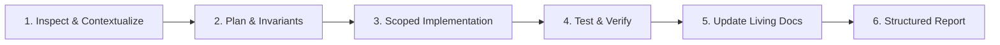

# SwiftDrop — AI Coding Agent Rulebook & Standards

> **Version:** 1.0 | **Audience:** All AI Coding Agents (Claude Code, Cursor, GitHub Copilot, Codex, etc.) & SwiftDrop Developers  
> **Authority:** Mandatory repository-level instruction file. Every AI coding agent must inspect, respect, and obey these rules on every task.

---

## 1. Authority, Scope & Order of Precedence

This rulebook governs all AI coding agents and developers contributing to the **SwiftDrop Parcel Delivery & Courier Management System**. 

Before modifying or creating any code, agents must inspect relevant requirements, domain boundaries, contracts, and existing tests. **Never assume missing requirements or invent project conventions.**

When instructions conflict, strictly adhere to the following order of precedence:
1. **Assignment Requirements & Approved SRS** (`docs/intial/SwiftDrop_SRS_v1.0.*`)
2. **Approved Domain, API & Event Contracts** (`docs/contracts/` & `docs/architecture/`)
3. **Engineering Rules, Development Standards & Best Practices** (`docs/intial/SwiftDrop_Engineering_Standards_and_Best_Practices_v1.0.*`)
4. **This AI Coding Agent Rulebook (`AGENTS.md`)**
5. **Existing Code & Implementation Patterns** (where they do not violate the above)

*If a conflict or ambiguity cannot be resolved with certainty, stop and request explicit user clarification rather than guessing.*

---

## 2. The Four Layers of Control

Every change in SwiftDrop is governed by four progressive control layers:
- **Layer 1 — Universal Project Rules:** Architecture, security, module boundaries, dependencies, and strict prohibitions (defined in this file).
- **Layer 2 — Architecture & Domain Contracts:** Formal module ownership, invariant boundaries, OpenAPI specifications, database migrations, and versioned event schemas (`docs/architecture/` and `docs/contracts/`).
- **Layer 3 — Automated Enforcement:** Linters (`golangci-lint` with `depguard`), unit/integration test suites, build checks, and CI validation (`scripts/verify.sh`).
- **Layer 4 — Human Review & Domain Ownership:** The assigned human owner for that specific domain must review and approve the pull request. An agent's completion claim is not considered verified until tests pass and the human owner approves.

---

## 3. Mandatory Agent Workflow

On every task, coding agents must follow this structured lifecycle:



1. **Inspect Before Editing:**
   - Read this file (`AGENTS.md`) and the relevant domain contract in `docs/architecture/domain-boundaries.md`.
   - Inspect existing tests, interfaces, and current Git changes in the module before writing code.
2. **Formulate a Plan:**
   - Identify which domain owns the change, what files are affected, and which business invariants must be protected.
   - For any non-trivial change, output a brief plan detailing assumptions and risks before writing code.
3. **Execute the Smallest Complete Change:**
   - Implement only what is required for the task.
   - **Never rewrite or regenerate an entire module** to add a feature or fix a bug.
   - Maintain strict package isolation; do not cross module boundaries without an approved interface.
4. **Test & Verify:**
   - Add or update unit tests covering happy paths, edge cases, validation errors, and unauthorized access.
   - Run available formatters, linters, and test suites.
   - **Never delete, weaken, or mock away existing assertions** to make tests pass.
5. **Update Co-Located Living Documentation (MANDATORY):**
   - Synchronously update the module's `README.md` to reflect all architectural, domain logic, and state changes.
   - If the module or service exposes any HTTP endpoints, update its co-located `API.md` with complete request and response structures.
6. **Provide a Structured Completion Report:**
   - Submit the mandatory completion report outlined in Section 12 of this file.

---

## 4. Architecture & Domain-Driven Design (DDD) Rules

SwiftDrop uses a **Domain-Driven Design (DDD) inspired Go Modular Monolith** for core operations, complemented by dedicated deployable services for independent scaling and asynchronous workloads.

```
System Topology:
API Gateway (Reverse Proxy / Edge Security / Rate Limiting)
├── Core API (Go Modular Monolith: Identity, Parcels, Dispatch, Pricing, Merchants, Delivery)
├── Tracking API (Separately deployable, read-optimized SSE projection service)
├── Outbox Relay (Dedicated daemon publishing committed events to RabbitMQ)
├── Event Worker (Background consumer for notifications, delivery updates, and webhooks)
└── AI Assistant Service (Python/FastAPI; calls approved Core APIs only)
Authoritative Persistence: PostgreSQL (Authoritative Business Store) + RabbitMQ (Event Bus)
```

### 4.1 Go Core API Modular Monolith Directory Structure
All Core API business logic resides in `core-api/internal/`:
```
core-api/
├── cmd/api/main.go              # Application entrypoint; parses config & calls wiring
├── internal/
│   ├── identity/                # Authentication, users, JWT, roles & permissions (Member 1)
│   ├── parcels/                 # Parcel aggregate root, booking, and lifecycle state machine (Member 2)
│   ├── pricing/                 # Tariff calculations, weight/dimension fee estimation (Member 2)
│   ├── dispatch/                # Courier assignment, zone routing, and dispatch board (Member 3)
│   ├── delivery/                # Delivery attempts, proof attachments, failure classifications (Member 3)
│   ├── merchants/               # Merchant tenant profiles, API keys, webhook configs (Member 4)
│   ├── admin/                   # Admin capabilities: delivery zones, system configuration, audit & reports (Member 7/1/4)
│   ├── events/                  # Event & integration support: outbox writer, event envelope, schema validation (Member 8)
│   ├── platform/                # Shared technical drivers (PostgreSQL pool, auth middleware, HTTP helpers)
│   └── app/wiring.go            # Central dependency injection container (wires repos, use cases, HTTP handlers)
├── migrations/                  # Canonical PostgreSQL schema migrations
└── tests/                       # Cross-module integration and end-to-end tests
```

### 4.2 Clean Layer Dependency Rules Inside Modules
Within any bounded context (e.g., `internal/parcels/`):
- **Domain (`domain/`):** Pure business logic, entity structs, value objects, and domain errors.
  - **STRICT PROHIBITION:** Must NOT import `net/http`, `database/sql`, RabbitMQ, or any infrastructure/transport package. Zero external dependencies.
- **Application (`application/`):** Use cases, command/query handlers, transaction boundaries, and repository interface definitions. Depends only on `domain/`.
- **Infrastructure (`infrastructure/`):** Concrete implementations of repository interfaces, SQL queries, external API clients, and outbox writers.
- **Transport (`transport/`):** HTTP handlers, routing, request parsing, input validation, and response DTO mapping. Thin layer only.
- *Anti-Boilerplate Policy:* Do not generate empty layer directories for simple features that have no complex business invariants.

### 4.3 Transactional State Transitions & Invariant Enforcement
- **Raw SQL Prohibition:** NEVER execute unvalidated, direct SQL column updates on parcel status (e.g., `UPDATE parcels SET status = 'DELIVERED' WHERE id = $1`).
- **Enforced Execution Path:**
  1. HTTP Handler parses input and verifies caller identity.
  2. Application Use Case initiates a PostgreSQL transaction and loads the `Parcel` aggregate root.
  3. Domain Aggregate evaluates invariants (valid transition, courier assigned, proof present).
  4. Single PostgreSQL Transaction atomically commits:
     - Updated parcel aggregate state
     - Immutable audit record in `parcel_status_history`
     - Integration event record in `outbox` table
  5. Outbox Relay publishes the committed outbox record to RabbitMQ asynchronously.

---

## 5. 10-Member Capability Ownership Matrix

Every team member has designated domain ownership. Agents must never modify another member's domain code or contracts without explicit coordination.

| Member | Primary Ownership | Domain / Service Responsibility |
| :--- | :--- | :--- |
| **Member 1** | Identity, Access & Security | Auth, JWT, user accounts, role-based access control, tenant validation |
| **Member 2** | Parcel Management & Pricing | Parcel aggregate root, booking lifecycle, dimension validation, fee rules, tariffs |
| **Member 3** | Dispatch, Couriers & Proof of Delivery | Courier assignments, dispatch board, fleet capacity, transit milestones, proof-of-delivery |
| **Member 4** | Merchant Integration | Merchant tenant management, onboarding, API keys, webhook configurations |
| **Member 5** | Tracking API & Real-Time Updates | Tracking API, read-optimized SSE streams, public tracking lookup |
| **Member 6** | Customer & Merchant Frontend | Customer & merchant portal (React/TypeScript), shipment tracking, booking UI |
| **Member 7** | Dispatcher/Admin Frontend & API Gateway | Dispatcher board, courier mobile web, admin dashboard, API Gateway routing |
| **Member 8** | Event-Driven Backend & Integrations | Outbox relay publisher, RabbitMQ broker, consumer worker, webhooks, DLQ |
| **Member 9** | DevOps, Kubernetes & Observability | Docker Compose, Kubernetes manifests, CI/CD pipelines, observability |
| **Member 10** | AI Assistant/MCP & Cross-Workflow Quality | Python assistant, approved tool definitions, fee estimation, tracking lookup, test coordination |

---

## 6. Strict Rule: Co-located Living Documentation & API Specifications

To prevent architectural drift and documentation rot across 10 developers and multiple AI agents, **every module and service must maintain co-located living documentation**. 

### 6.1 Module Living Documentation (`README.md`)
Every internal module in `core-api/internal/<module>/` and every independent service (`services/<service>/`, `web/<app>/`) MUST maintain an authoritative `README.md` that is **updated synchronously with every code change**. It must contain complete, up-to-date information:
1. **Module Purpose & Owner:** Primary domain capability and assigned owner (Members 1–10).
2. **Business Invariants & Rules:** Strict domain invariants, state machines, and validation rules enforced by this module.
3. **Domain Models & Structure:** Entities, value objects, domain errors, and aggregate root definitions.
4. **Internal Layer Organization:** Specific responsibilities of `domain/`, `application/`, `infrastructure/`, and `transport/`.
5. **Event Interactions:** Domain/integration events written to the outbox and asynchronous messages consumed.
6. **Data Ownership:** Specific PostgreSQL tables, migrations, and schema constraints owned by this module.
7. **Implementation Status:** Current feature completeness, active limitations, and recent changes.

### 6.2 Living API Specifications (`API.md`)
If a module or service exposes any HTTP/REST endpoints, it MUST maintain a co-located `API.md` specifying complete request and response contracts:
1. **Endpoint Overview:** Method, URI path, description, and required RBAC roles/permissions.
2. **Request Structure:**
   - Required headers (e.g., `Authorization: Bearer <jwt>`, `Idempotency-Key: <uuid>`).
   - Query parameters with types, constraints, defaults, and descriptions.
   - Request body JSON schema and a concrete, realistic JSON payload example.
3. **Response Structure:**
   - Success response envelope (`200 OK`, `201 Created`, etc.) with realistic JSON payload examples.
   - Field-level definitions and data types.
4. **Error Responses:**
   - Concrete JSON error envelopes for semantic validation errors (`400`/`422`), unauthorized access (`401`/`403`), missing resources (`404`), and state conflicts (`409`).

### 6.3 Zero-Drift Enforcement Policy
- **Synchronous Updates Required:** No task is complete if code is added, updated, or refactored without updating the module's `README.md` and `API.md` in the exact same change.
- **Agent Self-Check:** Before reporting completion, the agent must verify that the co-located documentation precisely matches the implemented code.

---

## 7. API, Database & Event Contract Rules

1. **Shared Contract Stability:**
   - Published REST endpoints (`/api/v1/*`) and event schemas are shared contracts.
   - Do NOT make breaking schema changes, rename payload fields, or alter enum values without an approved migration plan.
2. **Database Migrations:**
   - All schema changes must use sequential SQL migration files (`migrations/NNNNNN_name.up.sql`).
   - Never rely on manual database alterations.
   - Use exact decimal types (or integer minor units) for monetary values; never use floating-point numbers.
3. **Outbox & Messaging Guarantees:**
   - Domain state changes and outbox event creation MUST share the same PostgreSQL transaction.
   - Outbox messages are marked published only after broker confirmation.
   - All downstream consumers must be **strictly idempotent** to tolerate duplicate message delivery.

---

## 8. Security, Privacy & Safety Guardrails

- **Backend Enforcement:** Never trust frontend validation or client-supplied roles, prices, or user IDs. Authenticate and authorize every protected endpoint on the server.
- **Tenant & Object Isolation:** Queries must always scope by authenticated `tenant_id` or `user_id`. Never allow IDOR (Insecure Direct Object Reference) access to foreign parcels.
- **Zero Secrets in Code:** Never commit passwords, tokens, API keys, webhook secrets, or private keys. Use environment variables and configuration files with placeholder templates (`.env.example`).
- **Sanitized Logging:** Never log passwords, tokens, API keys, webhook payloads, or customer personally identifiable information (PII).
- **Public Tracking Masking:** Public tracking endpoints (`/api/v1/tracking/public/{trackingNumber}`) must return only sanitized milestone statuses—never full street addresses, recipient phone numbers, or private notes.
- **AI Tool Sandbox:** AI Assistant tools must be strictly read-only by default, authenticate through approved Core APIs, validate all input arguments, and possess zero direct database, shell, or arbitrary network access.

---

## 9. Coding & Testing Standards

### Go Backend
- All Go files must be formatted with `gofmt` and pass `golangci-lint`.
- Handle errors explicitly; wrap errors with context (`fmt.Errorf("failed to fetch parcel: %w", err)`).
- **Never use `panic`** for ordinary runtime or request errors.
- Pass `context.Context` to all database, HTTP, and broker calls, honoring timeouts and cancellation.
- Keep HTTP handlers thin; isolate persistence models from transport DTOs.

### React & TypeScript Frontend
- Enable TypeScript `strict` mode. Avoid `any`.
- Keep API interactions in dedicated client services; do not scatter `fetch` or `axios` calls across components.
- Frontend must never evaluate domain business logic or calculate delivery fees independently.

### Python AI Service
- Use type hints, explicit Pydantic schemas, and structured error responses.
- Never allow model-generated text to bypass API validation or invent operational facts.

### Testing Rules
- Write unit tests for all business invariants, state transitions, and authorization logic.
- Write integration tests for database transactions, outbox creation, and consumer idempotency.
- **Prohibited:** Deleting, weakening, or skipping existing tests to artificially achieve a passing build.

---

## 10. Critical DOs and DON'Ts

| DO | DON'T |
| :--- | :--- |
| **DO:** Inspect existing module code and tests before writing a single line. | **DON'T:** Regenerate an entire file or module for a small feature request. |
| **DO:** Respect module ownership and coordinate cross-boundary changes. | **DON'T:** Let an agent silently modify another team member's domain model or API contract. |
| **DO:** Enforce all status transitions through the `Parcel` aggregate root. | **DON'T:** Write raw SQL updates modifying status or assignment columns. |
| **DO:** Ensure outbox events and state changes commit in one transaction. | **DON'T:** Publish an event to RabbitMQ before the database transaction commits. |
| **DO:** Add integration tests verifying tenant isolation and idempotency. | **DON'T:** Trust an agent saying "all tests pass" without viewing the actual execution output. |
| **DO:** Keep `domain/` free of all external libraries and frameworks. | **DON'T:** Introduce CQRS, Event Sourcing, or new microservices without explicit approval. |
| **DO:** Concurrently update module `README.md` and `API.md` on every change. | **DON'T:** Treat documentation as an afterthought or complete a task without updating docs. |

---

## 11. Task Prompt Template for Team Members

When delegating tasks to any AI coding agent, developers should use this structured prompt:

```markdown
Task: [Short descriptive title, e.g., Implement proof-of-delivery photo attachment]
Owner: Member [X] — [Domain Capability, e.g., Delivery Records]

Read First:
- AGENTS.md
- docs/architecture/domain-boundaries.md
- [Relevant module README.md, API.md, existing code and tests]

Requirements:
- [Specific requirement 1]
- [Specific requirement 2]
- Preserve existing authorization, tenant isolation, and status transition invariants.
- Add unit/integration tests for both success and error/unauthorized cases.
- Update the module's living README.md and API.md with all new behaviors, schemas, and endpoints.

Restrictions:
- Do not modify contracts outside your assigned module without explicit confirmation.
- Do not add new external libraries or dependencies.
- Keep domain entities decoupled from SQL and HTTP packages.

Workflow:
1. Explain your implementation plan and any assumptions.
2. Implement the smallest complete change.
3. Run tests and report exact output.
4. Update co-located README.md and API.md.
5. Provide the mandatory completion report.
```

---

## 12. Mandatory Final Completion Report

At the conclusion of every task, the coding agent must output a structured summary formatted as follows:

```markdown
### Task Completion Report

- **Task Summary:** [1-2 sentences on what was achieved]
- **Files Modified/Created:**
  - `path/to/file1.go` (Description of change)
  - `path/to/file2.go` (Description of change)
- **Living Documentation Updated:**
  - `path/to/module/README.md` (Module documentation updated: Yes/No)
  - `path/to/module/API.md` (API contracts & schemas updated: Yes/No/N/A)
- **Domain Invariants & Contracts Preserved:** [Explicit statement of which business rules were respected]
- **Verification & Checks Run:**
  - Tests Executed: [Command run and results, e.g., `go test -v ./internal/parcels/...` - PASS]
  - Linters / Formatter: [Command run and results]
- **Breaking Changes / Contract Impact:** [None / Detailed description if pre-approved]
- **Known Limitations & Next Steps:** [Any remaining work or caveats]
```
