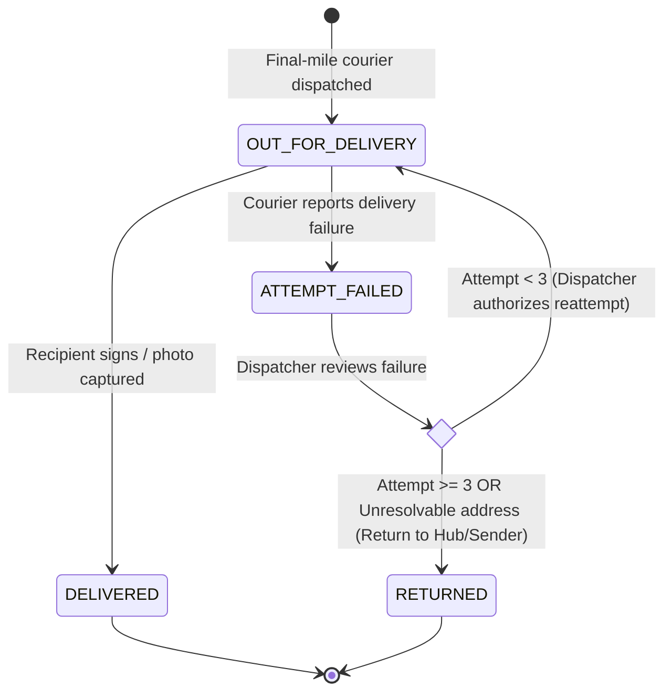

# ADR-004: Failed Delivery & Reattempt State Machine Semantics

> **Status:** Accepted  
> **Date:** 2026-10-21  
> **Owners:** Member 2 (Parcel Management), Member 3 (Dispatch & Delivery Records)  
> **Deciders:** SwiftDrop Engineering Team  
> **Resolves:** SRS §4.3 (Parcel Lifecycle), §13.2 (Failed delivery semantics), §17.2 (Open Decision #1)

---

## 1. Context & Problem Statement

In courier logistics, an unsuccessful delivery attempt is a common operational event (e.g. recipient not home, gated access, incorrect address). A naive system might conflate an individual attempt's failure with the overall parcel terminal state (e.g. marking the parcel `FAILED` or `CANCELLED`).

Such conflation leads to:
1. **Lost Audit History:** Overwriting attempt details or losing track of how many times a delivery was tried.
2. **Premature Termination:** Marking a parcel permanently dead when the customer merely requested an afternoon re-delivery.
3. **Dispatcher Blindness:** Inability to review failure reasons before approving a re-route.

SRS §4.3 and §13.2 explicitly mandate:
> *"Separate delivery attempt outcome from parcel lifecycle; allow reattempt only through explicit dispatcher action."*

---

## 2. Decision Rationale: Separation of Attempt vs. Lifecycle

We establish a strict boundary between the **Delivery Attempt Entity** (managed by Member 3) and the **Parcel Aggregate Root** (managed by Member 2):

| Concept | Entity / Table | Responsibility | Mutability |
| :--- | :--- | :--- | :--- |
| **Delivery Attempt** | `delivery_attempts` | Concrete physical attempt by a courier at a point in time (timestamp, GPS, proof, failure reason). | **Immutable** once created. |
| **Parcel State** | `parcels` | High-level business lifecycle stage (`OUT_FOR_DELIVERY`, `ATTEMPT_FAILED`, `RETURNED`). | Mutable via Domain Aggregate only. |
| **State History** | `parcel_status_history` | Authoritative chronological audit of all state transitions. | **Immutable** append-only. |

---

## 3. The Reattempt Lifecycle & Rules

### 3.1 Business Invariants & Constraints
1. **Maximum Attempt Ceiling:** A parcel may undergo a maximum of **3 delivery attempts** (`attempt_count <= 3`).
2. **Attempt Increment:** Every time a courier records an attempt failure, the `attempt_count` on the `parcels` table is incremented atomically.
3. **Recoverable vs. Terminal Status:**
   - `ATTEMPT_FAILED`: A transient, recoverable operational pause. The parcel is held at the local hub or in courier custody pending dispatch instructions.
   - `RETURNED`: A terminal status reached when 3 attempts have failed or when the dispatcher determines the package is undeliverable. The parcel is routed back to the merchant or original sender.
4. **Dispatcher Authorization Gate:** A courier **CANNOT** unilaterally reschedule a package for delivery. Only an authenticated user with role `DISPATCHER` or `ADMIN` can transition a parcel from `ATTEMPT_FAILED` back to `OUT_FOR_DELIVERY` (or reassign to another courier).

---

## 4. Standardized Failure Reason Codes

When recording an attempt failure via `POST /api/v1/courier/parcels/{id}/fail-attempt`, the courier client must provide a validated reason code:

| Reason Code | Category | Allow Immediate Reattempt? | Description |
| :--- | :--- | :--- | :--- |
| `RECIPIENT_UNAVAILABLE` | Operational | Yes | Recipient not home, phone unanswered. |
| `CUSTOMER_REQUESTED_RESCHEDULE`| Customer | Yes | Customer answered and requested delivery on another date/slot. |
| `ACCESS_RESTRICTED` | Environmental | Yes | Gated community, security refusal, guard dog, road blocked. |
| `INVALID_ADDRESS` | Data Quality | No (Requires address edit) | Street number does not exist, incorrect city/zone. |
| `REFUSED_BY_RECIPIENT` | Terminal / Intent | No (Immediate return) | Recipient actively refused package (e.g. unsolicited, damaged). |
| `DAMAGED_IN_TRANSIT` | Exceptional | No (Hold for inspection) | Package exterior breached or contents leaking. |
| `OTHER` | Miscellaneous | Discretionary | Requires mandatory detailed note (`failure_note >= 15 chars`). |

---

## 5. Domain Invariant Execution Path

When a delivery fails:
1. **Courier Action:** Courier submits failure form with `failure_reason_code`, optional GPS coordinates, and notes.
2. **Delivery Context (`core-api/internal/delivery`):**
   - Validates courier assignment to this parcel.
   - Creates a new record in `delivery_attempts` with `outcome = 'FAILED'`.
3. **Parcel Context (`core-api/internal/parcels`):**
   - Loads `Parcel` aggregate root.
   - Calls `parcel.RecordFailedAttempt(reasonCode, courierID)`.
   - Aggregate evaluates invariants:
     - Is current status `OUT_FOR_DELIVERY`?
     - Increments `attempt_count`.
     - Sets `current_status = ATTEMPT_FAILED`.
   - In one database transaction, updates `parcels`, appends to `parcel_status_history`, and writes `parcel.delivery.failed` event to `outbox_events`.

---

## 6. Public Tracking & Notification Masking

In compliance with **SRS §13.2** and **SEC-016 (Public Tracking Masking)**:
- **Public Tracking View (`/api/v1/tracking/public/{trackingNumber}`):**
  - Displays: `"Delivery attempt 1 of 3 was unsuccessful (Recipient Unavailable). Awaiting dispatch rescheduling."`
  - **Masked Data:** Courier identity, private internal notes, exact GPS coordinates, and phone numbers are scrubbed from public SSE streams and API responses.
- **Customer Notification:**
  - Automated SMS/Email sent to customer: *"We were unable to deliver your package today due to [Reason]. Please contact SwiftDrop support or your merchant to confirm a delivery window."*
- **Merchant Webhook:**
  - Event `parcel.delivery.failed` dispatched with attempt count and reason code so merchants can update their own CRM systems.
