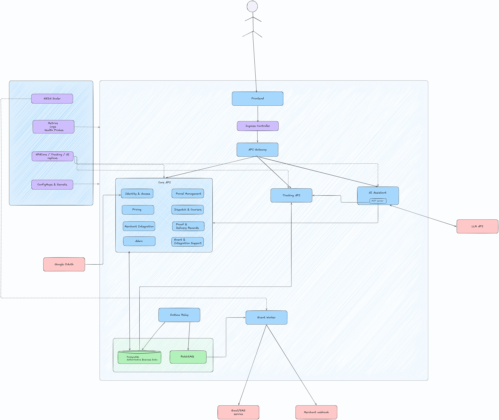
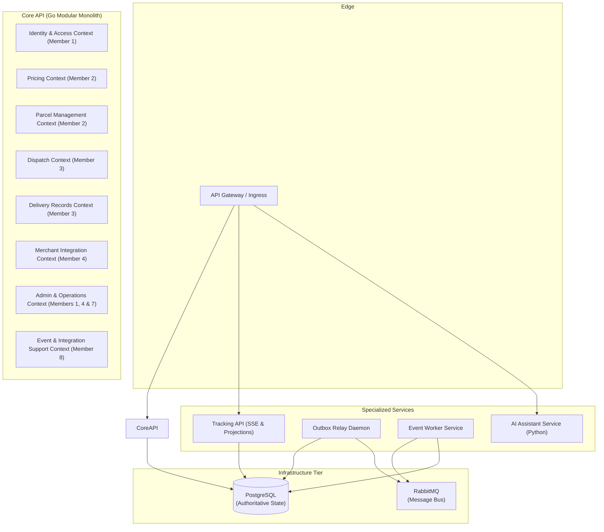
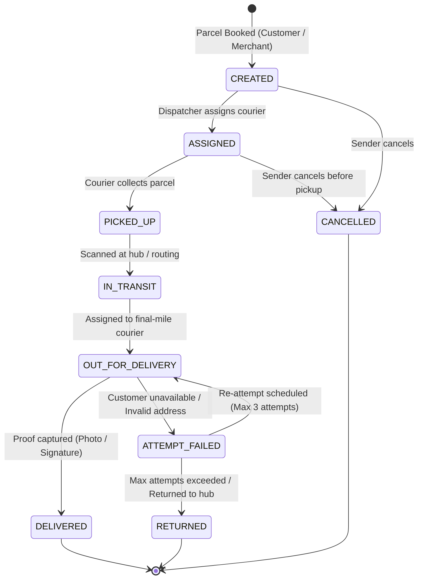

# SwiftDrop — Domain Boundaries & Capability Ownership

> **Authority:** Secondary to the approved SRS (`docs/intial/SwiftDrop_SRS_v1.0.*`) and Engineering Standards (`docs/intial/SwiftDrop_Engineering_Standards_and_Best_Practices_v1.0.*`). This document is the binding architectural contract for bounded contexts and team capability boundaries.

---

## 1. Bounded Contexts Overview

SwiftDrop organizes business capabilities into bounded contexts inside the Core API modular monolith, supported by specialized deployable services for read-heavy or asynchronous workloads.

*Figure 1: High-Level System Architecture, Component Topology & Service Boundaries.*

---

## 2. Team Member Ownership Breakdown

Each of the 10 team members owns a distinct business capability. Cross-module changes require explicit collaboration with the capability owner.

| Member | Bounded Context / Area | Code Path | Responsibilities |
| :--- | :--- | :--- | :--- |
| **Member 1** | Identity, Access & Security | `core-api/internal/identity/` | Authentication, user credentials, JWT tokens, RBAC roles (Admin, Dispatcher, Courier, Merchant, Customer), tenant isolation primitives. |
| **Member 2** | Parcel Management & Pricing | `core-api/internal/parcels/` `core-api/internal/pricing/` | Canonical Parcel aggregate root, parcel booking, status state machine, parcel history, dimensions, weight validation, pricing engine, tariff calculations. |
| **Member 3** | Dispatch, Couriers & Proof of Delivery | `core-api/internal/dispatch/` `core-api/internal/delivery/` | Courier profiles, fleet status, zone assignment, dispatch dashboard use cases, load/capacity checks, delivery attempts, proof-of-delivery photos/signatures. |
| **Member 4** | Merchant Integration | `core-api/internal/merchants/` | Merchant profiles, application/approval state handling, API key generation, webhook configuration endpoints. |
| **Member 5** | Tracking API & Real-Time Updates | `services/tracking/` | Standalone read-optimized tracking service, Server-Sent Events (SSE) stream, public milestone queries, Redis cache integration. |
| **Member 6** | Customer & Merchant Frontend | `web/src/features/customer-merchant/` | React/TypeScript single-page app: booking wizard, active shipment tracker, address management, merchant order submission UI. |
| **Member 7** | Dispatcher/Admin Frontend & API Gateway | `web/src/features/dispatcher-admin/` `core-api/internal/admin/` `deploy/gateway/` | Dispatcher management portal, admin dashboard, courier mobile web view, admin-facing Core API endpoints (zone setup, system metrics, reports), and API Gateway routing. |
| **Member 8** | Event-Driven Backend & Integrations | `core-api/internal/events/` `services/messaging/` | Core API outbox writer contract, shared event envelope, Outbox Relay poller, RabbitMQ broker setup, Event Worker, push notifications, merchant webhook dispatcher, retry/DLQ, reconciliation CronJob. |
| **Member 9** | DevOps, Kubernetes & Observability | `deploy/`, `.github/` | Docker Compose, Kubernetes manifests, Helm charts, ingress gateway, CI/CD pipelines, Prometheus/Grafana metrics, probe definitions. |
| **Member 10** | AI Assistant/MCP & Cross-Workflow Quality | `services/ai-assistant/` | Python/FastAPI assistant service, LLM tool definitions (tracking lookup, fee estimate), prompt safety, rate limiting, and cross-workflow end-to-end test coordination. |

---

## 3. Canonical Parcel Lifecycle State Machine

The parcel lifecycle is governed strictly by the `Parcel` aggregate root in `internal/parcels/domain/`. No other module, handler, or script may set an arbitrary parcel status.

### 3.1 Allowed State Transitions Table

| Current Status | Target Status | Authorized Actors | Required Conditions & Invariants |
| :--- | :--- | :--- | :--- |
| `CREATED` | `ASSIGNED` | Dispatcher, System Auto-assign | Valid courier ID assigned, courier active and within capacity. |
| `CREATED` | `CANCELLED` | Sender, Admin | Parcel has not been collected; refund calculation triggered if prepaid. |
| `ASSIGNED` | `PICKED_UP` | Assigned Courier | Physical pickup confirmed (barcode/QR scan match). |
| `ASSIGNED` | `CANCELLED` | Dispatcher, Admin | Courier unassigned; reason required in status history. |
| `PICKED_UP` | `IN_TRANSIT` | Courier, Hub Operator | Parcel arrived at sorting facility or in vehicle transit. |
| `IN_TRANSIT` | `OUT_FOR_DELIVERY` | Dispatcher, Final Courier | Final mile courier confirms assignment for delivery run. |
| `OUT_FOR_DELIVERY` | `DELIVERED` | Assigned Courier | Valid proof-of-delivery attached (photo URL or signature data). |
| `OUT_FOR_DELIVERY` | `ATTEMPT_FAILED` | Assigned Courier | Failure reason code required (e.g., `RECIPIENT_UNAVAILABLE`, `INVALID_ADDRESS`). |
| `ATTEMPT_FAILED` | `OUT_FOR_DELIVERY` | Dispatcher | Attempt count < 3; re-delivery scheduled. |
| `ATTEMPT_FAILED` | `RETURNED` | Dispatcher, Hub Operator | Attempt count >= 3 or sender requests immediate return. |

---

## 4. Cross-Context Interaction Rules

1. **In-Process vs. Asynchronous Communication:**
   - Synchronous intra-monolith calls must use Go interface contracts (e.g., `parcels` calling `pricing.Calculator` interface). Never call internal modules over HTTP or RabbitMQ.
   - Cross-service communication (Core API to Tracking, Notifications, or Webhooks) must use **RabbitMQ events published via the Transactional Outbox pattern**.
2. **Database Separation:**
   - Modules inside `core-api` share a PostgreSQL instance but must only query their own tables.
   - Foreign keys between contexts must be managed through application IDs rather than distributed joins across logical domains.
   - Direct database access from outside the Core API is strictly forbidden:
     - Tracking API reads from read-optimized views/tables.
     - AI Assistant connects ONLY through approved Core API HTTP/REST endpoints.
