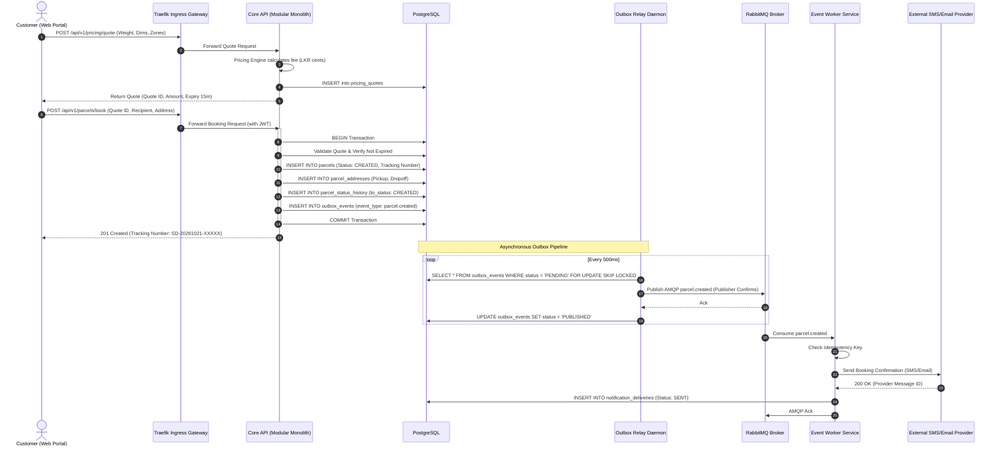
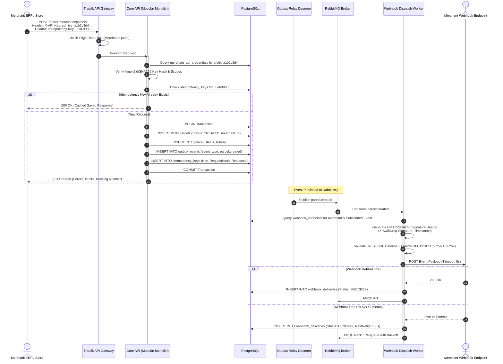
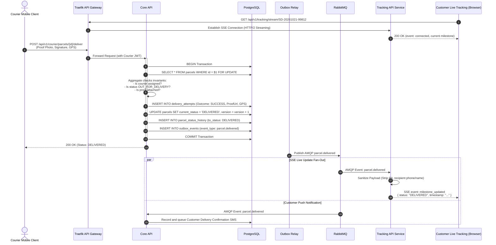
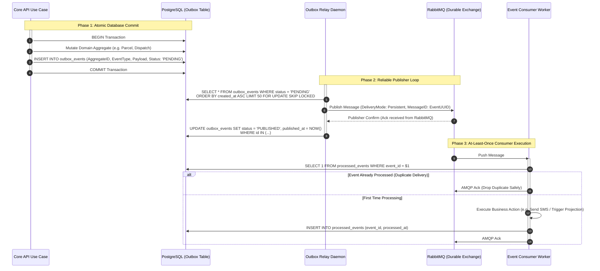

# SwiftDrop — Architecture Sequence Diagrams

> **Authority:** Fulfills SRS §17.1 (Required Deliverables: Sequence & Activity Diagrams) and reflects Domain Boundaries (`domain-boundaries.md`).  
> **Audience:** All SwiftDrop Developers, AI Coding Agents, and Solution Architects.

---

## 1. Customer Parcel Booking Flow

Covers customer price calculation, interactive booking confirmation, atomic transaction persistence, and asynchronous notification dispatch.



---

## 2. B2B Merchant API Order Creation & Webhook Delivery

Covers automated merchant order submission via API key authentication, rate limiting, and webhook event callback.



---

## 3. Courier Delivery Milestone & Real-Time SSE Fan-Out

Covers courier proof-of-delivery upload, domain transition validation, real-time tracking SSE projection, and customer notifications.



---

## 4. Google OAuth 2.0 / OpenID Connect (OIDC) Authentication

Covers secure identity federation, CSRF prevention via state/nonce, account linking, and issuance of JWT tokens and refresh cookies.

```mermaid
sequenceDiagram
    autonumber
    actor User as User (Browser)
    participant CoreAPI as Core API Auth Service
    participant Google as Google Identity Provider
    participant DB as PostgreSQL

    User->>CoreAPI: GET /api/v1/auth/oauth/google
    CoreAPI->>CoreAPI: Generate cryptographically random State & Nonce
    CoreAPI-->>User: 302 Redirect to accounts.google.com<br/>Set-Cookie: oauth_state=...; HttpOnly; Secure; SameSite=Lax

    User->>Google: Authenticate & Authorize SwiftDrop Scopes (email, profile)
    Google-->>User: 302 Redirect to /api/v1/auth/oauth/google/callback?code=...&state=...

    User->>CoreAPI: GET /api/v1/auth/oauth/google/callback?code=...&state=...<br/>Cookie: oauth_state=...
    
    activate CoreAPI
    CoreAPI->>CoreAPI: Verify returned state matches oauth_state cookie (CSRF check)
    CoreAPI->>Google: POST /token (Exchange auth code for ID Token & Access Token)
    Google-->>CoreAPI: 200 OK (id_token containing sub, email, email_verified)
    CoreAPI->>CoreAPI: Verify Google ID token signature, issuer, and nonce
    
    CoreAPI->>DB: SELECT * FROM oauth_identities WHERE provider = 'GOOGLE' AND provider_subject = sub
    
    alt Identity Exists
        CoreAPI->>DB: SELECT * FROM users WHERE id = identity.user_id
    else New Federated Identity
        CoreAPI->>DB: SELECT * FROM users WHERE email = google.email
        alt Local User Exists
            CoreAPI->>DB: INSERT INTO oauth_identities (user_id, 'GOOGLE', sub)
        else Brand New Account
            CoreAPI->>DB: INSERT INTO users (email, display_name, status: ACTIVE)
            CoreAPI->>DB: INSERT INTO user_roles (user_id, role_id: 'CUSTOMER')
            CoreAPI->>DB: INSERT INTO oauth_identities (user_id, 'GOOGLE', sub)
        end
    end

    CoreAPI->>CoreAPI: Mint RS256 JWT Access Token (15m expiry)
    CoreAPI->>DB: INSERT INTO user_sessions / refresh_tokens (token_hash, 7d expiry)
    
    CoreAPI-->>User: 302 Redirect to /portal/dashboard<br/>Set-Cookie: swiftdrop_refresh_token=...; HttpOnly; Secure; SameSite=Strict<br/>Response Body: { accessToken: "..." }
    deactivate CoreAPI
```

---

## 5. Transactional Outbox → RabbitMQ Publisher Pipeline

Illustrates zero message loss, at-least-once delivery, and consumer-side idempotency.


