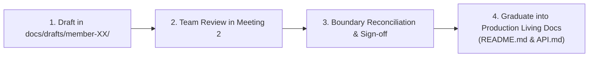

# SwiftDrop — Module Specifications & Initial Workload Drafts

> **Branch:** `docs/module-spec-reviews`  
> **Purpose:** Centralized draft hub for all 10 members to author, review, and align their 8 mandatory module specifications prior to Team Meeting 2.  
> **Status:** Draft / Proposal Stage (Not yet binding code contracts)

---

## 1. Why This Directory Exists

Before implementation begins, every team member must draft **8 standard engineering specifications** for their assigned capability. 

To prevent:
- **Git merge conflicts** from 10 developers pushing to the repository simultaneously,
- **Overlapping responsibilities** and competing database/API designs,
- **Prematurely polluting production module folders** (`core-api/internal/`, `services/`, etc.) with unapproved drafts,

all members work in **dedicated member directories** under `docs/drafts/`. This allows reviewers and coordinators to review all 10 members' specifications side-by-side, spot duplicates, resolve boundary ambiguities in Team Meeting 2, and cleanly graduate approved designs into authoritative living documentation.

---

## 2. Directory Structure & Member Allocations

Each member has a pre-allocated directory:

| Member | Directory | Primary Domain / Capability Area |
| :---: | :--- | :--- |
| **Member 1** | [`member-01-identity/`](./member-01-identity/) | Identity, Access Control (RBAC), JWT, Google OAuth 2.0 |
| **Member 2** | [`member-02-parcels-pricing/`](./member-02-parcels-pricing/) | Parcel Aggregate Root, Booking, Pricing & Tariffs |
| **Member 3** | [`member-03-dispatch-delivery/`](./member-03-dispatch-delivery/) | Dispatch Board, Courier Routing, Proof of Delivery |
| **Member 4** | [`member-04-merchants/`](./member-04-merchants/) | Merchant Profiles, Approvals, API Keys, Webhooks Config |
| **Member 5** | [`member-05-tracking/`](./member-05-tracking/) | Tracking API (SSE, read-optimized public queries) |
| **Member 6** | [`member-06-customer-merchant-web/`](./member-06-customer-merchant-web/) | Customer & Merchant React UI, Booking Wizard, Tracker |
| **Member 7** | [`member-07-dispatcher-admin-web-gateway/`](./member-07-dispatcher-admin-web-gateway/) | Dispatcher/Admin UI, Courier Web, Traefik Gateway |
| **Member 8** | [`member-08-events-messaging/`](./member-08-events-messaging/) | Transactional Outbox, RabbitMQ, Event Worker, DLQ |
| **Member 9** | [`member-09-devops-k8s/`](./member-09-devops-k8s/) | Docker Compose, Kubernetes, Helm, Observability |
| **Member 10** | [`member-10-ai-assistant-quality/`](./member-10-ai-assistant-quality/) | AI Assistant (Python/FastAPI), MCP Tools, E2E Test Quality |

---

## 3. Mandatory 8 Documents Per Member

Every member must create the following 8 standardized markdown files inside their allocated directory:

```text
member-XX-<capability>/
├── doc-01-scope-and-responsibilities.md
├── doc-02-functional-flows-and-business-rules.md
├── doc-03-internal-architecture-and-design.md
├── doc-04-interface-and-integration-contract.md
├── doc-05-data-and-persistence.md
├── doc-06-testing-strategy-and-acceptance.md
├── doc-07-security-failure-and-recovery.md
└── doc-08-implementation-deployment-and-ops.md
```

### Document Descriptions:
- **`doc-01-scope-and-responsibilities.md`**: Purpose, boundaries, functional scope, explicit exclusions, and owned tables/APIs.
- **`doc-02-functional-flows-and-business-rules.md`**: Step-by-step flows (happy, alternate, failure), sequence diagrams, and state machines.
- **`doc-03-internal-architecture-and-design.md`**: Internal package structure, DDD components, layers, and design patterns.
- **`doc-04-interface-and-integration-contract.md`**: Machine-readable API contracts (REST, DTOs, status codes) and event payloads.
- **`doc-05-data-and-persistence.md`**: ER diagram, tables, fields, constraints, indexes, and isolation boundaries.
- **`doc-06-testing-strategy-and-acceptance.md`**: Test-case matrix, unit/integration tests, mocking, and acceptance criteria.
- **`doc-07-security-failure-and-recovery.md`**: Auth/tenant checks, PII protection, failure modes, timeouts, retries, and rate limits.
- **`doc-08-implementation-deployment-and-ops.md`**: Local run instructions, `.env` variables, health endpoints, Docker, and operational runbook.

---

## 4. Rules of Contribution

1. **Strict Folder Isolation:**
   - Only edit files inside your own `member-XX-.../` directory.
   - Do not edit another member's folder without explicit discussion.
2. **Standard Document Header:**
   Add this standard header at the top of each document you write:
   ```markdown
   # Document X — [Document Title]

   > **Status:** Draft / Proposed (For Review in Meeting 2)  
   > **Author:** Member [X] — [Domain Area]  
   > **Target Module / Location:** [e.g., `services/ai-assistant/` or `core-api/internal/parcels/`]  
   > **Key Upstream Dependencies:** [e.g., Member 1 (Auth), Member 2 (Pricing)]  
   > **Open Questions / Needs Clarification:** [List questions or boundary doubts for the meeting]
   ```
3. **Flag Unresolved Boundaries & Doubts:**
   - If you are unsure who owns an endpoint, a database column, or a transition rule, document it under `Open Questions / Needs Clarification`! Meeting 2 will resolve these.

---

## 5. Review & Graduation Workflow



1. **Drafting:** All members push drafts on this branch (`docs/module-spec-reviews`).
2. **Reviewing:** In Team Meeting 2, members cross-review contracts to eliminate overlapping implementations and missing requirements.
3. **Approval:** Once signed off, this branch is merged into `main`.
4. **Graduation:** Approved contracts become binding and are transferred to their respective module living documents (`README.md`, `API.md`) and canonical architecture guides (`docs/architecture/domain-boundaries.md`).
