# Document 2 — Functional Flows & Business Rules

> **Status:** Draft / Proposed (For Review in Meeting 2)  
> **Author:** Member 7 — Dispatcher/Admin UI, Courier Web, Traefik Gateway  
> **Target Module / Location:** `web/src/features/dispatcher-admin/` (ops + courier screens), `core-api/internal/admin/` (admin module), `deploy/gateway/traefik/` (gateway)  
> **Key Upstream Dependencies:** Member 1 (Auth, RBAC, JWT), Member 2 (Parcels, Pricing), Member 3 (Dispatch, Delivery), Member 4 (Merchants), Member 5 (Tracking SSE), Member 8 (Outbox, events), Member 9 (Compose, Kubernetes)  
> **Open Questions / Needs Clarification:** U-18 to U-27 in section 12: deliver and fail endpoints, failure reason codes, auto RETURNED after 3rd fail, reattempt with new courier, courier status values, Idempotency-Key on other POSTs, POD upload method, merchant REJECTED/DISABLED

**Module:** Dispatcher/Admin/Courier Frontend, Admin Backend Module & API Gateway (Member 7) **Project:** SwiftDrop Parcel Delivery & Courier Management System **Based on:** Document 1 v3 (Module Scope), SRS v1.0 (sections 4, 5, 6.2), ADR-001, ADR-003, ADR-004, domain-boundaries.md, database-schema.md, api-conventions.md, sequence-diagrams.md, security-notes.md, web/README.md, deploy/gateway/ and the module API.md and README.md files **Status:** Draft v2 (adds diagrams to every flow that had none; text and rules unchanged from v1). Items marked **\[TBD\]** wait for a teammate or a team decision. Open questions reuse the U-xx numbers from Document 1 section 11.3; new ones start at U-18 (section 12). **Date:** 24 October 2026

## 1. How to read this document

This document answers two questions for every part of my module: **when is it used**, and **what happens step by step**.

Each flow has the same parts:

- **Trigger:** what starts it.
- **Actors:** who takes part.
- **Preconditions:** what must be true before it starts.
- **Main flow:** the normal, successful steps.
- **Alternate flows:** other valid paths.
- **Failure flows:** what happens when something goes wrong.
- **Postconditions:** what is true after it ends.
- **Rules:** business rules that apply.

Each statement is tagged by where it comes from:

| Tag | Meaning |
| --- | --- |
| **\[Repo\]** | Written in the team repository today |
| **\[Proposed\]** | Proposed by a teammate or by me, not yet agreed |
| **\[TBD\]** | Not decided. Linked to an open question U-xx |

Important reminder from Document 1: my screens and the gateway **show and route**. They never decide if an action is allowed (X-01, X-02). Every rule below that says "the backend rejects" is enforced by the owning module, not by my screen. My screen only shows the result.

## 2. Actors and triggering conditions

### 2.1 Actors

| Actor | Role in JWT | Uses | Notes |
| --- | --- | --- | --- |
| Dispatcher | DISPATCHER | `/ops/dispatch`, `/ops/couriers` | Assigns parcels, reviews failed deliveries |
| Administrator | ADMIN | All `/ops/*` screens | Everything a dispatcher can do, plus merchants, users, zones, pricing, reports |
| Courier | COURIER | `/courier/*` on a phone | Sees only own tasks |
| Core API modules | none (system) | Identity (M1), Parcels and Pricing (M2), Dispatch and Delivery (M3), Merchants (M4), Admin (M7 shared) | Make every business decision |
| Tracking API | none (system) | Live updates (M5) | Behind the gateway |
| Traefik gateway | none (system) | All traffic | Routes and limits only |
| Cloudflare | none (system) | Production edge | DNS, DDoS shield, first HTTPS hop |
| Anonymous visitor, customer, merchant | various | Not my screens | Only relevant to gateway flows |

**Figure 2.1 Context: who talks to my module**

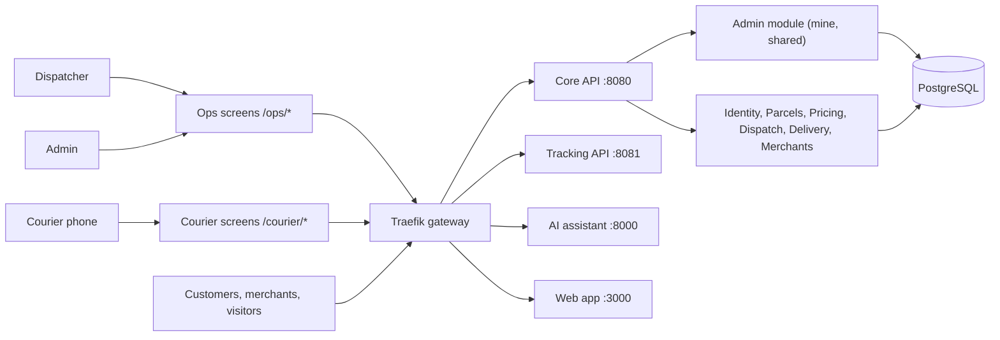


### 2.2 When is the module used (triggers)

| ID | Trigger | Actor | Flow |
| --- | --- | --- | --- |
| T-01 | Staff or courier opens the app or the access token expires | Any staff, courier | F-01, F-02 |
| T-02 | New parcel is booked (status CREATED) and appears on the board | Dispatcher | F-03, F-04 |
| T-03 | A courier is unavailable or overloaded and work must move | Dispatcher | F-05 |
| T-04 | A courier reports a failed delivery (status ATTEMPT\_FAILED) | Dispatcher | F-06 |
| T-05 | Dispatcher checks courier load, status and shifts | Dispatcher, admin | F-07 |
| T-06 | A merchant applies or a merchant must be stopped | Admin | F-08 |
| T-07 | A new staff member joins, changes job or leaves | Admin | F-09 |
| T-08 | The business opens a new area or changes delivery prices | Admin | F-10, F-11, A-01, A-02 |
| T-09 | Management wants delivery numbers for a period | Admin (dispatcher \[TBD U-02\]) | F-12, A-03 |
| T-10 | An incident or dispute needs an audit trail check | Admin | F-13, A-04 |
| T-11 | A parcel has wrong status data and must be fixed | Admin | F-14 \[TBD U-08\] |
| T-12 | Courier starts the day, collects, delivers or fails a delivery | Courier | C-01 to C-05 |
| T-13 | Any HTTP request reaches the system | Any client | G-01 to G-05 |
| T-14 | A teammate needs a new route or limit | Members 1 to 10 | G-06 |
| T-15 | Gateway config is changed and deployed | Member 7, Member 9 | G-07 |

## 3. Shared rules for every screen

These rules apply to every flow in sections 5 and 6. Flows do not repeat them.

### 3.1 Calling the API

| ID | Rule | Source |
| --- | --- | --- |
| R-API-01 | Every call goes through the shared API client in `web/src/shared/api/`. Base URL is `VITE_API_BASE_URL` (default `/api/v1`) | \[Repo\] web/README 4 |
| R-API-02 | Every protected call sends `Authorization: Bearer <access token>`. The token is read from memory only | \[Repo\] ADR-003 4.1 |
| R-API-03 | The client never sends who the user is (actor id, role) in the body. The backend reads it from the token | \[Repo\] security-notes 1, INV-03 |
| R-API-04 | The client sends only the fields listed in the API contract. It never sends a target status chosen by the user, except where the contract has an action field | INV-03 |
| R-API-05 | Every POST that creates or changes something sends `Idempotency-Key: <uuid-v4>` (rules in 3.3) | \[Repo\] web/README 4. Backend support outside booking \[TBD U-24\] |
| R-API-06 | Responses use the standard envelope: `data` for success, `error.code`, `error.message`, `error.correlation_id`, `error.details[]` for errors | \[Repo\] api-conventions 2 |
| R-API-07 | Money arrives as integer cents in LKR and is shown with `formatLKR(cents)`. The screen never adds, multiplies or rounds money | \[Repo\] web/README 5, INV-13 |
| R-API-08 | Times arrive in UTC. Screens show them in Sri Lanka time (Asia/Colombo, UTC+05:30) | \[Repo\] database-schema 3.5 |

### 3.2 Showing results and errors

| HTTP result | What the screen does |
| --- | --- |
| 200 / 201 | Show a short success message. Refresh the data that changed (do not edit the list by hand) |
| 400 / 422 | Show `error.message` near the form. Show each `error.details[].issue` next to its field. Keep what the user typed |
| 401 | Run the token refresh flow (F-02) once, then repeat the request once. If refresh fails, go to login |
| 403 | Show "You do not have permission for this action." Do not retry. Do not hide the error |
| 404 | Show "This item no longer exists." Refresh the list |
| 409 | Show `error.message` (for example "Courier has reached maximum capacity"). Refresh the data, because someone else changed it |
| 413 | Show "File is too large (maximum 10 MB)." |
| 429 | Show "Too many requests. Please wait and try again." Use `Retry-After` if present. Do not auto-retry in a loop |
| 500 / 502 / 503 / network error | Show a safe message plus the `correlation_id` (if any) so support can find the log. Offer a "Try again" button that reuses the same Idempotency-Key |

Every screen also has a **loading** state and an **empty** state (M7-UI-15). Status is always shown as text plus colour (M7-UI-16). Raw stack traces, tokens or personal data are never shown (INV-10).

**Figure 3.1 How every screen handles a response**

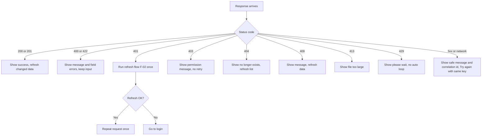


### 3.3 Idempotency key rules (frontend side)

1. When the user presses a create or change button, the client makes **one** new key for that action.
2. If the request fails with a network error, timeout or 5xx, and the user presses "Try again" **without changing the input**, the client sends **the same key**.
3. If the user changes the input, the client makes a **new key**.
4. After a success, the key is thrown away.
5. Keys live in memory only (same as tokens). If the page is reloaded, the key is lost; the user then sees fresh data from the server and decides again.
6. Backend behaviour \[Repo\] api-conventions 4: same key and same body within 24 hours returns the saved response with header `Idempotent-Replay: true`. Same key and a different body returns 409 `IDEMPOTENCY_KEY_PAYLOAD_MISMATCH`. The screen treats a replay as a normal success.

**Figure 3.2 Life of one Idempotency-Key in the browser**

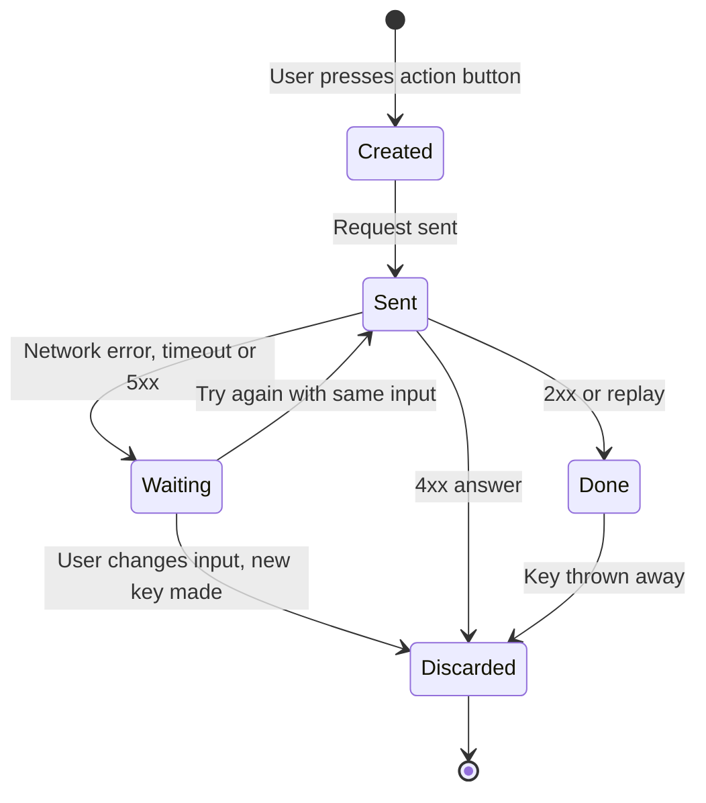


### 3.4 Double-click and double-submit

- Every action button is disabled from the first press until the response arrives. It shows a spinner.
- Forms submit only once even if Enter is pressed twice.
- This is a usability guard only. The real protection is the backend (idempotency key, parcel version, status checks).

### 3.5 Keeping data fresh

- Lists use TanStack Query. Data is fetched again when the screen opens, when the window gets focus again, and after every action. \[Repo\] web/README stack
- The dispatch board also refreshes on a timer, proposed every 30 seconds. **\[Proposed; no live-update stream exists for staff screens yet\]**
- If the server and the screen disagree, the server wins (Doc 1 section 5).

**Figure 3.3 When lists are fetched again**

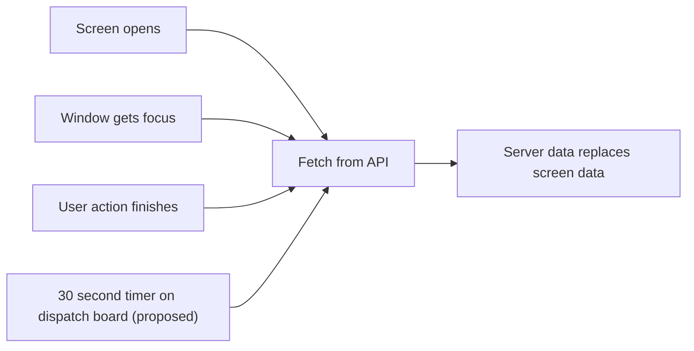


## 4. State machines

These state machines belong to other modules. I copy them here so my screens show the right buttons. If a module changes its machine, this section must be updated.

### 4.1 Parcel lifecycle (owner: Member 2) \[Repo\] domain-boundaries.md 3

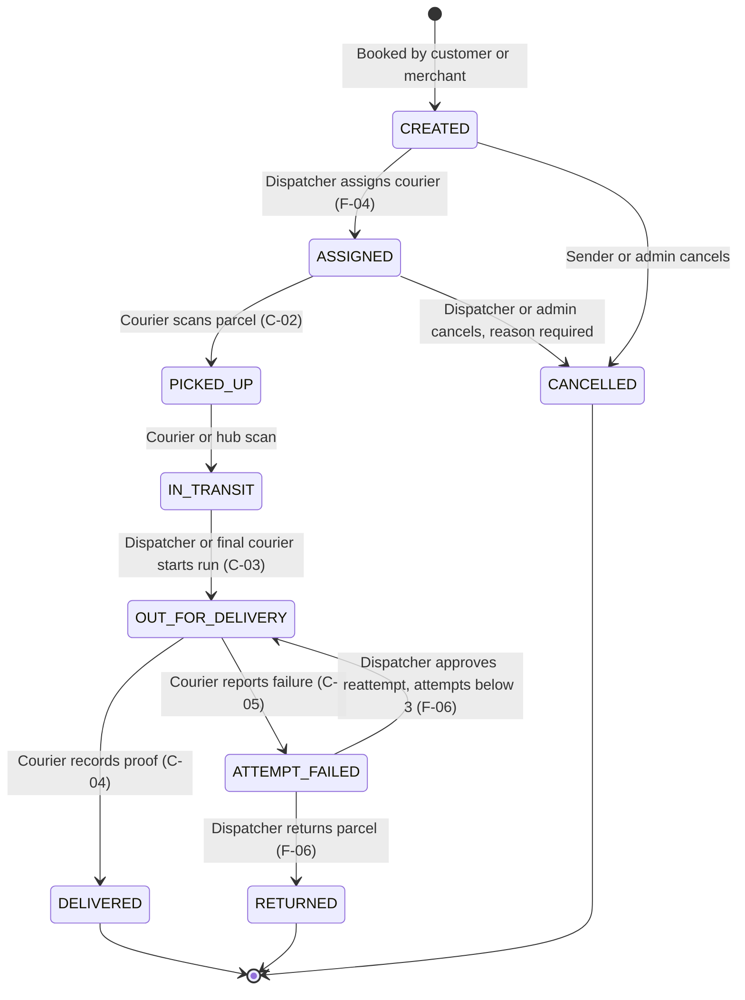

**Permitted transitions and which of my screens can ask for them**

| From | To | Who may ask | My screen and button | Endpoint |
| --- | --- | --- | --- | --- |
| CREATED | ASSIGNED | Dispatcher, admin | Dispatch board, "Assign" | `POST /api/v1/dispatch/assignments` \[Repo\] |
| CREATED | CANCELLED | Sender, admin | Not on my screens \[TBD U-08\] | not documented |
| ASSIGNED | CANCELLED | Dispatcher, admin | Dispatch board, "Cancel" \[TBD\] | not documented |
| ASSIGNED | PICKED\_UP | Assigned courier | Courier task, "Picked up" (after scan) | \[TBD U-27\] |
| PICKED\_UP | IN\_TRANSIT | Courier, hub operator | Courier task, "In transit" | \[TBD U-27\] |
| IN\_TRANSIT | OUT\_FOR\_DELIVERY | Dispatcher, final courier | Courier task, "Start delivery" | \[TBD U-27\] |
| OUT\_FOR\_DELIVERY | DELIVERED | Assigned courier | POD screen, "Confirm delivery" | \[TBD U-18\] |
| OUT\_FOR\_DELIVERY | ATTEMPT\_FAILED | Assigned courier | Courier task, "Delivery failed" | \[TBD U-19\] |
| ATTEMPT\_FAILED | OUT\_FOR\_DELIVERY | Dispatcher (admin \[TBD U-07\]) | Failed-delivery review, "Reattempt" | Requested from M2/M3 |
| ATTEMPT\_FAILED | RETURNED | Dispatcher, hub operator | Failed-delivery review, "Return to sender" | Requested from M2/M3 |

**Rules for my screens**

- A button is shown only when the parcel's current status allows that transition in the table above. This is for usability only (INV-01). The backend still checks.
- DELIVERED, RETURNED and CANCELLED are final. No action buttons are shown for them.
- Every status change must be one database transaction that updates `parcels`, adds a row to `parcel_status_history` and adds an `outbox_events` row \[Repo\] database-schema 3.4. My screens never see a "half done" change.
- A rejected (illegal) transition creates no history and no event (SRS AT-007). The screen shows the error and refreshes.

**Known conflict:** dispatch README rule 2 says a parcel can be **assigned** when it is CREATED **or ATTEMPT\_FAILED**, but the state machine has no ATTEMPT\_FAILED to ASSIGNED arrow. So it is not clear how a reattempt with a **different** courier works **\[TBD U-22\]**.

### 4.2 Delivery attempt and failed-delivery decision (owners: Members 2 and 3) \[Repo\] ADR-004

A **delivery attempt** is a separate record from the parcel status. An attempt row is never changed after it is written (ADR-004 section 2).

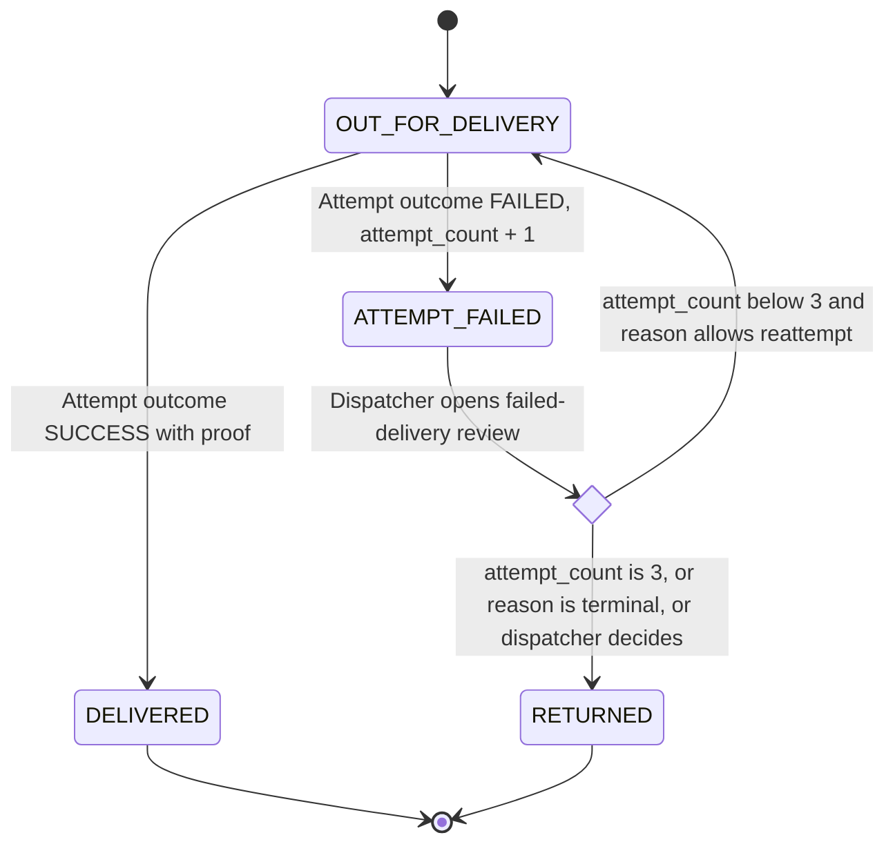

**Failure reason codes and what the review screen suggests** \[Repo\] ADR-004 section 4

| Reason code | Reattempt allowed? | Suggested button on review screen |
| --- | --- | --- |
| RECIPIENT\_UNAVAILABLE | Yes | Reattempt (default) |
| CUSTOMER\_REQUESTED\_RESCHEDULE | Yes | Reattempt (default) |
| ACCESS\_RESTRICTED | Yes | Reattempt (default) |
| INVALID\_ADDRESS | No, address must be fixed first | Reattempt disabled with text "Address must be corrected first" **\[TBD: who edits the address and with which endpoint\]** |
| REFUSED\_BY\_RECIPIENT | No, immediate return | Return to sender (default) |
| DAMAGED\_IN\_TRANSIT | No, hold for inspection | Return to sender, or no action until inspected **\[TBD with M3\]** |
| OTHER | Dispatcher decides | Both buttons; the note (at least 15 characters) is shown in full |

The "suggested" button is a hint only. The backend decides if the action is valid.

**Known conflicts:**

- delivery/README.md lists different codes (INCORRECT\_ADDRESS, PREMISES\_INACCESSIBLE, RECIPIENT\_REJECTED). I follow ADR-004 because it is an accepted decision record **\[TBD U-20\]**.
- delivery/README.md rule 3 says the 3rd failure moves the parcel to RETURNED **automatically**. ADR-004 says a dispatcher reviews and returns it. The delivery API also answers `next_action: REATTEMPT_SCHEDULED`, which suggests automatic scheduling **\[TBD U-21\]**. Until decided, the review screen handles both cases: if the parcel is already RETURNED it shows "Returned automatically after 3 failed attempts" and no buttons.

### 4.3 Courier assignment (owner: Member 3)

`courier_assignments.status` values are ASSIGNED, ACCEPTED, REJECTED, COMPLETED, CANCELLED \[Repo\] database-schema. The API does not yet expose accept or reject **\[TBD U-23\]**.

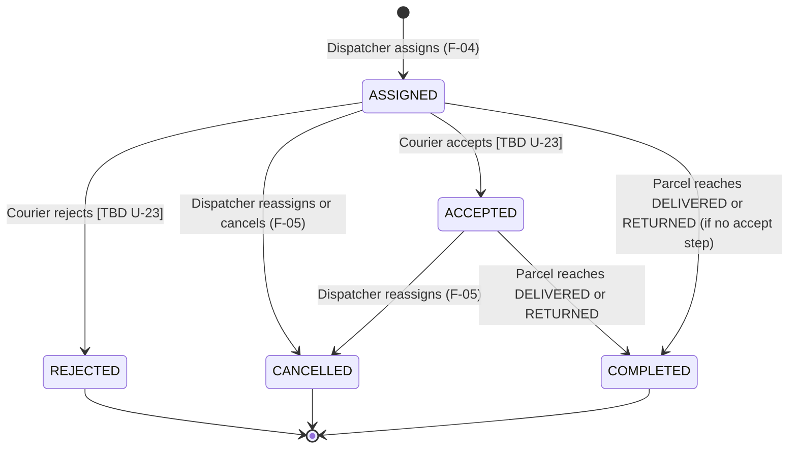

**Rules** \[Repo\] SRS 5.3, dispatch README 2

- A parcel has **at most one active** assignment at a time.
- A courier cannot have more active assignments than their maximum capacity (default 25).
- Only couriers who are active and on shift can get new work. Disabled couriers get none.
- Reassignment keeps the old assignment row (it becomes CANCELLED) and records who did it and why.
- "Active workload" must have a written definition from Member 3 (SRS 5.3). Until then, the board shows the `active_assignments` number from the API as is **\[TBD U-23\]**.

### 4.4 Courier operational status (owner: Member 3)

The schema says AVAILABLE, BUSY, OFF\_DUTY. The board API example says ON\_SHIFT **\[TBD U-23\]**. The fleet screen shows whatever value the API returns, as text, and never computes it.

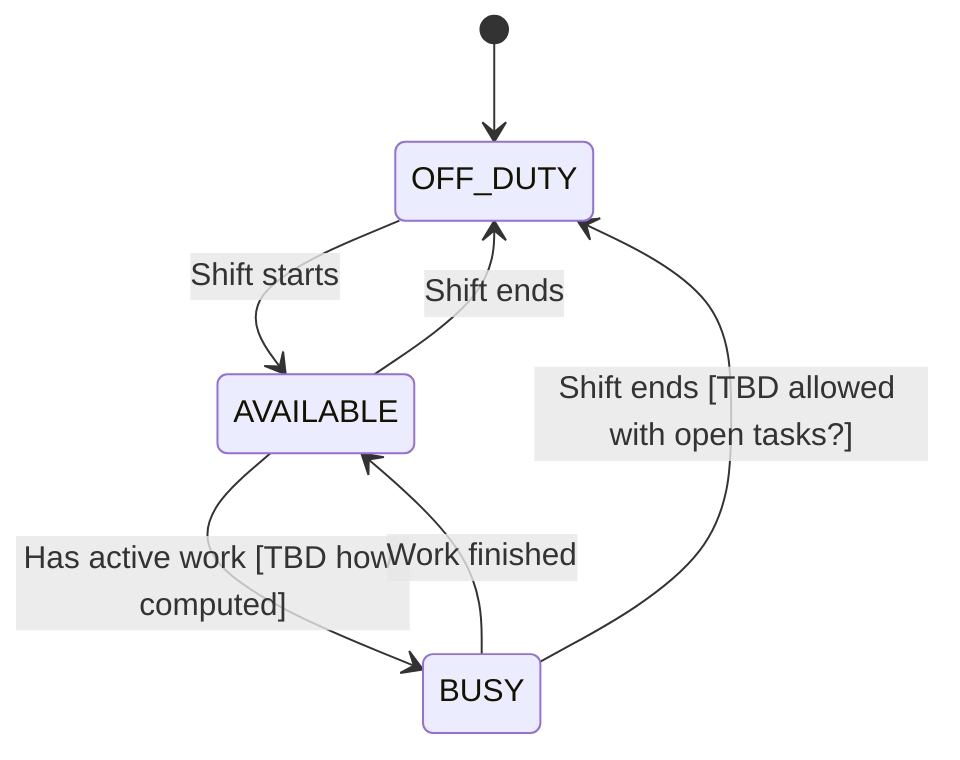

### 4.5 Merchant account (owner: Member 4)

Repo statuses: PENDING, APPROVED, SUSPENDED (merchants README). SRS adds REJECTED and FR-ADM-005 adds "disable" **\[TBD U-26\]**.

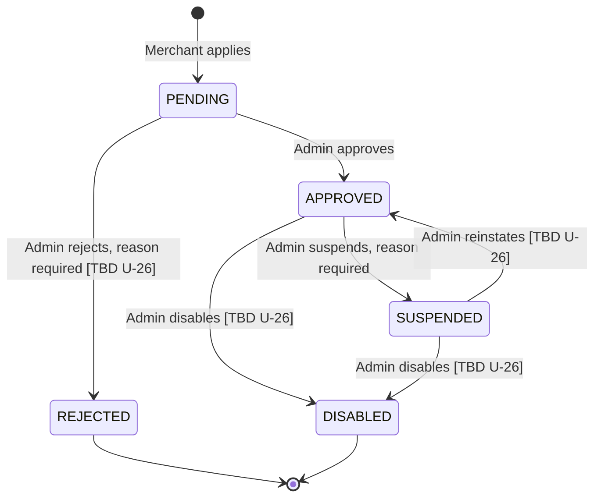

**Rules:** every change writes an `audit_logs` row (action for example `MERCHANT_APPROVED`) \[Repo\] SRS FR-IAM-009, database-schema. A merchant that is not APPROVED cannot create orders (SRS AT-011). That check is done by Member 4, not by my screen.

### 4.6 Delivery zone and pricing rule (owners: admin module and Member 2)

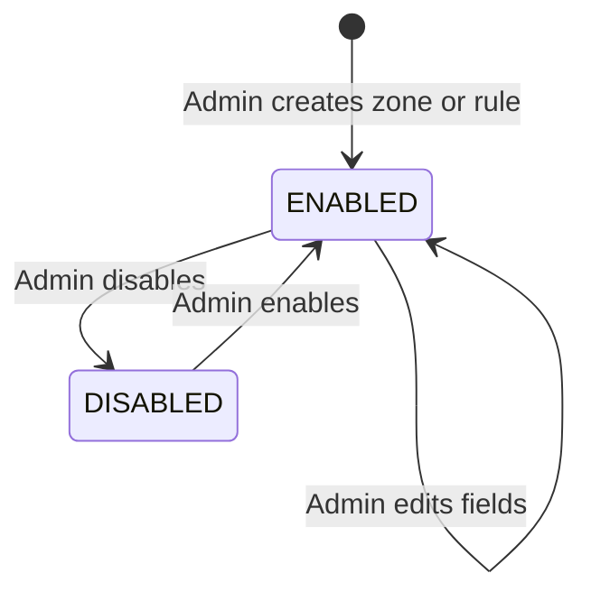

- A zone or rule is never deleted. It is disabled (database-schema 3.1, soft deletes only).
- Pricing rules have a `version` and `effective_from` / `effective_to`. Editing a rule that is already in use should create a **new version**, so old quotes keep their rule version (SRS 5.2, pricing\_quotes stores `rule_version_id`) **\[TBD U-14: Member 2 to confirm "edit makes new version"\]**.
- Field name for on/off: `active` in admin API.md, `enabled` in database-schema and Member 2's proposal **\[TBD U-13\]**. I use `enabled` in the screen model and map it.

### 4.7 Staff session in the browser (UI state only)

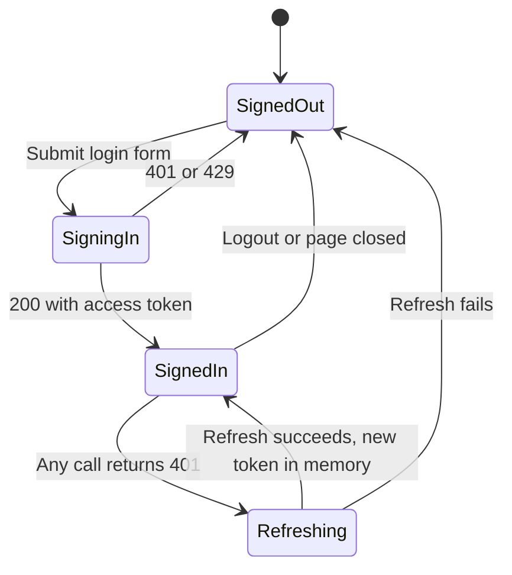

On page reload the in-memory token is gone. The app calls refresh once at start; if the refresh cookie is still valid the user stays signed in (F-01 alternate flow).

## 5. Dispatcher and admin screen flows (`/ops/*`)

### F-01 Staff sign-in and role routing

- **Trigger:** T-01. **Actors:** dispatcher, admin, courier; Identity module (M1).
- **Preconditions:** user has an active account with role DISPATCHER, ADMIN or COURIER.
- **Main flow:**
  1. User opens `/auth/login` and enters email and password.
  2. Screen sends `POST /api/v1/auth/login` \[Repo\].
  3. Backend returns `access_token` (15 minutes), `user.role`, and sets the refresh cookie (HttpOnly, Secure, SameSite=Strict, Path=/api/v1/auth) \[Repo\] ADR-003.
  4. Screen stores the token in memory (AuthContext) only.
  5. Screen sends the user to the start page for the role: DISPATCHER to `/ops/dispatch`, ADMIN to `/ops/dispatch`, COURIER to `/courier/tasks` (Doc 1 D-04).
- **Alternate flows:**
  - A1 Page reload: app calls `POST /api/v1/auth/refresh` at start; success skips the login form.
  - A2 CUSTOMER or MERCHANT signs in on the same screen: sent to `/portal/*` (Member 6). If they type an `/ops/*` address, the route guard shows "Not allowed" and the backend returns 403 to any call (web/README e2e journey 5).
  - A3 Google sign-in: staff use email and password only **\[TBD with M1: may staff use Google?\]**.
- **Failure flows:**
  - E1 Wrong password: 401 `AUTH_INVALID_CREDENTIALS`. Show "Email or password is wrong." Do not say which one.
  - E2 Too many tries: 429. Show the wait message. The limit is 5 per minute per IP, burst 3 \[Repo\] security-notes 3; it is not yet in the gateway file (U-06).
  - E3 Server down: show safe error with "Try again".
- **Postconditions:** token in memory, refresh cookie set, role-based menu shown. Nothing stored in localStorage or sessionStorage (INV-11).
- **Rules:** menu items are hidden by role for usability only (INV-01). Courier token storage differs in ADR-003 **\[TBD U-01\]**; until decided, couriers use the same in-memory rule as staff.

**Figure F-01a Sign-in sequence**

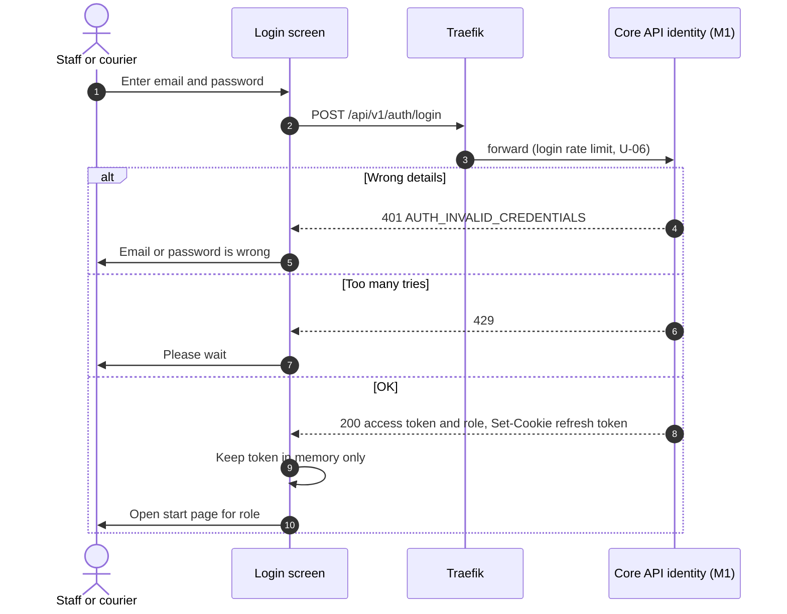


**Figure F-01b Role routing after sign-in**

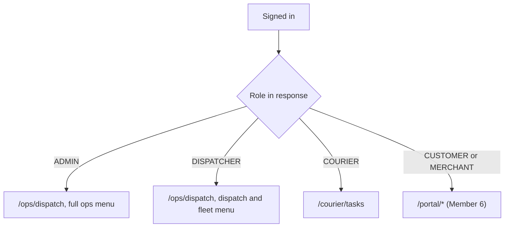


### F-02 Silent token refresh (all screens)

- **Trigger:** any API call returns 401. **Actors:** any signed-in user; Identity module.
- **Preconditions:** a refresh cookie may exist.
- **Main flow:**
  1. Call returns 401.
  2. Client starts **one** refresh: `POST /api/v1/auth/refresh` (cookie sent by browser).
  3. Backend checks the refresh token, marks it used, returns a new access token and sets a new cookie (rotation) \[Repo\] ADR-003 4.2.
  4. Client saves the new token in memory and repeats the failed call **once**.
- **Concurrency rule (important):** if 5 calls get 401 at the same moment, the client must send **only one** refresh request and make the other 4 wait for it. Reason: refresh tokens are single use. If two refresh calls send the same old token, the backend sees "reuse", treats it as theft and logs the user out of every session (ADR-003 4.2, SEC-004).
- **Failure flows:** refresh returns 401 (expired, reused or revoked) then clear memory, go to `/auth/login`, show "Your session has ended. Please sign in again." Any unsaved form text is lost **\[Proposed: keep a draft in memory for the current page only\]**.
- **Postconditions:** new access token in memory, or user signed out.
- **Note:** `/auth/refresh` and `/auth/logout` are in ADR-003 but not in identity API.md yet (Doc 1 section 9).

**Figure F-02a One shared refresh for many 401s**

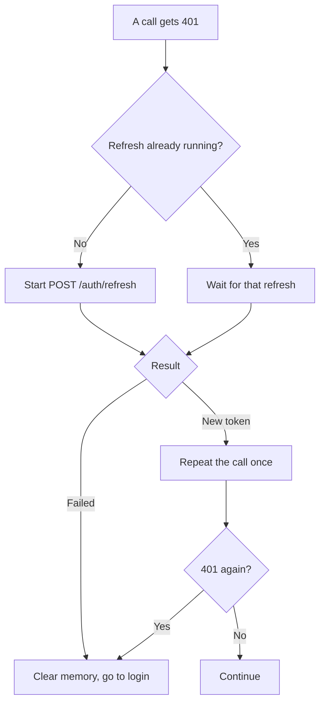


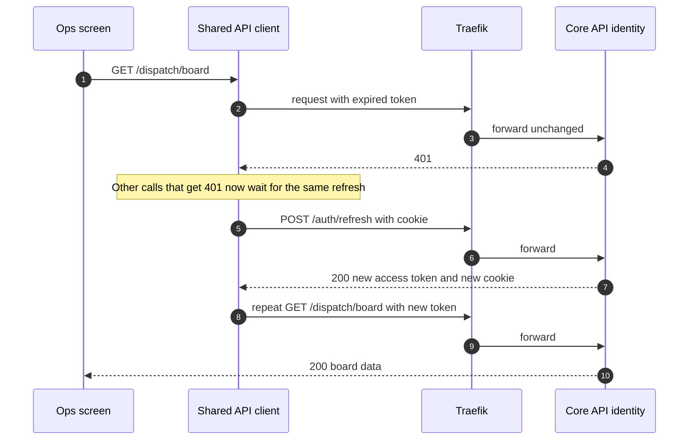

### F-03 Load the dispatch board (M7-UI-01, M7-UI-04)

- **Trigger:** T-02; dispatcher opens `/ops/dispatch` or the 30-second timer fires. **Actors:** dispatcher or admin; Dispatch module (M3).
- **Preconditions:** signed in as DISPATCHER or ADMIN.
- **Main flow:**
  1. Dispatcher picks a zone (default: last zone used in this browser tab, else the first zone in the list).
  2. Screen calls `GET /api/v1/dispatch/board?zone_code=ZONE_1` \[Repo\].
  3. Screen shows two panels: **Unassigned parcels** (tracking number, weight, city, age since created) and **Couriers** (name, status, load bar `active_assignments / max_capacity`).
  4. Couriers at full capacity are shown with the text "Full" and greyed out, but still listed.
- **Alternate flows:**
  - A1 No unassigned parcels: empty state "No parcels waiting in this zone."
  - A2 No active couriers: empty state "No couriers on shift in this zone." Assign buttons are disabled.
  - A3 Parcels in ATTEMPT\_FAILED: shown in a separate "Needs review" tab that opens F-06 **\[TBD: does the board API return them, or a separate list?\]**.
- **Failure flows:** 403 for a COURIER who types the address; 500 shows error with "Try again"; the last good data stays on screen with the label "Last updated hh:mm" when a timed refresh fails.
- **Postconditions:** none (read only).
- **Rules:** the screen does not sort couriers by "best choice" or suggest one. That would be a business decision **\[TBD: Member 3 may add auto-suggest later\]**. Sorting by name or by load is allowed because it is display only.

**Figure F-03 Loading the board**

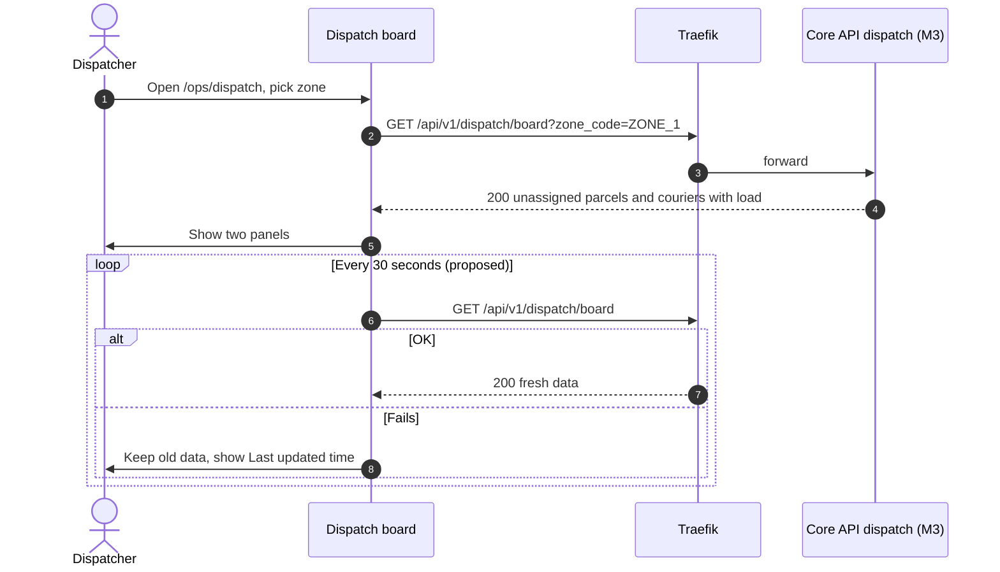


### F-04 Assign a parcel to a courier (M7-UI-02, M7-UI-05)

- **Trigger:** dispatcher picks a parcel and a courier and presses "Assign". **Actors:** dispatcher or admin; Dispatch module (M3); Parcels module (M2).
- **Preconditions:** parcel is shown as unassigned; courier is shown as on shift and not full. (The backend checks both again.)
- **Main flow:**
  1. Dispatcher selects a parcel, then a courier. A confirm box shows "Assign SD-20261021-04921 to Bob Miller (8/25)?".
  2. Client creates an Idempotency-Key and sends `POST /api/v1/dispatch/assignments` with `{ "parcel_id", "courier_id" }` \[Repo\].
  3. Backend (M3) checks role, parcel status, courier status and capacity, then in one transaction creates the assignment, moves the parcel to ASSIGNED (through the Parcel aggregate, M2), writes history and the `parcel.assigned.v1` outbox event.
  4. Backend returns 200 with `assignment_id`, `assigned_at`, `assigned_by`.
  5. Screen shows "Assigned", refreshes the board. The parcel leaves the unassigned list and the courier load goes up by 1.
- **Alternate flows:**
  - A1 Assign several parcels to one courier: done as separate requests one by one, each with its own key. If one fails, the others are not undone; the screen lists which ones failed **\[Proposed; no bulk endpoint exists\]**.
- **Failure flows:**

| Response | Meaning | Screen action |
| --- | --- | --- |
| 400 `PARCEL_NOT_ELIGIBLE_FOR_ASSIGNMENT` | Parcel is no longer CREATED (someone else assigned it, or it was cancelled) | "This parcel can no longer be assigned. The board has been refreshed." |
| 409 `COURIER_CAPACITY_EXCEEDED` | Courier is full | "Bob Miller has reached maximum capacity (25)." Refresh |
| 409 concurrent change (`ErrConcurrentConflict`) | Parcel version changed during the request | "Someone else changed this parcel. Please check and try again." Refresh |
| 404 | Parcel or courier no longer exists | "Parcel or courier not found." Refresh |
| 403 | Not allowed | Permission message, no retry |
| Network error or 5xx | Unknown if it worked | "Try again" with **same key**. If the backend does not support keys here (U-24), the retry returns 400 not eligible, and the screen then refreshes and shows the real result |

- **Postconditions (success):** parcel ASSIGNED, exactly one active assignment, history row with actor DISPATCHER, outbox event written. **(failure):** nothing changed.
- **Rules:** FR-ADM-002, FR-ADM-003, SRS 5.3. The screen never sends `assigned_by`; the backend takes it from the token.

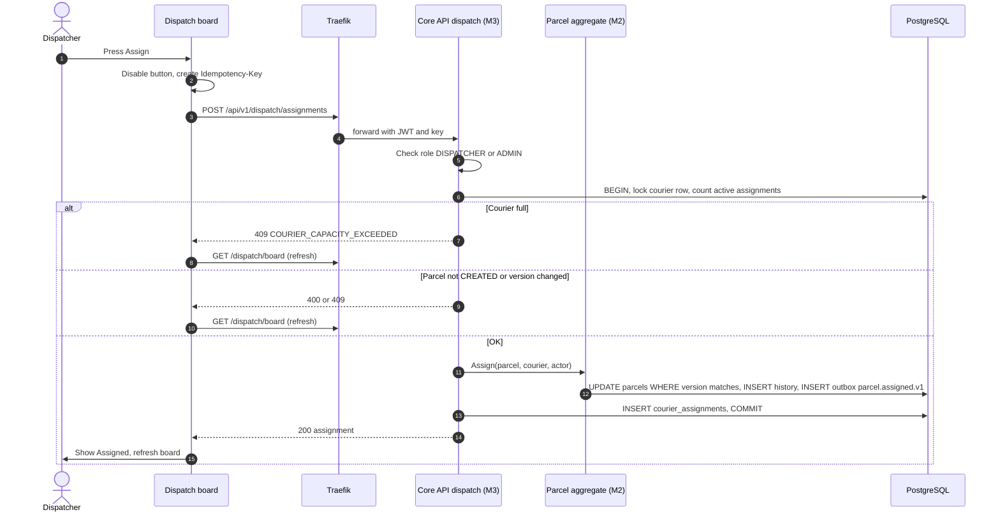

The "lock courier row" step is how Member 3 can stop two parallel assignments from both passing the capacity check. **\[TBD: Member 3 to confirm the locking method\]**.

**Figure F-04b Assign button on screen**

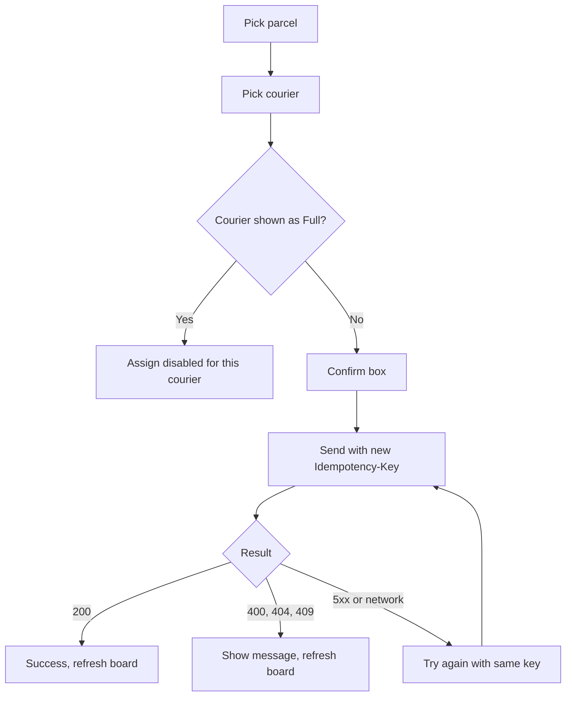


### F-05 Reassign a courier (M7-UI-03) \[TBD U-07\]

- **Trigger:** T-03. **Actors:** dispatcher or admin; Dispatch module.
- **Preconditions:** parcel has an active assignment and is not yet DELIVERED, RETURNED or CANCELLED. Allowed statuses for reassignment are **\[TBD U-07\]** (probably ASSIGNED, maybe ATTEMPT\_FAILED, maybe OUT\_FOR\_DELIVERY).
- **Main flow (proposed):**
  1. Dispatcher opens the parcel and presses "Reassign".
  2. Picks a new courier and must type a reason (proposed minimum 10 characters) **\[Proposed\]**.
  3. Client sends the reassign request with an Idempotency-Key **\[TBD: endpoint; Doc 1 A-03 assumes the assignment endpoint with a reason\]**.
  4. Backend ends the old assignment (CANCELLED), creates a new one, writes history with actor and reason, writes an event.
  5. Board refreshes; the old courier's load goes down, the new one's goes up.
- **Failure flows:** same as F-04, plus "parcel already picked up" type errors defined by Member 3.
- **Postconditions:** old assignment kept as history; one active assignment (SRS 5.3).
- **Edge case:** if the old courier marks PICKED\_UP at the same moment as the reassignment, only one request can win (parcel version check). The loser gets 409 and the screen refreshes.

**Figure F-05 Reassign (proposed, endpoint TBD U-07)**

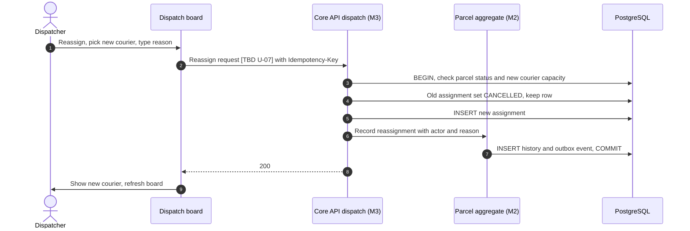


### F-06 Failed-delivery review: reattempt or return (M7-UI-06)

- **Trigger:** T-04. **Actors:** dispatcher (admin \[TBD U-07\]); Parcels (M2) and Delivery (M3).
- **Preconditions:** parcel is ATTEMPT\_FAILED.
- **Main flow:**
  1. Dispatcher opens "Needs review" and picks a parcel.
  2. Screen loads `GET /api/v1/parcels/{id}` \[Repo\] and the attempt list **\[TBD: attempts endpoint\]**. It shows: "Attempt 1 of 3 failed", reason code with a readable label, courier note, time, and courier name.
  3. Screen shows the suggested action from the table in 4.2.
  4. Dispatcher presses **Reattempt** (optionally choosing a courier, U-22) or **Return to sender** and may add a note.
  5. Client sends the request with an Idempotency-Key **\[TBD: endpoint, requested from M2/M3\]**.
  6. Backend checks `attempt_count < 3` for reattempt, changes status, writes history and an event.
  7. Screen shows the result and removes the parcel from "Needs review".
- **Alternate flows:**
  - A1 Third failure: Reattempt button is disabled with "Maximum 3 attempts reached". Only Return is offered.
  - A2 Already RETURNED automatically (U-21): read-only view.
  - A3 INVALID\_ADDRESS: Reattempt disabled until the address is fixed **\[TBD who fixes it\]**.
- **Failure flows:** 409 `PARCEL_INVALID_TRANSITION` (another dispatcher already decided) then refresh and show the new status; 403 if role not allowed.
- **Postconditions:** parcel OUT\_FOR\_DELIVERY (reattempt) or RETURNED (final). Attempt records are unchanged.

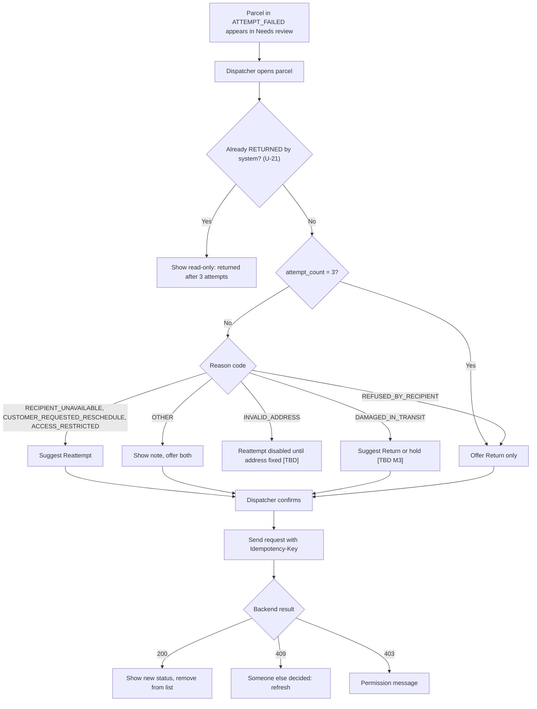

**Figure F-06b Reattempt or return sequence (endpoint TBD)**

```mermaid
sequenceDiagram
    autonumber
    actor D as Dispatcher
    participant UI as Review screen
    participant GW as Traefik
    participant CORE as Core API parcels and delivery (M2, M3)
    participant DB as PostgreSQL
    D->>UI: Open parcel in Needs review
    UI->>GW: GET /api/v1/parcels/{id} and attempts [TBD]
    GW->>CORE: forward
    CORE-->>UI: status ATTEMPT_FAILED, attempt 1 of 3, reason, note
    D->>UI: Press Reattempt or Return
    UI->>GW: Decision [TBD endpoint] with Idempotency-Key
    GW->>CORE: forward
    CORE->>DB: BEGIN, check role, status and attempt_count
    alt Allowed
        CORE->>DB: UPDATE parcels, INSERT history, INSERT outbox, COMMIT
        CORE-->>UI: 200 new status
    else Already decided or not allowed
        CORE-->>UI: 409 PARCEL_INVALID_TRANSITION
        UI->>GW: Reload parcel
    end
```


### F-07 Fleet screen (M7-UI-07)

- **Trigger:** T-05. **Actors:** dispatcher, admin; Dispatch module.
- **Preconditions:** signed in as DISPATCHER or ADMIN.
- **Main flow:** open `/ops/couriers`; list couriers with status, vehicle type, current zone, load and shift; filter by zone and status.
- **Alternate flow:** "availability toggle" (web/README) lets a dispatcher mark a courier off duty **\[TBD: endpoint and whether a courier with open tasks may be set OFF\_DUTY\]**.
- **Failure flows:** standard (3.2).
- **Rules:** no fleet endpoints exist yet (Doc 1 section 9, Requested). Built on example data until Member 3 confirms (Doc 1 A-04).

**Figure F-07 Fleet screen (endpoints requested)**

```mermaid
sequenceDiagram
    autonumber
    actor D as Dispatcher
    participant UI as Fleet screen
    participant DSP as Core API dispatch (M3)
    D->>UI: Open /ops/couriers
    UI->>DSP: List couriers [TBD endpoint]
    DSP-->>UI: Couriers with status, vehicle, zone, load
    D->>UI: Set courier off duty
    UI->>DSP: Availability change [TBD] with Idempotency-Key
    alt Allowed
        DSP-->>UI: 200 new status
    else Courier has open tasks [TBD rule]
        DSP-->>UI: 409 or 422 with reason
    end
    UI->>DSP: Reload list
```


### F-08 Merchant approval (M7-UI-08, M7-AD-04)

- **Trigger:** T-06. **Actors:** admin; Merchants module (M4); admin module.
- **Preconditions:** signed in as ADMIN.
- **Main flow:**
  1. Admin opens `/ops/merchants` (proposed route), default filter PENDING.
  2. Admin opens one application and checks company name, registration number, contact.
  3. Admin presses Approve (or Reject, Suspend, Disable where 4.5 allows). Reject, Suspend and Disable need a reason **\[Proposed: minimum 10 characters\]**.
  4. Client sends the action with an Idempotency-Key **\[TBD: endpoints requested from M4\]**.
  5. Backend changes status, writes `audit_logs` (actor, previous and new state, IP, request id).
  6. Screen shows the new status and refreshes.
- **Failure flows:** 409 if the merchant status changed meanwhile (another admin acted); 422 if the move is not allowed (for example PENDING to SUSPENDED).
- **Postconditions:** new status saved and audited. If APPROVED, the merchant can create orders and API keys; if SUSPENDED or DISABLED, M4 rejects their API calls (AT-011).

```mermaid
sequenceDiagram
    autonumber
    actor A as Admin
    participant UI as Merchant approval screen
    participant GW as Traefik
    participant M4 as Core API merchants (M4)
    participant AUD as Audit log (admin, shared)
    participant DB as PostgreSQL
    A->>UI: Press Approve
    UI->>GW: POST approve [TBD path] with Idempotency-Key
    GW->>M4: forward
    M4->>M4: Check role ADMIN and current status PENDING
    M4->>DB: BEGIN, UPDATE merchants WHERE version matches
    M4->>AUD: Write MERCHANT_APPROVED audit row
    AUD->>DB: INSERT audit_logs
    M4->>DB: COMMIT
    M4-->>UI: 200 status APPROVED
    UI->>A: Show Approved
```

### F-09 User and role management (M7-UI-09)

- **Trigger:** T-07. **Actors:** admin; Identity module (M1).
- **Preconditions:** signed in as ADMIN. Endpoints requested from M1 (Doc 1 section 9).
- **Main flow:** list users with filters; open one; change role (one of ADMIN, DISPATCHER, COURIER, MERCHANT, CUSTOMER) or disable the account; reason required; backend audits it (FR-IAM-009).
- **Rules (proposed, backend enforces):**
  - An admin cannot disable their own account or remove their own ADMIN role (prevents lock-out). **\[Proposed; M1 to confirm\]**
  - The last active ADMIN cannot be removed. **\[Proposed; M1 to confirm\]**
  - A disabled user's sessions are ended so they cannot keep working with a refresh token. **\[TBD with M1\]**
  - Changing a role takes effect at the user's next token (within 15 minutes) unless M1 revokes sessions. The screen says so. **\[TBD with M1\]**
  - Making a user a COURIER also needs a courier profile (vehicle, capacity) in the dispatch module. **\[TBD: M1 and M3 to agree who creates it\]**
- **Failure flows:** 409 email already used; 422 rule broken (for example self-disable); 403.
- **Postconditions:** role or status changed and audited.

**Figure F-09 Change a role or disable a user**

```mermaid
flowchart TD
    A["Admin opens user"] --> B["Choose new role or Disable"]
    B --> C["Type reason"]
    C --> D["Send to identity module with key [TBD endpoint]"]
    D --> E{"Backend checks (M1)"}
    E -- "Own account" --> X["422 not allowed (proposed)"]
    E -- "Last active admin" --> X
    E -- "OK" --> F["Save, write audit row"]
    F --> G{"Disable?"}
    G -- "Yes" --> H["End user sessions [TBD M1]"]
    G -- "No" --> I["Role used from next token, within 15 min"]
    F --> J{"New role COURIER?"}
    J -- "Yes" --> K["Courier profile needed in dispatch [TBD M1 and M3]"]
```


### F-10 Delivery zone management (M7-UI-10, M7-AD-01)

Screen side of backend flow A-01.

- **Trigger:** T-08. **Actors:** admin; admin module.
- **Preconditions:** signed in as ADMIN.
- **Main flow:**
  1. Admin opens `/ops/zones` and sees the zone list (code, name, enabled, number of postal codes, surcharge).
  2. Admin presses "New zone" and fills code, name, surcharge and postal code prefixes.
  3. Screen does simple form checks only (required fields, code format, postal code is digits) to help the user. The backend repeats all checks.
  4. Client sends `POST /api/v1/admin/zones` with an Idempotency-Key \[Repo\].
  5. On 201 the list refreshes.
- **Alternate flows:** edit zone, enable or disable zone **\[Proposed by M2: PATCH /admin/zones/{id} and /{id}/status\]**.
- **Failure flows:** postal code already in another zone shows the conflicting zone name (from `error.details`); zone code taken; surcharge invalid.
- **Rules:** surcharge is entered as rupees and cents in the form but sent in the format the API agrees on. Today API.md uses the string "3.50", which breaks the integer-cents rule **\[TBD U-03\]**. The screen does not do any fee calculation with it.

**Figure F-10 Zone form on screen**

```mermaid
flowchart TD
    A["Admin fills zone form"] --> B{"Simple checks pass? required, code format, digits"}
    B -- "No" --> C["Show field hint, stay on form"]
    B -- "Yes" --> D["POST /api/v1/admin/zones with key"]
    D --> E{"Result"}
    E -- "201" --> F["Refresh zone list"]
    E -- "409 postal code" --> G["Show conflicting zone name, keep input"]
    E -- "409 zone code" --> H["Show code already used"]
    E -- "422" --> I["Show field errors"]
```


### F-11 Pricing rule management (M7-UI-11)

- **Trigger:** T-08. **Actors:** admin; Pricing module (M2).
- **Preconditions:** signed in as ADMIN; zones exist.
- **Main flow:** list rules (origin zone, destination zone, service level, weight range, base fee in LKR, effective dates, version, enabled); create or edit; client sends with an Idempotency-Key to the M2 proposed endpoints \[Proposed\]; refresh.
- **Failure flows:** 422 messages from M2 (for example "Minimum weight must be less than maximum weight", "Base fee cannot be negative"); 409 overlap naming the existing rule (if overlaps are forbidden, U-14).
- **Rules:** fees are typed in rupees, converted to integer cents by the shared helper only for sending, never used to compute a price. Effective dates are chosen as Sri Lanka dates and sent as UTC **\[TBD with M2: is effective\_from a date or a timestamp?\]**.
- **Example:** rule "Colombo 01 to Kandy, STANDARD, 0 to 5 kg, base fee LKR 450.00" is sent as `base_fee_cents: 45000`.

**Figure F-11 Save a pricing rule (endpoints proposed by M2)**

```mermaid
sequenceDiagram
    autonumber
    actor A as Admin
    participant UI as Pricing screen
    participant GW as Traefik
    participant PRC as Core API pricing (M2)
    participant DB as PostgreSQL
    A->>UI: Fill rule, base fee LKR 450.00
    UI->>UI: Shared helper turns 450.00 into 45000 cents for sending only
    UI->>GW: POST /api/v1/admin/pricing-rules with Idempotency-Key
    GW->>PRC: forward
    PRC->>PRC: Validate weights, fees, dates
    PRC->>DB: Check overlap with enabled rules
    alt Overlap and overlaps forbidden (U-14)
        PRC-->>UI: 409 naming existing rule
    else Invalid values
        PRC-->>UI: 422 with messages
    else OK
        PRC->>DB: INSERT rule with version 1, COMMIT
        PRC-->>UI: 201 rule
        UI->>A: Show rule, refresh list
    end
```


### F-12 Reports (M7-UI-12, M7-AD-02)

Screen side of A-03.

- **Trigger:** T-09. **Actors:** admin (dispatcher \[TBD U-02\]); admin module.
- **Main flow:** pick a date range (default last 7 days) and optional zone; call `GET /api/v1/admin/reports/operational?from=…&to=…&zone=…` \[Repo\]; show total parcels, delivered, failed attempts, first-attempt rate, average delivery time.
- **Rules:** values are shown exactly as returned. The screen does not recompute percentages (INV-02). "97.2%" is shown as "97.2%".
- **Failure flows:** `from` after `to` gives 422; range too long **\[TBD: maximum range\]**; empty period shows zeros with "No parcels in this period".

**Figure F-12 Reports screen**

```mermaid
sequenceDiagram
    autonumber
    actor A as Admin
    participant UI as Reports screen
    participant GW as Traefik
    participant ADM as Core API admin
    A->>UI: Pick dates and zone
    UI->>UI: Block from after to
    UI->>GW: GET /api/v1/admin/reports/operational?from&to&zone
    GW->>ADM: forward
    ADM-->>UI: 200 numbers
    UI->>A: Show numbers exactly as returned
```


### F-13 Audit log explorer (M7-UI-12, M7-AD-03)

- **Trigger:** T-10. **Actors:** admin; admin module (A-04).
- **Main flow:** filter by date, actor, action, target type and target id; page through results (20 per page, max 100) \[Repo\] api-conventions 2.2; open one entry to see previous and new state.
- **Rules:** read only. No edit or delete buttons exist anywhere (INV-12). Personal data in `previous_state` and `new_state` is shown only to ADMIN **\[TBD with M1: masking rules for audit views\]**.

**Figure F-13 Audit explorer**

```mermaid
sequenceDiagram
    autonumber
    actor A as Admin
    participant UI as Audit explorer
    participant ADM as Core API admin
    participant DB as PostgreSQL
    A->>UI: Set filters
    UI->>ADM: GET audit query [TBD path] page=1 per_page=20
    ADM->>DB: SELECT from audit_logs, newest first
    ADM-->>UI: 200 data and meta
    A->>UI: Next page or open one entry
    UI->>ADM: GET page=2
    Note over UI,ADM: No edit or delete call exists
```


### F-14 Admin parcel correction (M7-UI-13) \[TBD U-08\]

- **Trigger:** T-11. **Actors:** admin; Parcels module (M2).
- **Main flow (if in my scope):** admin opens a parcel, chooses a correction allowed by M2, must type a reason, confirms; backend applies it through the Parcel aggregate and writes history plus `audit_logs` (FR-ADM-009, FR-LIFE-007).
- **Rules:** never a free status dropdown. Only the corrections Member 2 exposes. Endpoint requested (Doc 1 section 9).

**Figure F-14 Parcel correction (if in scope, U-08)**

```mermaid
sequenceDiagram
    autonumber
    actor A as Admin
    participant UI as Correction screen
    participant PA as Core API parcels (M2)
    participant DB as PostgreSQL
    A->>UI: Open parcel, choose an allowed correction
    UI->>UI: Reason is required before Save
    UI->>PA: Correction [TBD endpoint] with reason and key
    PA->>PA: Check ADMIN and that correction is allowed
    PA->>DB: BEGIN, UPDATE parcels, INSERT history, INSERT audit_logs, INSERT outbox, COMMIT
    PA-->>UI: 200 corrected parcel
```


## 6. Courier mobile flows (`/courier/*`)

Couriers work on phones, often on slow or broken connections. Extra rules:

| ID | Rule |
| --- | --- |
| R-CR-01 | Big buttons, one action per screen, works at 360 px width |
| R-CR-02 | Every status button sends an Idempotency-Key and keeps it for retries (3.3) |
| R-CR-03 | There is **no offline queue**. If the network is down, the screen says "No connection. Your update was not sent." and keeps the form so the courier can press "Try again" later **\[Proposed; offline mode not in scope\]** |
| R-CR-04 | After any 409 the task is reloaded and the courier sees the real status (SRS FR-COU-006) |
| R-CR-05 | A courier only ever sees their own tasks. If they open another parcel's address, the backend returns 403 and the screen shows "This task is not assigned to you" |
| R-CR-06 | Gateway rate limit for `/api/v1/courier/*` is per IP, not per user (Doc 1 M7-GW-02, U-06) |

### C-01 Courier task list

- **Trigger:** courier opens `/courier/tasks`. **Actors:** courier; Delivery/Dispatch (M3).
- **Main flow:** call the task list **\[TBD: `GET /api/v1/courier/deliveries` in SRS 6.2, not in API.md\]**; show today's pickups and deliveries grouped by status, with tracking number, area and recipient name (FR-COU-001, FR-COU-002).
- **Alternate flows:** no tasks shows "No tasks for today"; pull to refresh.
- **Failure flows:** standard.

**Figure C-01 Courier task list**

```mermaid
sequenceDiagram
    autonumber
    actor C as Courier phone
    participant GW as Traefik
    participant DEL as Core API delivery and dispatch (M3)
    C->>GW: GET /api/v1/courier/deliveries [TBD]
    GW->>DEL: forward with courier JWT
    DEL->>DEL: Only tasks assigned to this courier
    DEL-->>C: 200 pickups and deliveries
    C->>C: Group by status, show list
```


### C-02 Pickup with barcode scan

- **Trigger:** courier is at the sender with an ASSIGNED parcel.
- **Main flow:** courier presses "Scan", scans the label (or types the tracking number: scan is simulated per web/README); screen compares the scanned number with the task **only to warn** "This label does not match this task"; courier confirms; client sends the picked-up update with a key **\[TBD U-27\]**; backend checks the courier is assigned and status is ASSIGNED, then sets PICKED\_UP.
- **Failure flows:** 409 parcel was reassigned or cancelled meanwhile: "This task has changed. It has been reloaded."; 403 not assigned.
- **Rule:** the scan check on the phone is a convenience. The backend's check is the real one (domain-boundaries 3.1: "barcode/QR scan match").

**Figure C-02 Pickup on the phone**

```mermaid
flowchart TD
    A["Courier at sender, task ASSIGNED"] --> B["Scan label or type number"]
    B --> C{"Matches task?"}
    C -- "No" --> D["Warn: label does not match"] --> B
    C -- "Yes" --> E["Press Picked up"]
    E --> F["Send update with key [TBD U-27]"]
    F --> G{"Result"}
    G -- "200" --> H["Task shows PICKED_UP"]
    G -- "409" --> I["Task changed, reload"]
    G -- "403" --> J["Not your task"]
    G -- "Network error" --> K["Not sent, Try again with same key"] --> F
```


### C-03 Start delivery run

- **Trigger:** courier leaves for final delivery (IN\_TRANSIT to OUT\_FOR\_DELIVERY).
- **Main flow:** courier presses "Start delivery"; client sends update with a key **\[TBD U-27: who triggers this, the courier or the dispatcher; dispatch README says "courier marks run started"\]**; parcel becomes OUT\_FOR\_DELIVERY; event `parcel.out_for_delivery.v1`.

**Figure C-03 Start delivery run**

```mermaid
sequenceDiagram
    autonumber
    actor C as Courier phone
    participant GW as Traefik
    participant DSP as Core API dispatch (M3)
    participant PA as Parcel aggregate (M2)
    participant DB as PostgreSQL
    C->>GW: Start delivery [TBD U-27] with key
    GW->>DSP: forward
    DSP->>PA: Move IN_TRANSIT to OUT_FOR_DELIVERY
    PA->>DB: UPDATE parcels, INSERT history, INSERT outbox parcel.out_for_delivery.v1, COMMIT
    DSP-->>C: 200 OUT_FOR_DELIVERY
```


### C-04 Proof of delivery (M7-CR-02)

- **Trigger:** courier hands the parcel to the recipient.
- **Preconditions:** parcel is OUT\_FOR\_DELIVERY and assigned to this courier.
- **Main flow:**
  1. Courier opens `/courier/tasks/:id/pod`.
  2. Takes a photo and/or captures a signature on screen, types the name of the person who received it, optional note.
  3. Screen checks the photo size. If above 10 MB it is resized on the phone first **\[Proposed: resize to about 1600 px wide, JPEG\]**.
  4. Photo is uploaded **\[TBD U-25: upload method, either multipart through Core API within the 10 MB gateway limit, or a pre-signed URL to object storage as security-notes 7 suggests\]**.
  5. Client sends the complete-delivery request with the proof reference and an Idempotency-Key **\[TBD U-18: `POST /api/v1/deliveries/{parcel_id}/complete` (delivery API.md) or `POST /api/v1/courier/parcels/{id}/deliver` (sequence-diagrams.md)\]**.
  6. Backend checks courier, status and proof; in one transaction writes `delivery_attempts` (SUCCESS), sets DELIVERED, writes history and `parcel.delivered` event \[Repo\] sequence-diagrams 3.
  7. Screen shows "Delivered" and goes back to the list.
- **Alternate flows:** signature only, photo only, or OTP (schema allows OTP) **\[TBD: which proof types are required\]**.
- **Failure flows:**

| Response | Screen action |
| --- | --- |
| 400 `MISSING_DELIVERY_PROOF` | "Please add a photo or signature." |
| 403 `NOT_ASSIGNED_COURIER` | "This task is not assigned to you." Reload list |
| 409 `INVALID_STATE_FOR_DELIVERY` | "This parcel is not out for delivery any more." Reload |
| 413 | "Photo too large." Resize and retry |
| Upload succeeded, complete call timed out | "Try again" sends the same proof reference and **same key**. No second photo upload |

- **Postconditions:** parcel DELIVERED (final). Proof stored privately; only a reference in PostgreSQL (FR-COU-007). Public tracking shows "Delivered - Proof Verified" with no image (api-conventions 5).

```mermaid
sequenceDiagram
    autonumber
    actor C as Courier phone
    participant GW as Traefik
    participant DEL as Core API delivery (M3)
    participant PA as Parcel aggregate (M2)
    participant DB as PostgreSQL
    participant TRK as Tracking API (M5)
    C->>C: Capture photo and signature, resize if over 10 MB
    C->>GW: Upload photo [TBD U-25]
    GW->>DEL: forward (10 MB limit on Core API route)
    DEL-->>C: proof reference
    C->>GW: POST complete delivery [TBD U-18] with Idempotency-Key
    GW->>DEL: forward with courier JWT
    DEL->>DB: BEGIN, SELECT parcel FOR UPDATE
    DEL->>DEL: Check assigned courier, status OUT_FOR_DELIVERY, proof present
    DEL->>DB: INSERT delivery_attempts SUCCESS
    DEL->>PA: MarkDelivered
    PA->>DB: UPDATE parcels, INSERT history, INSERT outbox parcel.delivered, COMMIT
    DEL-->>C: 200 DELIVERED
    Note over DB,TRK: Outbox relay publishes event and Tracking API pushes a masked update to live viewers
```

**Figure C-04b Proof screen on the phone**

```mermaid
flowchart TD
    A["Open POD screen"] --> B["Take photo and or signature, enter receiver name"]
    B --> C{"Photo over 10 MB?"}
    C -- "Yes" --> D["Resize on phone"] --> E
    C -- "No" --> E["Upload photo [TBD U-25]"]
    E --> F{"Upload OK?"}
    F -- "No" --> G["Show error, Try again"] --> E
    F -- "Yes" --> H["Send complete delivery with proof reference and key"]
    H --> I{"Result"}
    I -- "200" --> J["Delivered, back to list"]
    I -- "400 missing proof" --> B
    I -- "409 or 403" --> K["Reload task"]
    I -- "Timeout" --> L["Try again with same reference and key, no new upload"] --> H
```


### C-05 Report a failed delivery (M7-CR-03)

- **Trigger:** courier cannot deliver.
- **Preconditions:** parcel OUT\_FOR\_DELIVERY and assigned to this courier.
- **Main flow:**
  1. Courier presses "Delivery failed".
  2. Picks one reason from the ADR-004 list (7 codes). For OTHER, a note of at least 15 characters is required; the counter shows how many are left.
  3. Optional: share location (GPS) if the courier allows it **\[TBD: required or optional?\]**.
  4. Client sends the failure with an Idempotency-Key **\[TBD U-19: `POST /api/v1/courier/parcels/{id}/fail-attempt` (ADR-004) or `POST /api/v1/deliveries/{parcel_id}/failed` (delivery API.md); field names `failure_reason_code` and `failure_note` (schema) or `reason_code` and `notes` (API.md)\]**.
  5. Backend writes an attempt row (FAILED), increases `attempt_count` in the same transaction, sets ATTEMPT\_FAILED, writes `parcel.delivery_failed.v1` event \[Repo\] ADR-004 section 5.
  6. Screen shows "Attempt 1 of 3 recorded. The dispatcher will decide the next step." and removes it from active tasks.
- **Failure flows:** 422 note too short or unknown reason; 409 parcel no longer OUT\_FOR\_DELIVERY; network error then "Try again" with the same key.
- **Postconditions:** one new FAILED attempt row, attempt count +1, parcel ATTEMPT\_FAILED (or RETURNED if U-21 is "automatic" and this was attempt 3). Customer gets a masked message; merchant gets a webhook (ADR-004 section 6).
- **Rule:** the courier cannot reschedule. There is no "try again later" button for the courier (ADR-004 3.1 rule 4).

```mermaid
sequenceDiagram
    autonumber
    actor C as Courier phone
    participant GW as Traefik
    participant DEL as Core API delivery (M3)
    participant PA as Parcel aggregate (M2)
    participant DB as PostgreSQL
    actor D as Dispatcher board
    C->>GW: POST fail-attempt [TBD U-19] reason and note, Idempotency-Key
    GW->>DEL: forward
    DEL->>DEL: Check courier assigned, reason valid, note 15+ chars if OTHER
    DEL->>DB: BEGIN, INSERT delivery_attempts FAILED
    DEL->>PA: RecordFailedAttempt(reason, courier)
    PA->>DB: UPDATE parcels attempt_count + 1, status ATTEMPT_FAILED, INSERT history, INSERT outbox, COMMIT
    DEL-->>C: 200 attempt 1 of 3
    D->>GW: Board refresh (timer)
    GW-->>D: Parcel now in Needs review (F-06)
```

**Figure C-05b Failure form on the phone**

```mermaid
flowchart TD
    A["Press Delivery failed"] --> B["Pick reason code"]
    B --> C{"Reason is OTHER?"}
    C -- "Yes" --> D{"Note 15 or more characters?"}
    D -- "No" --> E["Show characters left, block Send"] --> D
    D -- "Yes" --> F["Send with key"]
    C -- "No" --> F
    F --> G{"Result"}
    G -- "200" --> H["Show attempt N of 3, dispatcher decides next"]
    G -- "422" --> B
    G -- "409" --> I["Reload task"]
    G -- "Network error" --> J["Not sent, Try again with same key"] --> F
```


## 7. Admin backend module flows (`core-api/internal/admin/`)

These are the backend flows I own together with Members 1 and 4 (U-10: which Go code I write is still open). Every endpoint requires the ADMIN role \[Repo\] admin README 2.

### A-01 Create or update a delivery zone

- **Trigger:** `POST /api/v1/admin/zones` (create) or the proposed PATCH (edit).
- **Preconditions:** caller has a valid JWT with role ADMIN.
- **Main flow (create):**
  1. Auth middleware checks the token and role. Not ADMIN gives 403.
  2. Idempotency middleware checks `Idempotency-Key` (scope `USER:<admin id>`, operation `POST /admin/zones`). Replay returns the saved 201.
  3. Validate input: `zone_code` required, unique, upper case letters, digits and underscore **\[Proposed format\]**; `name` required, 1 to 100 characters **\[Proposed\]**; surcharge not negative **\[format TBD U-03\]**; `postal_code_prefixes` at least one, digits only, no duplicates in the list.
  4. `BEGIN` transaction.
  5. Insert into `delivery_zones` (enabled = true).
  6. Insert each prefix into `zone_postal_codes`. A **unique constraint on the prefix** makes the database reject a prefix that is already used by another zone.
  7. Insert an `audit_logs` row (action `ZONE_CREATED`, new state, IP, request id) **\[Proposed action name\]**.
  8. Save the idempotency record. `COMMIT`.
  9. Return 201 with the zone.
- **Failure flows:**

| Case | Response (proposed codes) |
| --- | --- |
| Missing or bad field | 422 `VALIDATION_FAILED` with `details[]` per field |
| Zone code already exists | 409 `ZONE_CODE_ALREADY_EXISTS` |
| Postal prefix already in another zone | 409 `ZONE_POSTAL_CODE_CONFLICT`, details name the prefix and the other zone code |
| Same key, different body | 409 `IDEMPOTENCY_KEY_PAYLOAD_MISMATCH` |
| Not ADMIN | 403 `ACCESS_DENIED` |
| Database error | 500 with correlation id, transaction rolled back, nothing saved |

- **Postconditions:** zone and all its prefixes saved together, or nothing saved. One audit row.
- **Rules:**
  - Postal code uniqueness (admin README rule 3). **\[TBD: does "conflicting" mean exact same prefix only, or also overlapping prefixes such as "627" and "62701"? Proposed: forbid both, check with a query inside the transaction.\]**
  - Disabling a zone does not change parcels already booked. New quotes for that zone are refused by Member 2's pricing **\[TBD with M2\]**.
  - Zone changes are not published as events (I publish nothing, X-08). If pricing caches zones, Member 2 must reload them **\[TBD with M2\]**.
  - Zone schema differs between admin README (base surcharge, active) and database-schema.md (enabled, boundary polygon, no surcharge) **\[TBD U-13\]**.
- **Concurrency:** two admins add the same prefix to two zones at the same time. Both pass validation, but the unique constraint lets only one commit; the other gets 409 `ZONE_POSTAL_CODE_CONFLICT`. Editing a zone uses a `version` column with the same optimistic check as parcels **\[Proposed: `delivery_zones` has no version column today\]**; a stale edit gets 409 and the screen reloads.

```mermaid
sequenceDiagram
    autonumber
    actor A as Admin
    participant UI as Zones screen
    participant GW as Traefik
    participant ADM as Core API admin
    participant DB as PostgreSQL
    A->>UI: Save new zone
    UI->>GW: POST /api/v1/admin/zones with Idempotency-Key
    GW->>ADM: forward (CORS, 10 MB limit)
    ADM->>ADM: Check JWT role ADMIN
    ADM->>DB: Look up idempotency key
    alt Key seen with same body
        ADM-->>UI: 201 saved response, Idempotent-Replay true
    else New key
        ADM->>ADM: Validate fields
        ADM->>DB: BEGIN, INSERT delivery_zones, INSERT zone_postal_codes
        alt Prefix already used
            DB-->>ADM: unique violation
            ADM->>DB: ROLLBACK
            ADM-->>UI: 409 ZONE_POSTAL_CODE_CONFLICT
        else OK
            ADM->>DB: INSERT audit_logs, INSERT idempotency_keys, COMMIT
            ADM-->>UI: 201 zone
        end
    end
```

**Figure A-01b Zone validation steps in the backend**

```mermaid
flowchart TD
    A["Request in"] --> B{"Role ADMIN?"}
    B -- "No" --> X1["403"]
    B -- "Yes" --> C{"Key seen before?"}
    C -- "Same body" --> R["Return saved response"]
    C -- "Different body" --> X2["409 key mismatch"]
    C -- "New" --> D{"Fields valid?"}
    D -- "No" --> X3["422 with details"]
    D -- "Yes" --> E["BEGIN transaction"]
    E --> F{"Zone code free?"}
    F -- "No" --> X4["ROLLBACK, 409 code exists"]
    F -- "Yes" --> G{"All prefixes free?"}
    G -- "No" --> X5["ROLLBACK, 409 postal conflict"]
    G -- "Yes" --> H["Insert zone, prefixes, audit row, key record"]
    H --> I["COMMIT, 201"]
```


### A-02 System settings (`system_settings`)

- **Trigger:** admin changes a runtime switch **\[TBD: no endpoint or screen defined; which settings exist is not decided\]**.
- **Rules (proposed):** only known keys may be set (no free keys); each change writes an audit row with old and new value; secrets are never stored here (X-10).

**Figure A-02 Change a setting (proposed)**

```mermaid
sequenceDiagram
    autonumber
    actor A as Admin
    participant ADM as Core API admin
    participant DB as PostgreSQL
    A->>ADM: Change setting [TBD endpoint] with key
    ADM->>ADM: Check ADMIN and key is in allowed list
    ADM->>DB: BEGIN, read old value, UPDATE system_settings
    ADM->>DB: INSERT audit_logs with old and new value, COMMIT
    ADM-->>A: 200
```


### A-03 Operational report query

- **Trigger:** `GET /api/v1/admin/reports/operational` \[Repo\].
- **Main flow:** check ADMIN; validate `from` and `to` (dates, `from` not after `to`); read only queries over parcels, attempts and history through approved read models **\[TBD: admin module may only read its own tables (domain-boundaries 4.2). Reading other modules' data needs a Go interface from those modules or a reporting view; agree with M2 and M3\]**; return the numbers.
- **Definitions to agree** **\[TBD with M2, M3\]**:
  - "Day" boundaries: proposed Sri Lanka time (00:00 to 23:59 Asia/Colombo), converted to UTC for the query.
  - `first_attempt_delivery_rate` = delivered on attempt 1 / all parcels that reached a final status in the period.
  - `average_delivery_time_hours` = from CREATED to DELIVERED.
  - Percent is sent as a string ("97.2%") in API.md. Proposed: send a number and let the screen format it **\[TBD\]**.
- **Failure flows:** 422 bad dates; 403 not ADMIN (or allowed dispatcher, U-02).
- **Idempotency:** read only, safe to repeat.

**Figure A-03 Report query in the backend**

```mermaid
sequenceDiagram
    autonumber
    participant UI as Reports screen
    participant ADM as Core API admin
    participant RD as Read interfaces of parcels and delivery [TBD]
    participant DB as PostgreSQL
    UI->>ADM: GET /admin/reports/operational
    ADM->>ADM: Check role, validate dates
    ADM->>ADM: Turn Sri Lanka dates into UTC range (proposed)
    ADM->>RD: Counts for range and zone
    RD->>DB: Read-only queries
    RD-->>ADM: Counts
    ADM->>ADM: Work out rates, safe when total is 0
    ADM-->>UI: 200 report
```


### A-04 Audit log query

- **Trigger:** audit explorer (F-13). Endpoint requested.
- **Rules:** `GET` only. No update or delete endpoint exists, and the database user for the app should have no UPDATE or DELETE right on `audit_logs` **\[Proposed; check with M9\]**. Results are paginated and sorted newest first. Kept at least 2 years (database-schema retention).

**Figure A-04 Why audit rows cannot change**

```mermaid
flowchart LR
    A["Admin module code"] -->|"INSERT and SELECT only"| T[("audit_logs")]
    B["Any UPDATE or DELETE"] -.->|"no endpoint, no database right (proposed)"| T
```


### A-05 Merchant approval (with Member 4)

The admin module README lists "ApproveMerchant" as its use case, but merchant status lives in the merchants table owned by Member 4. **Proposed split:** the admin endpoint checks ADMIN, then calls Member 4's Go interface (not HTTP, domain-boundaries 4.1) which changes the status and writes the audit row in the same transaction (F-08 diagram). **\[TBD U-10\]**

**Figure A-05 Proposed split for merchant approval**

```mermaid
sequenceDiagram
    autonumber
    participant H as Admin HTTP handler
    participant UC as ApproveMerchant use case (admin)
    participant MI as Merchants Go interface (M4)
    participant DB as PostgreSQL
    H->>UC: Approve(merchant id, admin from token)
    UC->>MI: ChangeStatus(id, APPROVED, actor, reason)
    MI->>DB: BEGIN, UPDATE merchants WHERE version matches
    MI->>DB: INSERT audit_logs MERCHANT_APPROVED, COMMIT
    MI-->>UC: new status
    UC-->>H: 200
```


## 8. Gateway flows (`deploy/gateway/traefik/`)

### G-01 Route a request

- **Trigger:** any HTTP request (T-13).
- **Main flow:**
  1. Production: Cloudflare receives the request (HTTPS), then sends it to Traefik on 443 using the origin certificate. Local: request hits Traefik on port 80.
  2. Traefik entrypoint trusts forwarded headers only from the listed private and Cloudflare IP ranges \[Repo\] traefik.yml.
  3. Traefik picks the router. With no explicit priority, Traefik gives longer rules higher priority, so the order is:

| Order | Rule | Service | Middlewares |
| --- | --- | --- | --- |
| 1 | `PathPrefix(/api/v1/tracking)` | tracking-api:8081 | CORS, tracking rate limit |
| 2 | `PathPrefix(/api/v1/ai)` | ai-assistant:8000 | CORS (AI limit missing, U-06) |
| 3 | `PathPrefix(/api/v1)` | core-api:8080 | CORS, 10 MB upload limit |
| 4 | `PathPrefix(/)` | web:3000 | none |

  4. Middlewares run in order; if one stops the request (429, 413, CORS preflight) the service is never called.
  5. The service answers. Traefik passes the status code and headers back unchanged, including 401 and 403 (M7-GW-10).
- **Rules:**
  - R-GW-01 The gateway never reads or checks tokens or API keys (D-03, INV-04).
  - R-GW-02 Every public path goes to exactly one service (INV-06).
  - R-GW-03 No retry middleware on any route that accepts POST, PUT or PATCH. A gateway retry could send a change twice. **\[Proposed\]**
  - R-GW-04 No Core API path may start with `/api/v1/tracking` or `/api/v1/ai`, because PathPrefix matches by text and the tracking or AI router would take it. **\[Proposed rule for all teams\]**
- **Edge cases:**
  - `/api/v2/anything` or `/api/foo` does not match `/api/v1`, so it falls to the frontend and returns the web page with 200 instead of a 404. **Proposed fix:** add a router `PathPrefix(/api)` that returns 404 JSON. **\[TBD with M9\]**
  - `/health/live`, `/health/ready`, `/metrics` are not under `/api/v1`, so they fall to the frontend, not to core-api. Good, but the smoke test must prove it (INV-05). If a service ever puts health under `/api/v1/...`, it becomes public; R-GW-04 style rule needed.
  - The dashboard (`api.insecure: true`) must be off in production (M7-GW-06).

```mermaid
flowchart TD
    A["Request arrives"] --> B{"Production?"}
    B -- "Yes" --> C["Cloudflare: DNS, DDoS, HTTPS"] --> D["Traefik websecure :443"]
    B -- "No" --> E["Traefik web :80"]
    D --> F["Restore client IP if sender is trusted"]
    E --> F
    F --> G{"Path starts with"}
    G -- "/api/v1/tracking" --> H["CORS, tracking rate limit"] --> H2["tracking-api :8081"]
    G -- "/api/v1/ai" --> I["CORS [AI limit TBD]"] --> I2["ai-assistant :8000"]
    G -- "/api/v1" --> J["CORS, 10 MB limit"] --> J2["core-api :8080"]
    G -- "anything else" --> K["web :3000"]
    H -- "limit hit" --> X["429"]
    J -- "body over 10 MB" --> Y["413"]
```

### G-02 Rate limiting

- **Trigger:** a request on a route with a rate limit middleware.
- **Main flow:** Traefik keeps a token bucket per client. Tracking today: average 30 per minute, burst 50 \[Repo\] (security-notes says burst 10, U-15). If a token is free the request passes; if not, 429.
- **Rules and edge cases:**
  - **Which IP is counted.** By default Traefik's rate limit counts the address of the direct sender. Behind Cloudflare that is a Cloudflare server, so many users could share one bucket. The middleware must set `sourceCriterion` (for example the `CF-Connecting-IP` header, or an `ipStrategy` depth) so the real visitor is counted. **\[Proposed; must be tested, ADR-001 unchecked item\]**
  - **Per pod.** Each Traefik replica has its own bucket. With 3 replicas a client may get up to 3 times the limit (ADR-001 section 3). Numbers are set with that in mind.
  - **Per user limits** in security-notes (courier, AI) cannot be done at the gateway because it does not read tokens. They become per IP here, and per user in the backend (U-06).
  - Proposed limits still to add: login 5 per minute burst 3; merchant API 120 per minute burst 20 (per IP here, per key in backend); courier 60 per minute burst 15; AI 10 per minute burst 2 \[security-notes 3, U-06\].
  - Example: a phone network that puts many couriers behind one public IP (carrier NAT) could hit the courier limit together. **\[TBD: check during testing; may need a higher per-IP number\]**

**Figure G-02 Rate limit decision**

```mermaid
flowchart TD
    A["Request on a limited route"] --> B["Find client key: real IP from sourceCriterion (proposed)"]
    B --> C{"Token left in this pod's bucket?"}
    C -- "Yes" --> D["Take one token, pass to service"]
    C -- "No" --> E["429 Too Many Requests"]
    F["Tokens refill at average rate, up to burst"] --> C
```


### G-03 CORS preflight

- **Trigger:** browser sends `OPTIONS` with an `Origin` header from a different site.
- **Main flow:** if the origin is in the allowlist, Traefik answers with the allowed methods and headers and the browser sends the real request; otherwise no CORS headers are sent and the browser blocks it.
- **Rules:** if the team chooses one domain with paths (U-11, my recommendation), the web app is same-origin and needs no CORS at all; CORS then only matters for other origins. Header list and max age differences with security-notes (X-Request-ID, X-Tenant-ID, 3600 vs 86400, credentials) are Doc 1 M7-GW-04 items **\[TBD U-09\]**. Wildcard `*` origin with credentials is never allowed (SEC-014).

**Figure G-03 CORS preflight**

```mermaid
sequenceDiagram
    autonumber
    participant B as Browser on other origin
    participant GW as Traefik CORS middleware
    participant S as Service
    B->>GW: OPTIONS with Origin and wanted headers
    alt Origin in allowlist
        GW-->>B: 204 with allowed methods, headers, max age
        B->>GW: Real request
        GW->>S: forward
        S-->>B: answer with CORS headers
    else Origin not allowed
        GW-->>B: No CORS headers
        B->>B: Browser blocks the call
    end
```


### G-04 Live tracking stream (SSE) through the gateway

- **Trigger:** a browser opens the tracking stream (Member 6's screen; I own only the route).
- **Main flow:** request matches the tracking router; no buffering middleware is applied on that route, so events flow at once; the Tracking API sends a heartbeat comment (20 s proposed by M5, 15 s in ADR-002, U-17) so Cloudflare and Traefik do not close an idle connection; the client reconnects automatically if the stream drops.
- **Rules:** the path is not agreed (U-16); limits proposed 30 lookups per minute and 5 open streams per IP (Doc 1 D-10). Traefik's rate limit counts requests, not open connections, so "5 streams per IP" needs a different tool (Traefik `inFlightReq` middleware) **\[Proposed\]**. Entry point timeouts must not cut long streams **\[to be verified in the SSE test\]**.

**Figure G-04 SSE stream through the gateway**

```mermaid
sequenceDiagram
    autonumber
    participant W as Browser tracking page (M6)
    participant CF as Cloudflare
    participant GW as Traefik
    participant TRK as Tracking API (M5)
    W->>CF: GET stream path [TBD U-16]
    CF->>GW: forward
    GW->>GW: Tracking router, rate limit, no buffering
    GW->>TRK: open stream
    TRK-->>W: 200 text/event-stream, current milestone
    loop Every 20 s or 15 s (U-17)
        TRK-->>W: heartbeat comment
    end
    TRK-->>W: milestone event when status changes
    Note over W,TRK: If the link drops, the browser reconnects by itself
```


### G-05 Upload size limit

- **Trigger:** a request body to the Core API route.
- **Main flow:** the buffering middleware reads the body; above 10 MB (10485760 bytes) it answers 413 and the Core API is never called.
- **Rules:** JSON bodies are limited to 1 MB by the backend (SEC-006), photos to 10 MB. The courier screen resizes photos before upload (C-04). Tracking and AI routes have no size limit middleware **\[TBD: add a small limit to AI\]**.

**Figure G-05 Upload size check**

```mermaid
flowchart TD
    A["Request to /api/v1"] --> B["Buffering middleware reads body"]
    B --> C{"Body over 10485760 bytes?"}
    C -- "Yes" --> D["413, Core API never called"]
    C -- "No" --> E["Forward to core-api"]
    E --> F{"JSON over 1 MB? (backend, SEC-006)"}
    F -- "Yes" --> G["Backend rejects"]
    F -- "No" --> H["Normal handling"]
```


### G-06 Route-change request (process)

```mermaid
flowchart TD
    A["Teammate needs a new route, limit or setting"] --> B["Sends written request: path, service, port, access level, limits, special needs"]
    B --> C{"Path clashes with an existing prefix? (R-GW-04)"}
    C -- "Yes" --> D["Agree a different path with the teammate"] --> B
    C -- "No" --> E["Update route map document"]
    E --> F["Edit dynamic-routes.yml and, for Kubernetes, ingressroutes.yaml and middlewares.yaml"]
    F --> G["Run gateway smoke tests on Docker Compose (Member 9's file)"]
    G --> H{"All pass?"}
    H -- "No" --> F
    H -- "Yes" --> I["Pull request, reviewed by requester and Member 9"]
    I --> J["Merge, notify requester"]
```

### G-07 Deploy and reload gateway config

- **Docker:** Traefik's file provider watches the folder (`watch: true`), so a saved change is loaded without restart. A YAML mistake can make routes disappear, so every change is checked in CI before merge **\[TBD with M9: config check step in ci.yml\]**.
- **Kubernetes:** `ingressroutes.yaml` and `middlewares.yaml` are applied by the pipeline; Traefik picks up the change from the cluster. Rollback is "apply the previous commit's files" (INV-09).
- **Postcondition:** the smoke test list (route to each service, 429 on tracking, 413 on core, 401 and 403 unchanged, internal paths not reachable) passes after each deploy.

**Figure G-07 Change and deploy gateway config**

```mermaid
flowchart TD
    A["Edit gateway files in a branch"] --> B["CI checks YAML and config [TBD M9]"]
    B --> C{"Check passes?"}
    C -- "No" --> A
    C -- "Yes" --> D["Smoke tests on Docker Compose"]
    D --> E{"Pass?"}
    E -- "No" --> A
    E -- "Yes" --> F["Merge"]
    F --> G["Docker: file watch reloads, Kubernetes: pipeline applies files"]
    G --> H["Smoke tests again"]
    H --> I{"Pass?"}
    I -- "No" --> J["Apply previous commit's files (rollback)"]
    I -- "Yes" --> K["Done"]
```


### G-08 Correlation ID \[TBD U-09\]

Proposed: if a request has `X-Request-ID`, keep it; if not, the gateway adds one, so the Core API can put it in logs, in `audit_logs.request_id` and in `error.correlation_id`. Header name and whether Traefik or Core API creates it are not decided.

**Figure G-08 Correlation ID (proposed)**

```mermaid
sequenceDiagram
    autonumber
    participant C as Client
    participant GW as Traefik
    participant CORE as Core API
    C->>GW: Request, maybe with X-Request-ID
    alt Header missing
        GW->>GW: Add new X-Request-ID [TBD U-09]
    end
    GW->>CORE: forward with X-Request-ID
    CORE->>CORE: Put id in logs and audit_logs.request_id
    CORE-->>C: Response, error.correlation_id = same id
```


## 9. Idempotency, concurrency and duplicate requests (summary)

| Situation | Who protects | Expected behaviour | Status |
| --- | --- | --- | --- |
| Dispatcher double-clicks Assign | Button disable (UI) + Idempotency-Key + parcel status check (M3) | One assignment. Second press does nothing or gets the saved response | Key support \[TBD U-24\] |
| Two dispatchers assign the same parcel | Parcel `version` optimistic lock (M2) | One wins; other gets 400 not eligible or 409; screen refreshes | \[Repo\] database-schema 3.3 |
| Two parcels assigned to a courier with 1 slot left | Courier row lock or count check in one transaction (M3) | One wins; other gets 409 COURIER\_CAPACITY\_EXCEEDED | Method \[TBD M3\] |
| Reassign while courier picks up | Parcel version | One wins; loser 409 | \[Repo\] |
| Two dispatchers decide on the same failed parcel | Parcel version and status check | Second gets 409 PARCEL\_INVALID\_TRANSITION | \[Repo\] |
| Courier presses Delivered, network drops, presses again | Same Idempotency-Key + status check | One delivery record; second call returns saved response or 409 INVALID\_STATE\_FOR\_DELIVERY, which the screen treats as "already delivered" after reload | Key support \[TBD U-24\] |
| Courier reports a failure twice (retry) | Same key | One attempt row, attempt count +1 only once | Key support \[TBD U-24\] |
| Admin saves a zone twice | Idempotency-Key + unique zone code | One zone | \[Proposed\] A-01 |
| Two admins add the same postal prefix | Unique constraint on prefix | One commits; other 409 | \[Proposed\] |
| Two admins edit the same zone or rule | Version column | Second gets 409 and reloads | \[Proposed\]; no version column yet |
| Two admins act on the same merchant | Merchant `version` (M4) | Second gets 409 | \[Repo\] merchants have version |
| Many 401s at once | Single shared refresh in API client | One refresh call; no "token reuse" logout | \[Proposed\] F-02 |
| Same key reused with different body | Backend | 409 IDEMPOTENCY\_KEY\_PAYLOAD\_MISMATCH | \[Repo\] api-conventions 4 |
| Gateway retry duplicates a POST | No retry middleware on write routes | Never happens | \[Proposed\] R-GW-03 |
| Event delivered twice to a worker | Member 8 consumers | No double effect | \[Repo\]; not my module |
| Report requested many times | Read only | Safe to repeat | \[Repo\] |

**Figure 9.1 Two dispatchers assign the same parcel**

```mermaid
sequenceDiagram
    autonumber
    actor D1 as Dispatcher Nimal
    actor D2 as Dispatcher Ayesha
    participant CORE as Core API dispatch and parcels
    participant DB as PostgreSQL
    D1->>CORE: Assign parcel P to Kasun
    D2->>CORE: Assign parcel P to Ruwan
    CORE->>DB: UPDATE parcels WHERE id = P AND version = 3 (for Nimal)
    DB-->>CORE: 1 row, version now 4
    CORE-->>D1: 200 assigned
    CORE->>DB: UPDATE parcels WHERE id = P AND version = 3 (for Ayesha)
    DB-->>CORE: 0 rows
    CORE-->>D2: 409 or 400 not eligible
    D2->>CORE: Refresh board, P is gone
```


**Figure 9.2 Courier retry after network drop**

```mermaid
sequenceDiagram
    autonumber
    actor C as Courier phone
    participant CORE as Core API delivery
    participant DB as PostgreSQL
    C->>CORE: Complete delivery, key K1
    CORE->>DB: Save delivery and key K1 response, COMMIT
    CORE--xC: Answer lost (network drop)
    C->>CORE: Try again, same key K1
    CORE->>DB: Find K1 with same body
    CORE-->>C: Saved 200, Idempotent-Replay true
    Note over C,DB: One delivery record only
```


## 10. Real examples and edge cases

### 10.1 Worked example: one normal day

1. 08:55 Sri Lanka time. Nimal (dispatcher) signs in. Board for ZONE\_COLOMBO\_01 shows 12 unassigned parcels and 4 couriers. Kasun (courier) is at 8/25.
2. 09:00. Nimal assigns SD-20261024-04921 (2.5 kg, Colombo 03) to Kasun. Board shows Kasun 9/25.
3. 10:15. Kasun scans the label at the merchant's shop. Parcel PICKED\_UP.
4. 13:40. Kasun starts the delivery run. Parcel OUT\_FOR\_DELIVERY.
5. 14:05. Nobody is home. Kasun picks RECIPIENT\_UNAVAILABLE. Phone shows "Attempt 1 of 3 recorded". Customer gets "We were unable to deliver your package today due to Recipient Unavailable".
6. 14:06. On the next board refresh the parcel appears in "Needs review". Nimal presses Reattempt for tomorrow. Parcel OUT\_FOR\_DELIVERY again; attempt rows stay as they were.
7. Next day 11:20. Delivery succeeds. Kasun takes a photo (6 MB, resized to about 1 MB) and the recipient signs. Parcel DELIVERED. Public tracking shows "Delivered - Proof Verified" without the photo.

**Figure 10.1 The worked example as a timeline**

```mermaid
sequenceDiagram
    autonumber
    actor N as Nimal dispatcher
    actor K as Kasun courier
    participant S as SwiftDrop
    actor R as Recipient
    N->>S: 09:00 Assign SD-20261024-04921 to Kasun
    K->>S: 10:15 Scan, PICKED_UP
    K->>S: 13:40 Start run, OUT_FOR_DELIVERY
    K->>S: 14:05 Failed, RECIPIENT_UNAVAILABLE
    S-->>R: Masked message about failed attempt
    N->>S: 14:06 Reattempt approved
    K->>S: Next day 11:20 Photo and signature
    S-->>R: Delivered, Proof Verified
```


### 10.2 Edge cases

| # | Case | Expected result |
| --- | --- | --- |
| E-01 | Courier at 25/25 is chosen | 409 COURIER\_CAPACITY\_EXCEEDED; screen says so and refreshes |
| E-02 | Parcel cancelled by sender while dispatcher has the board open | Assign returns 400 not eligible; parcel disappears after refresh |
| E-03 | Third failed attempt | Reattempt disabled; only Return offered (or already RETURNED, U-21) |
| E-04 | OTHER reason with a 10-character note | Phone blocks submit and shows "5 more characters needed"; backend also rejects with 422 |
| E-05 | Courier opens a task link from a colleague's phone | 403; "This task is not assigned to you" |
| E-06 | Photo of 14 MB | Phone resizes before upload; if resizing fails, 413 from gateway and the message to retake |
| E-07 | Access token expires during a long form | Save press gets 401; F-02 refreshes; save is repeated once with the same key; user sees success |
| E-08 | Refresh cookie expired (7 days, or 14 for couriers, U-01) | Sent to login with "Your session has ended" |
| E-09 | Customer types `/ops/dispatch` | Route guard shows "Not allowed"; any API call returns 403 |
| E-10 | Postal prefix 00300 already in ZONE\_COLOMBO\_03 | 409 naming ZONE\_COLOMBO\_03; form keeps the input |
| E-11 | Admin tries to disable their own account | 422 from M1 (proposed rule) |
| E-12 | Report with `from` = 2026-10-31, `to` = 2026-10-01 | 422; screen also prevents choosing it |
| E-13 | Report period with no parcels | Zeros and "No parcels in this period"; no division-by-zero error (backend returns 0 or null for rates, \[TBD\]) |
| E-14 | 40 couriers behind one mobile network IP | May hit the per-IP courier limit; seen as 429 "Please wait" (G-02) |
| E-15 | Request to `/api/v2/parcels` | Today returns the web page (200). Proposed fix in G-01 |
| E-16 | Request to `/metrics` from the internet | Must not reach core-api (served by web or 404); smoke test proves it |
| E-17 | Board timer refresh fails (Wi-Fi drop) | Last data stays with "Last updated 09:42"; no error pop-up every 30 s |
| E-18 | Dispatcher opens the same parcel in two browser tabs and acts in both | Second action gets 409 and the tab refreshes |
| E-19 | Merchant suspended while their API client is sending orders | Orders after the commit are rejected by M4 (AT-011); orders already created stay |
| E-20 | Pricing rule edited while a customer holds a 15-minute quote | Quote keeps its old rule version (SRS 5.2); the edit applies to new quotes only \[TBD U-14\] |

## 11. Preconditions, postconditions and invariants (cross-check)

All flows must keep the invariants from Document 1 section 6 (INV-01 to INV-13). The ones most at risk in these flows:

| Invariant | Flows where it matters | How the flow keeps it |
| --- | --- | --- |
| INV-01 Hiding a button is not security | F-01, F-03 to F-14, C-01 to C-05 | Backend 403 is tested for every action with a wrong role |
| INV-02 UI never invents state or prices | F-03, F-06, F-11, F-12 | Refresh after every action; numbers shown as returned |
| INV-03 UI never sends actor or arbitrary status | F-04 to F-14, C-02 to C-05 | Only contract fields sent; no free status field |
| INV-04 Gateway makes no permission decisions | G-01 to G-05 | No auth middleware in Traefik |
| INV-05 Internal endpoints not public | G-01 | Smoke tests for health, metrics, dashboard |
| INV-07 SSE not buffered or cut | G-04 | No buffering on tracking route; SSE test |
| INV-11 Tokens in memory only | F-01, F-02 | No storage APIs used for tokens |
| INV-12 Audit logs never edited | A-04, F-13 | Read-only endpoints; no UPDATE/DELETE grant (proposed) |
| INV-13 Money from integer cents | F-10, F-11 | `formatLKR`; no arithmetic on fees |

Business rules from other modules that these flows rely on (not mine to enforce): one active assignment per parcel, capacity 25 default, only on-shift couriers, maximum 3 attempts, only the assigned courier records delivery or failure, proof required for DELIVERED, attempt rows immutable, status changes atomic with history and outbox.

## 12. Open questions

Document 1 questions U-01 to U-17 still apply. These flows depend most on U-01 (courier token storage), U-02 (who sees reports), U-03 (surcharge format), U-06 (rate limits), U-07 (reassignment and who approves reattempt), U-08 (parcel correction), U-09 (correlation ID, CORS), U-10 (who writes admin Go code), U-11 (paths or subdomains), U-13 (zone model), U-14 (pricing overlaps and versions), U-15 to U-17 (tracking limits, SSE path, heartbeat).

New questions found while writing this document:

| ID | Question | Decide with |
| --- | --- | --- |
| U-18 | Complete-delivery endpoint: `POST /api/v1/deliveries/{parcel_id}/complete` (delivery API.md) or `POST /api/v1/courier/parcels/{id}/deliver` (sequence-diagrams.md)? | Member 3 |
| U-19 | Failed-attempt endpoint: `POST /api/v1/courier/parcels/{id}/fail-attempt` (ADR-004) or `POST /api/v1/deliveries/{parcel_id}/failed` (delivery API.md)? Field names `failure_reason_code`/`failure_note` or `reason_code`/`notes`? | Member 3 |
| U-20 | Reason code list: ADR-004 (7 codes) or delivery README (4 different codes)? I follow ADR-004 | Members 2, 3 |
| U-21 | After the 3rd failure: automatic RETURNED (delivery README) or dispatcher decides (ADR-004)? What does `next_action: REATTEMPT_SCHEDULED` mean? | Members 2, 3 |
| U-22 | How does a reattempt with a different courier work, since there is no ATTEMPT\_FAILED to ASSIGNED transition but dispatch README allows assigning ATTEMPT\_FAILED parcels? | Members 2, 3 |
| U-23 | Courier status values (AVAILABLE/BUSY/OFF\_DUTY vs ON\_SHIFT), definition of active workload, and is there a courier accept/reject step (ACCEPTED/REJECTED in courier\_assignments)? | Member 3 |
| U-24 | Will the backend accept `Idempotency-Key` on assignment, reattempt/return, pickup, delivery, failed attempt, merchant and user actions, and zone saves? api-conventions only requires it for booking and merchant orders | Members 1 to 4, Member 8 |
| U-25 | POD photo upload: multipart through Core API (10 MB gateway limit) or pre-signed URL to object storage? Which proof types are required (photo, signature, OTP)? | Members 3, 9 |
| U-26 | Merchant statuses: add REJECTED and DISABLED? Can SUSPENDED go back to APPROVED? | Member 4 |
| U-27 | Courier status-update endpoint for PICKED\_UP, IN\_TRANSIT and OUT\_FOR\_DELIVERY, and who starts OUT\_FOR\_DELIVERY (courier or dispatcher) | Members 2, 3 |

**Figure 12.1 Who must answer the open questions**

```mermaid
flowchart LR
    M3["Member 3"] --- Q1["U-07 U-18 U-19 U-22 U-23 U-25 U-27"]
    M2["Member 2"] --- Q2["U-03 U-04 U-13 U-14 U-20 U-21"]
    M1["Member 1"] --- Q3["U-01 U-02 U-06 U-10"]
    M4["Member 4"] --- Q4["U-10 U-26"]
    M5["Member 5"] --- Q5["U-15 U-16 U-17"]
    M9["Member 9"] --- Q6["U-09 U-11 U-12 U-25"]
    ALL["Members 1 to 4 and 8"] --- Q7["U-24"]
    LEAD["Team lead or group"] --- Q8["U-08 U-11"]
```


## 13. Traceability

| Requirement | Flows |
| --- | --- |
| FR-ADM-001, FR-ADM-004 | F-03 |
| FR-ADM-002, FR-ADM-003 | F-04, F-05, section 9 |
| FR-ADM-005 | F-08, A-05 |
| FR-ADM-006, FR-IAM-009 | F-09 |
| FR-ADM-007 | F-10, F-11, A-01 |
| FR-ADM-008 | F-12, A-03 |
| FR-ADM-009, FR-LIFE-007 | F-13, F-14, A-04 |
| FR-COU-001 to FR-COU-007 | C-01 to C-05 |
| ADR-003 | F-01, F-02 |
| ADR-004 | F-06, C-05, section 4.2 |
| ADR-001, SEC-014, SEC-015 | G-01 to G-08 |
| SRS 5.3, 5.4 | section 4.3, section 9 |
| AT-007, AT-011 | section 4.1, F-08 |

## 14. Sign-off

To be reviewed by Members 1, 2, 3, 4, 5, 6, 8, 9 and 10. Members 2 and 3 are most important for sections 4, 5 and 6; Member 9 for section 8.

| Member | Approved (date) | Notes |
| --- | --- | --- |
| Member 1 |  |  |
| Member 2 |  |  |
| Member 3 |  |  |
| Member 4 |  |  |
| Member 5 |  |  |
| Member 6 |  |  |
| Member 8 |  |  |
| Member 9 |  |  |
| Member 10 |  |  |
