# Document 5 — Data & Persistence Specification

> **Status:** Draft / Proposed (For Review in Meeting 2)  
> **Author:** Member 7 — Dispatcher/Admin UI, Courier Web, Traefik Gateway  
> **Target Module / Location:** `web/src/features/dispatcher-admin/` (ops + courier screens), `core-api/internal/admin/` (admin module), `deploy/gateway/traefik/` (gateway)  
> **Key Upstream Dependencies:** Member 1 (users table), Member 2 and Member 3 (foreign keys to delivery_zones), Member 8 (outbox), Member 9 (database deployment)  
> **Open Questions / Needs Clarification:** U-35 to U-41 in section 12: my tables missing from system ERD, gateway log retention, zone id type before Member 2/3 foreign keys, audit target_id and reason, idempotency key, migration numbering, audit archive after 2 years

**Module:** Dispatcher/Admin/Courier Frontend, Admin Backend Module & API Gateway (Member 7) **Project:** SwiftDrop Parcel Delivery & Courier Management System **Based on:** Document 1 v3 (scope), Document 2 v2 (flows), Document 3 v1 (design), database-schema.md (system ERD), domain-boundaries.md, admin README.md and API.md, api-conventions.md, security-notes.md, SRS sections 5.4, 7.2, 7.3, docs/operations (local-development, runbook, environment-variables), docs/testing/test-strategy.md **Status:** Draft v1. Items marked **\[TBD\]** wait for a teammate or a team decision. Open questions reuse U-01 to U-34 from Documents 1 to 3; new ones start at U-35 (section 12). **Date:** 24 October 2026

## 1. How to read this document

This document answers: **what data does my module own, and how is it kept correct?**

The full system diagram of all tables is in `docs/architecture/database-schema.md` section 1 \[Repo\]. I do not copy it. This document covers only:

- the tables my module **owns** or **co-owns**,
- the tables it **uses** but does not own,
- the data that lives **outside** the database (browser memory, gateway memory and logs).

Every picture is an image first, with its Mermaid text in a fold-out box underneath. Tags: **\[Repo\]** = in the repository today, **\[Proposed\]** = my proposal, **\[TBD\]** = not decided.

**Important finding:** `zone_postal_codes` and `system_settings` are owned by the admin module (admin README section 4) but are **missing** from the system ERD and the ownership table in database-schema.md. They must be added there (U-35).

## 2. What data my module owns

| Part of my module | Data it keeps | Where | Lasts |
| --- | --- | --- | --- |
| Admin backend module | `delivery_zones`, `zone_postal_codes`, `system_settings` | PostgreSQL | Kept (soft disable, never deleted) |
| Admin backend module (with Member 1) | `audit_logs` | PostgreSQL | At least 2 years, never edited |
| Admin backend module (uses, shared) | rows in `idempotency_keys` | PostgreSQL | 24 hours |
| Ops and courier screens | Access token, cached API answers, form input, idempotency keys | Browser memory only | Until the tab closes or the user logs out |
| Gateway | Rate-limit counters | Traefik memory (per pod) | Seconds to minutes |
| Gateway | Access logs (errors 400 to 599, JSON) | Container log output (collected by Member 9's tools) | **\[TBD U-36\]** |

The screens and the gateway own **no** database tables (Doc 1 X-05, X-06).

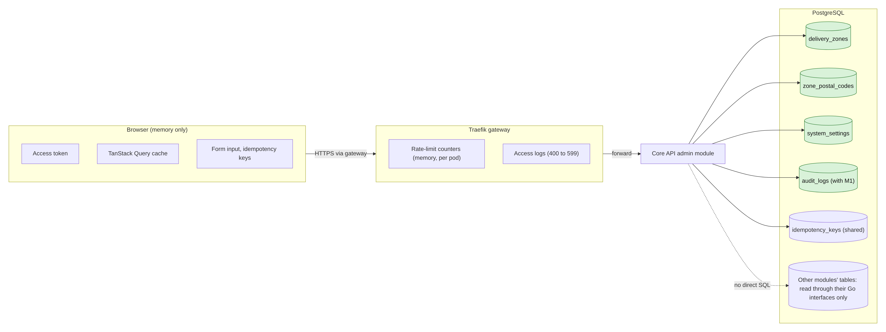

<details>
<summary>Diagram source (Mermaid)</summary>

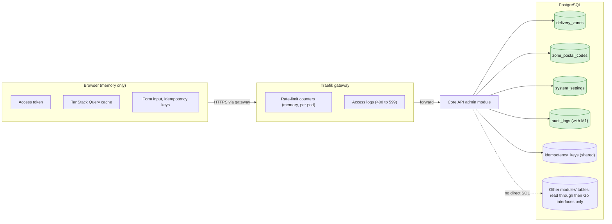

</details>

## 3. Schema diagram (ERD)

My tables are shown with the neighbour tables they connect to. Neighbour tables show only the columns that matter here; their full shape is in the system ERD.

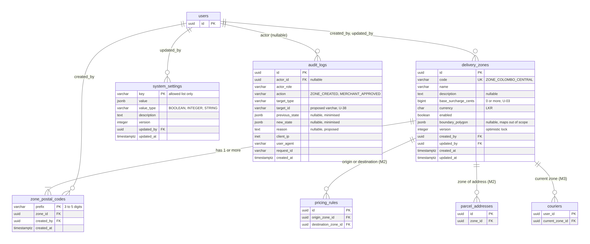

<details>
<summary>Diagram source (Mermaid)</summary>

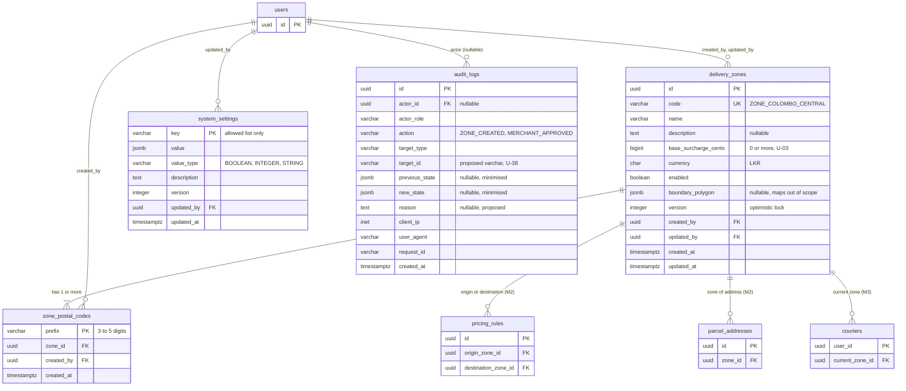

</details>

**Differences from the repo you must know about**

| Item | database-schema.md today | admin README / API.md | This document proposes | Why |
| --- | --- | --- | --- | --- |
| `delivery_zones.id` | `varchar`, value like `ZONE_COLOMBO_01` | API returns `zone_id: "zn_01HA09876"` and a separate `zone_code` | `uuid` id + separate unique `code` | Standard says every entity uses uuid (database-schema 3.1); code can then be renamed safely **\[TBD U-37\]** |
| Surcharge | not in table | `base_surcharge: "3.50"` | `base_surcharge_cents bigint` + `currency` | Money rule: integer cents (database-schema 3.2) **\[TBD U-03\]** |
| On/off flag | `enabled` | `active` | `enabled` | Matches schema and Member 2 **\[TBD U-13\]** |
| `version` | missing | missing | added | Optimistic locking (Doc 3 DD-11, U-34) |
| `created_by`, `updated_by`, `updated_at` | missing | missing | added | Who changed config is needed for support; full detail stays in `audit_logs` |
| `zone_postal_codes`, `system_settings` | missing | listed | added to the system ERD | U-35 |
| `audit_logs.reason` | missing | SRS asks for a reason on corrections and approvals | added | FR-ADM-009, FR-IAM-009 **\[TBD with M1\]** |

## 4. Data dictionary

Column types are PostgreSQL 16. "Rule" means a database constraint unless marked "app" (checked in Go code).

### 4.1 `delivery_zones` (owner: admin module, Members 7 and 1)

One row is one delivery area, for example "Colombo Central".

| Column | Type | Null | Default | Rule | Meaning |
| --- | --- | --- | --- | --- | --- |
| `id` | uuid | no | `gen_random_uuid()` | PK | Internal id. Never shown as a business code |
| `code` | varchar(40) | no |  | UNIQUE; CHECK `code ~ '^ZONE_[A-Z0-9_]{2,35}$'` | Human code used in filters, e.g. `ZONE_COLOMBO_CENTRAL` |
| `name` | varchar(100) | no |  | CHECK `length(trim(name)) between 1 and 100` | Display name |
| `description` | text | yes |  | app: max 500 characters | Notes for admins |
| `base_surcharge_cents` | bigint | no | 0 | CHECK `>= 0` | Extra fee for the zone in LKR cents. Used by pricing (M2), never by the browser |
| `currency` | char(3) | no | `'LKR'` | CHECK `currency = 'LKR'` | Only LKR in this project |
| `enabled` | boolean | no | true |  | Disabled zones get no new quotes (M2 rule, TBD) |
| `boundary_polygon` | jsonb | yes |  | app: valid GeoJSON if present | Kept for the future; maps are out of scope (Doc 1 11.4) |
| `version` | integer | no | 1 | CHECK `>= 1` | Goes up by 1 on every change |
| `created_by` | uuid | no |  | FK `users(id)` ON DELETE RESTRICT | Admin who created it |
| `updated_by` | uuid | no |  | FK `users(id)` ON DELETE RESTRICT | Admin who changed it last |
| `created_at` | timestamptz | no | `now()` |  | UTC |
| `updated_at` | timestamptz | no | `now()` |  | UTC |

**Indexes:** PK on `id`; unique index on `code`; index on `enabled` is **not** needed (table is small).

### 4.2 `zone_postal_codes` (owner: admin module)

One row says "this postal code prefix belongs to this zone". Sri Lanka postal codes have 5 digits (e.g. 00300 for Colombo 3, 20000 for Kandy).

| Column | Type | Null | Default | Rule | Meaning |
| --- | --- | --- | --- | --- | --- |
| `prefix` | varchar(5) | no |  | PK (so one prefix belongs to only one zone); CHECK `prefix ~ '^[0-9]{3,5}$'` | Postal code or its start |
| `zone_id` | uuid | no |  | FK `delivery_zones(id)` ON DELETE RESTRICT | Owning zone |
| `created_by` | uuid | no |  | FK `users(id)` | Admin who added it |
| `created_at` | timestamptz | no | `now()` |  | UTC |

**Indexes:** PK on `prefix`; index on `zone_id` (list a zone's prefixes); `prefix varchar_pattern_ops` index to make "starts with" lookups fast for the overlap check.

**Overlap rule (app + lock):** "003" and "00300" must not be in different zones. The PK cannot see this, so the use case checks it inside the transaction while holding the advisory lock (section 7.2, Doc 3 DD-07).

### 4.3 `system_settings` (owner: admin module)

A small key and value store for runtime switches. **No secrets ever** (Doc 1 X-10).

| Column | Type | Null | Default | Rule | Meaning |
| --- | --- | --- | --- | --- | --- |
| `key` | varchar(100) | no |  | PK; CHECK `key ~ '^[a-z][a-z0-9_.]{2,99}$'`; app: must be in the allowed list | e.g. `reports.max_range_days` |
| `value` | jsonb | no |  | app: must match `value_type` | The value |
| `value_type` | varchar(10) | no |  | CHECK `value_type in ('BOOLEAN','INTEGER','STRING')` | How to read `value` |
| `description` | text | no |  |  | What the setting does |
| `version` | integer | no | 1 |  | Optimistic lock |
| `updated_by` | uuid | yes |  | FK `users(id)` | Null for seed rows |
| `updated_at` | timestamptz | no | `now()` |  | UTC |

Which settings exist is still open (Doc 2 A-02). Proposed starting list in section 10.

### 4.4 `audit_logs` (co-owners: admin module and Member 1)

One row records one sensitive action. Rows are **only ever inserted**.

| Column | Type | Null | Default | Rule | Meaning |
| --- | --- | --- | --- | --- | --- |
| `id` | uuid | no | `gen_random_uuid()` | PK |  |
| `actor_id` | uuid | yes |  | FK `users(id)` ON DELETE RESTRICT | Who did it. Null for failed sign-in attempts \[Repo\] |
| `actor_role` | varchar(20) | no |  | CHECK in the 5 roles or `SYSTEM` | Role at the time |
| `action` | varchar(60) | no |  | CHECK `action ~ '^[A-Z_]+$'`; app: from a fixed list | e.g. `ZONE_CREATED`, `ZONE_DISABLED`, `SETTING_CHANGED`, `MERCHANT_APPROVED`, `ROLE_CHANGED` |
| `target_type` | varchar(30) | no |  |  | `ZONE`, `SETTING`, `MERCHANT`, `USER`, `PARCEL` |
| `target_id` | varchar(100) | no |  |  | Target id. **Proposed varchar**, because setting keys are not uuids (repo has uuid, U-38) |
| `previous_state` | jsonb | yes |  | app: only changed fields, no secrets, personal data masked | Before |
| `new_state` | jsonb | yes |  | same | After |
| `reason` | text | yes |  | app: required for reject, suspend, disable, correction | Why (proposed column) |
| `client_ip` | inet | yes |  |  | Real visitor IP (from trusted headers) |
| `user_agent` | varchar(300) | yes |  | app: cut to 300 characters |  |
| `request_id` | varchar(100) | yes |  |  | Correlation id (U-09) |
| `created_at` | timestamptz | no | `now()` |  | UTC |

**Indexes:** `(created_at DESC)`; `(actor_id, created_at DESC)`; `(target_type, target_id, created_at DESC)`; `(action, created_at DESC)`.

**Append-only protection (two layers):**

1. The application database role gets `INSERT, SELECT` on `audit_logs` but **not** `UPDATE` or `DELETE`.
2. A trigger raises an error on any `UPDATE` or `DELETE`, so even a mistake by a privileged user is blocked. Only the retention job (section 8) runs with a separate role and a session flag that the trigger allows **\[Proposed; agree with M1, M9\]**.

### 4.5 `idempotency_keys` (shared platform table, I only use it)

Shape is in database-schema.md \[Repo\]. Two points matter to my module:

- The repo makes `key` alone the primary key, but lookups use `(key, caller_scope)`. Two different users could, by chance or on purpose, send the same key. **Proposed:** primary key `(caller_scope, operation, key)` **\[U-39, platform owner\]**.
- Admin use cases write the key row in the **same transaction** as the change (Doc 3 4.7).

## 5. Ownership and permission boundaries

### 5.1 Who may read and write which table

| Table | Owner (writes) | My admin module | Other modules | Frontend and gateway |
| --- | --- | --- | --- | --- |
| `delivery_zones` | Admin module | Read and write | Read **through an admin Go interface** (`ZoneLookup`), e.g. pricing (M2) and dispatch (M3) **\[Proposed\]** | Never |
| `zone_postal_codes` | Admin module | Read and write | Read through `ZoneLookup.ZoneForPostalCode(code)` | Never |
| `system_settings` | Admin module | Read and write | Read through `SettingsReader` **\[Proposed\]** | Never |
| `audit_logs` | Admin + Member 1 | Insert and read | Insert through the shared `AuditWriter` (U-30) | Never |
| `idempotency_keys` | Platform | Through middleware | Through middleware | Never |
| `parcels`, `parcel_status_history`, `delivery_attempts`, `courier_assignments` | Members 2, 3 | **No SQL.** Report numbers through their read interfaces (Doc 3 DD-08, DD-09) | Owners | Never |
| `merchants` | Member 4 | **No SQL.** Status change through `MerchantStatusChanger` | Owner | Never |
| `users`, `user_roles` | Member 1 | Only as FK target; names for display through Member 1's interface | Owner | Never |

**Foreign keys across modules.** Other modules point at `delivery_zones.id` with real foreign keys (`ON DELETE RESTRICT`). That is allowed by database-schema 3.1 and keeps data correct. Because zones are never deleted, RESTRICT never blocks normal work.

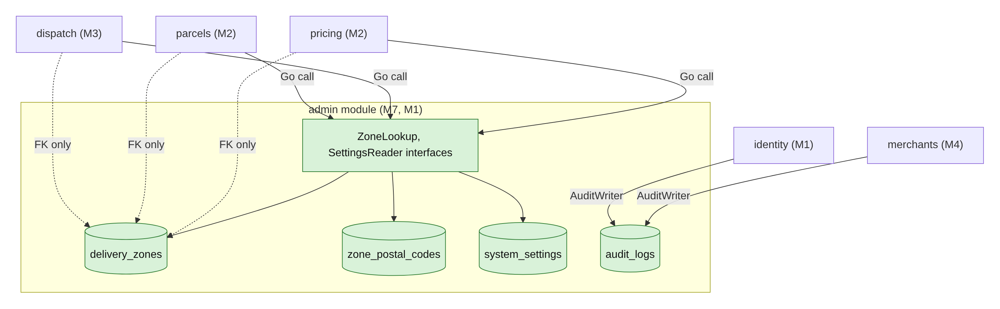

<details>
<summary>Diagram source (Mermaid)</summary>

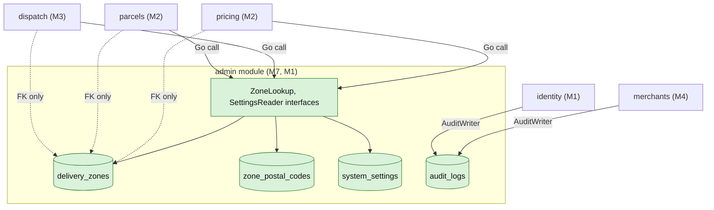

</details>

### 5.2 Database roles

The Core API is one program, so all its modules use one login. The module rule ("only your own tables") is therefore enforced by **code review, depguard and tests**, not by the database. The database still protects what it can. **\[Proposed, with Member 9\]**

| Database role | Used by | Rights |
| --- | --- | --- |
| `swiftdrop_migrator` | Migration job only | Owns the schema; `CREATE`, `ALTER`, `DROP` |
| `swiftdrop_app` | Core API | `SELECT, INSERT, UPDATE` on business tables; **no** `DELETE` on zones, prefixes, settings; **only** `INSERT, SELECT` on `audit_logs`; no DDL |
| `swiftdrop_maintenance` | Retention CronJob | `DELETE` on `audit_logs` older than the limit, `idempotency_keys` expired rows |
| `swiftdrop_tracking_ro` | Tracking API (M5) | Read-only on its views; no access to my tables |

Passwords live only in Kubernetes Secrets (`postgres-credentials`) \[Repo\] environment-variables.md.

## 6. Migration strategy and ordering

### 6.1 Tool and rules \[Repo\]

- Tool: **golang-migrate v4.17+**, folder `core-api/migrations/`, run with `make migrate-up` locally and the `core-api-migrate` Job in Kubernetes \[Repo\] local-development.md, deployment-guide.md.
- Every change has an `.up.sql` and a `.down.sql` (AGENTS.md 7).
- A merged migration is **never edited**. Fixes go in a new migration.
- No manual changes to the database.

### 6.2 Numbering for a 10-person team \[Proposed, U-40\]

The repo says `NNNNNN_name.up.sql`. With 10 people adding files at the same time, two people will pick the same number. Proposal: use **timestamp numbers** (`migrate create -ext sql -dir core-api/migrations -format 20060102150405 name`), plus the module name in the file name. golang-migrate sorts by the number, so order is by time of creation.

Example names:

```
core-api/migrations/
├── 20261025090000_identity_create_users_roles.up.sql            # Member 1 (must come first)
├── 20261025100000_admin_create_delivery_zones.up.sql            # me
├── 20261025100100_admin_create_zone_postal_codes.up.sql         # me
├── 20261025100200_admin_create_system_settings.up.sql           # me
├── 20261025100300_admin_create_audit_logs.up.sql                # me with Member 1
├── 20261025100400_admin_audit_logs_append_only_trigger.up.sql   # me with Member 1
├── 20261025110000_pricing_create_pricing_rules.up.sql           # Member 2 (needs delivery_zones)
├── 20261025120000_dispatch_create_couriers.up.sql               # Member 3 (needs delivery_zones)
└── ... each with a matching .down.sql
```

### 6.3 Order my migrations must follow

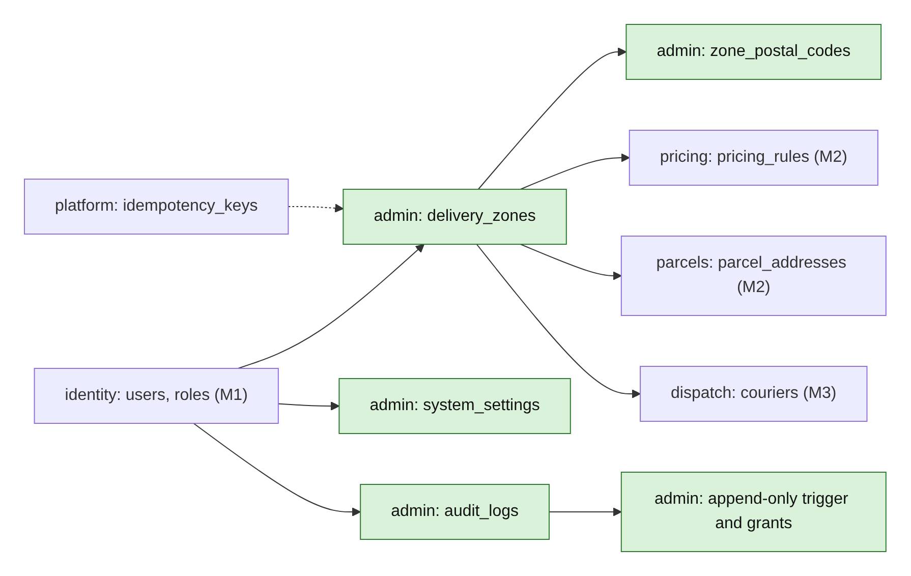

<details>
<summary>Diagram source (Mermaid)</summary>

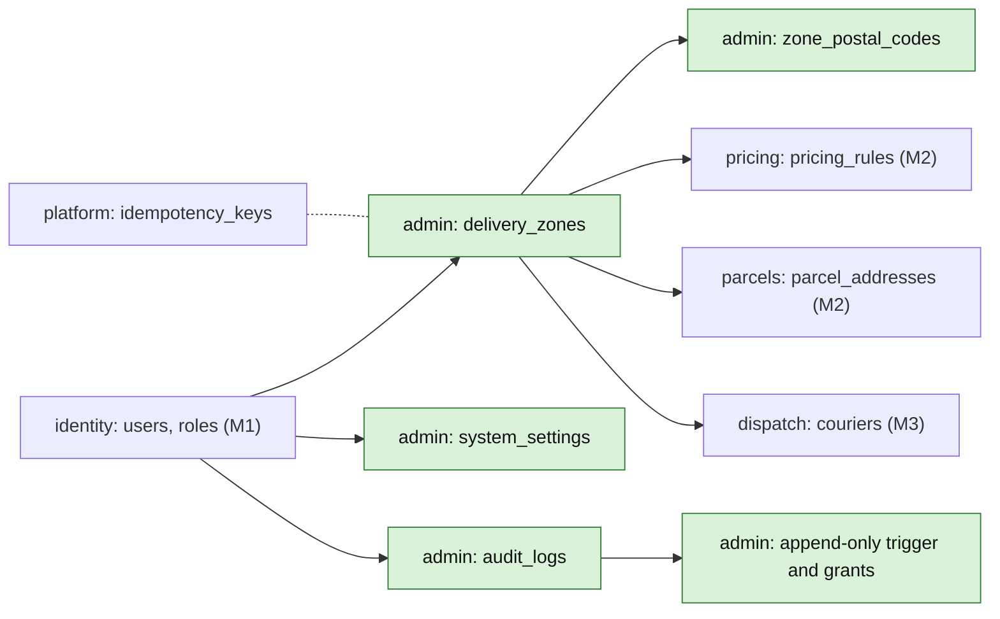

</details>

**Why the order matters:** Members 2 and 3 have foreign keys to `delivery_zones`, so my zone migration must exist **before** theirs. I will merge the zone migrations first and tell them the file number **\[TBD with M2, M3\]**.

### 6.4 Planned migrations (data definition, shape only)

```sql
-- 20261025100000_admin_create_delivery_zones.up.sql
CREATE TABLE delivery_zones (
    id                   uuid PRIMARY KEY DEFAULT gen_random_uuid(),
    code                 varchar(40)  NOT NULL UNIQUE CHECK (code ~ '^ZONE_[A-Z0-9_]{2,35}$'),
    name                 varchar(100) NOT NULL CHECK (length(trim(name)) BETWEEN 1 AND 100),
    description          text,
    base_surcharge_cents bigint  NOT NULL DEFAULT 0 CHECK (base_surcharge_cents >= 0),
    currency             char(3) NOT NULL DEFAULT 'LKR' CHECK (currency = 'LKR'),
    enabled              boolean NOT NULL DEFAULT true,
    boundary_polygon     jsonb,
    version              integer NOT NULL DEFAULT 1 CHECK (version >= 1),
    created_by           uuid NOT NULL REFERENCES users(id) ON DELETE RESTRICT,
    updated_by           uuid NOT NULL REFERENCES users(id) ON DELETE RESTRICT,
    created_at           timestamptz NOT NULL DEFAULT now(),
    updated_at           timestamptz NOT NULL DEFAULT now()
);
-- .down.sql: DROP TABLE delivery_zones;  (only works before other modules add FKs)

-- 20261025100100_admin_create_zone_postal_codes.up.sql
CREATE TABLE zone_postal_codes (
    prefix     varchar(5) PRIMARY KEY CHECK (prefix ~ '^[0-9]{3,5}$'),
    zone_id    uuid NOT NULL REFERENCES delivery_zones(id) ON DELETE RESTRICT,
    created_by uuid NOT NULL REFERENCES users(id) ON DELETE RESTRICT,
    created_at timestamptz NOT NULL DEFAULT now()
);
CREATE INDEX idx_zone_postal_codes_zone ON zone_postal_codes (zone_id);
CREATE INDEX idx_zone_postal_codes_prefix_pattern ON zone_postal_codes (prefix varchar_pattern_ops);

-- 20261025100400_admin_audit_logs_append_only_trigger.up.sql
CREATE FUNCTION audit_logs_block_change() RETURNS trigger AS $$
BEGIN
    IF current_setting('swiftdrop.retention_job', true) = 'on' AND TG_OP = 'DELETE' THEN
        RETURN OLD;   -- only the retention job may delete, and only when it sets this flag
    END IF;
    RAISE EXCEPTION 'audit_logs is append-only';
END $$ LANGUAGE plpgsql;
CREATE TRIGGER trg_audit_logs_append_only
    BEFORE UPDATE OR DELETE ON audit_logs
    FOR EACH ROW EXECUTE FUNCTION audit_logs_block_change();
REVOKE UPDATE, DELETE ON audit_logs FROM swiftdrop_app;
```

`gen_random_uuid()` is built into PostgreSQL 13 and newer, so no extension is needed.

### 6.5 Changing a table later (expand and contract)

Core API runs 2 to 4 pods. During a rolling deploy, old and new code run at the same time, so a migration must work with **both**. Every later change follows these steps:

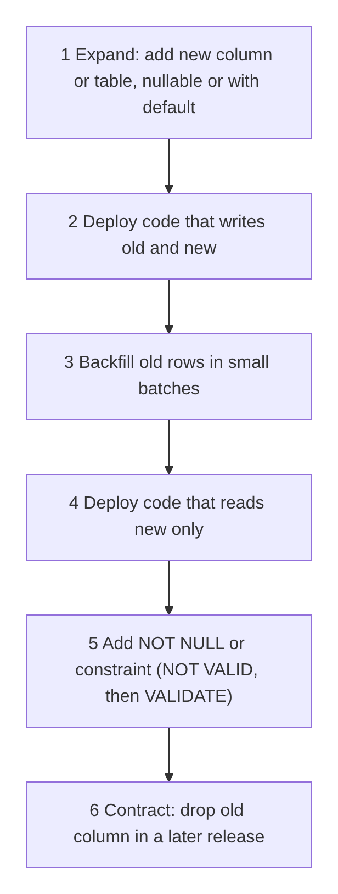

<details>
<summary>Diagram source (Mermaid)</summary>

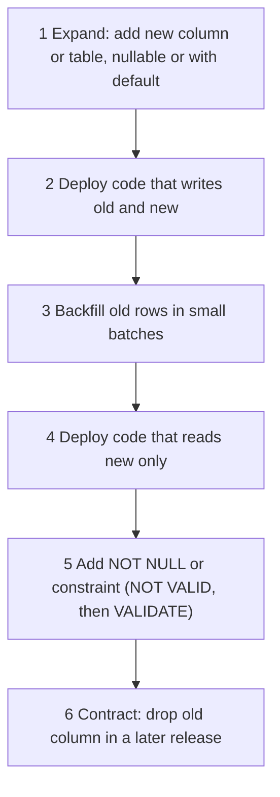

</details>

Rules for later migrations:

- Add indexes on big tables with `CREATE INDEX CONCURRENTLY` in their **own** file (it cannot run inside a transaction). My tables are small, so this mainly matters for `audit_logs`.
- Never rename a column in one step. Add the new one, copy, switch, then drop.
- Every `down.sql` that would lose data says so in a comment at the top.
- Rollback in production uses `migrate down 1` only after the code that needs the change has been rolled back first \[Repo\] runbook 3.3.

## 7. Transactions, isolation and concurrency

Full design is in Doc 3 section 4.7. The data rules are:

### 7.1 What changes together

| Use case | Tables written in one transaction |
| --- | --- |
| Create zone | `delivery_zones`, `zone_postal_codes`, `audit_logs`, `idempotency_keys` |
| Update zone (name, surcharge, prefixes) | `delivery_zones` (version + 1), `zone_postal_codes` (delete removed, insert new), `audit_logs`, `idempotency_keys` |
| Enable or disable zone | `delivery_zones`, `audit_logs`, `idempotency_keys` |
| Change setting | `system_settings`, `audit_logs`, `idempotency_keys` |
| Approve or suspend merchant | `merchants` (by M4 code), `audit_logs`, `idempotency_keys` |
| Reports, audit search | read only |

Removing a prefix from a zone is the **only** real delete on my tables, and it happens inside a zone update. Zones and settings are never deleted.

### 7.2 Isolation level and locks

| Problem | Protection |
| --- | --- |
| Two admins add exactly the same prefix | PK on `zone_postal_codes.prefix`; second insert fails with `23505` and becomes 409 `ZONE_POSTAL_CODE_CONFLICT` |
| Two admins add overlapping prefixes ("003" and "00300") | `pg_advisory_xact_lock(hashtext('admin.zone_prefixes'))` at the start of the transaction, then the overlap query, then the insert. Released at commit or rollback |
| Two admins edit the same zone | `UPDATE delivery_zones ... WHERE id = $1 AND version = $2`; 0 rows means 409 `CONCURRENT_MODIFICATION` |
| Two admins change the same setting | Same version check |
| Report reads while writes happen | READ COMMITTED: each query sees committed data. Numbers in one report may be a few seconds apart; this is fine for reports |
| Long locks blocking others | `SET LOCAL lock_timeout = '3s'` and `statement_timeout = '5s'` in admin transactions **\[Proposed\]** |
| Deadlocks | Always lock in the same order: advisory lock first, then the zone row, then prefixes |

Isolation level for all admin transactions is PostgreSQL's default **READ COMMITTED**. SERIALIZABLE was considered and not chosen (Doc 3 DD-07).

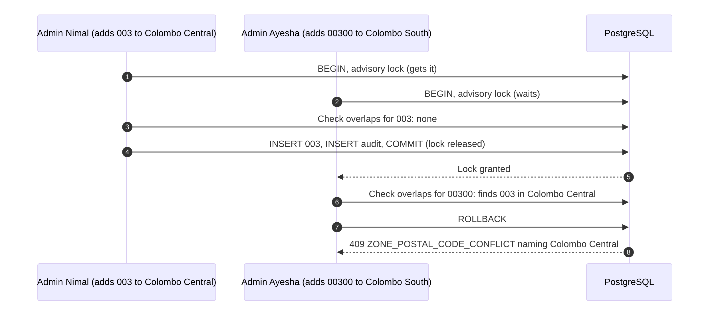

<details>
<summary>Diagram source (Mermaid)</summary>

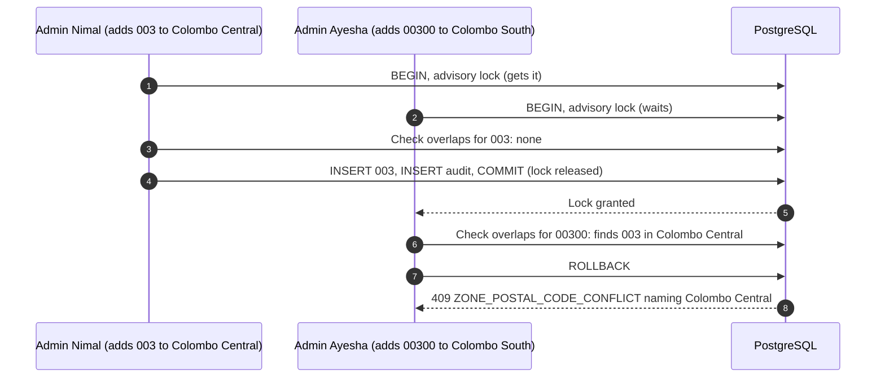

</details>

## 8. Validation, integrity, retention, audit and privacy

### 8.1 Validation layers

| Layer | Checks | Why |
| --- | --- | --- |
| Screen (zod) | Required, length, digits, code format | Fast help for the user. Not trusted |
| Handler (transport) | JSON shape, types, size | Reject garbage early |
| Domain (value objects) | `ZoneCode`, `PostalPrefix`, `Money` rules; no duplicate prefix inside one zone; at least one prefix | Business rules in one place |
| Use case | Prefix overlap with other zones, setting key is allowed | Needs data from the database |
| Database | PK, UNIQUE, CHECK, FK, NOT NULL, trigger | Last line of defence if code has a bug |

The same rule may appear in several layers on purpose. The database rule is the one that cannot be skipped.

### 8.2 Retention and deletion

| Data | Keep for | How it is removed | Source |
| --- | --- | --- | --- |
| `delivery_zones`, `zone_postal_codes` | Forever (zones are disabled, not deleted) | Prefix rows removed only by a zone update, which is audited | database-schema 3.1 soft deletes |
| `system_settings` | Forever | Never deleted; unused keys disabled in code | \[Proposed\] |
| `audit_logs` | **At least 2 years** | Monthly CronJob deletes rows older than 2 years using the maintenance role **\[Proposed; or archive to a dump first, U-41\]** | database-schema 5 |
| `idempotency_keys` | 24 hours | Hourly CronJob deletes rows where `expires_at < now()` (platform owner) | api-conventions 4 |
| Browser data | Until logout or tab close | Logout clears the query cache and token; nothing written to storage | ADR-003, INV-11 |
| Gateway rate-limit counters | Seconds | In memory, gone on restart | ADR-001 |
| Gateway access logs | **\[TBD U-36 with M9\]**, proposed 14 days | Log tool rotation | SRS 7.3 asks to set it |

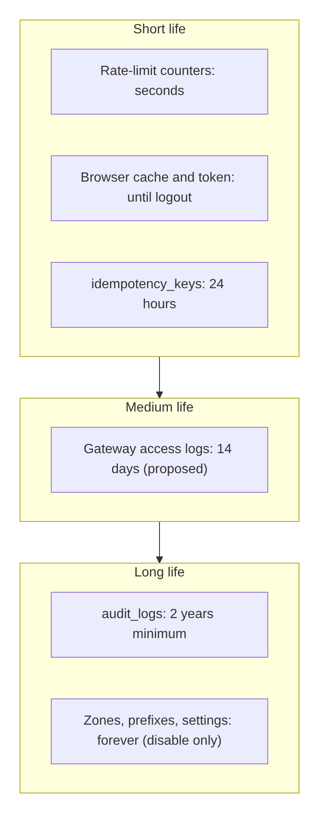

<details>
<summary>Diagram source (Mermaid)</summary>

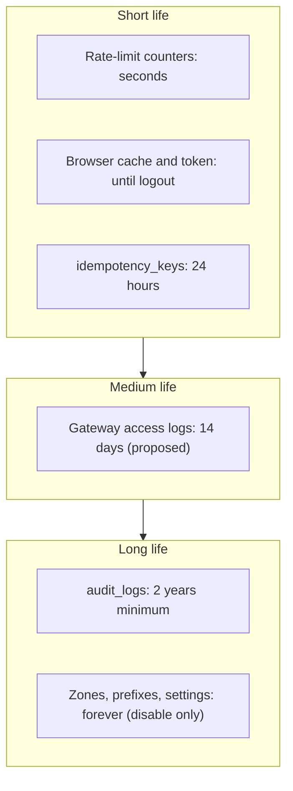

</details>

### 8.3 Audit rules

- Every change to a zone, prefix list, setting, merchant status or user role writes one `audit_logs` row in the **same** transaction (Doc 3 DD-10).
- `previous_state` and `new_state` hold only the **fields that changed**, not whole records.
- Read access to audit logs is ADMIN only (Doc 2 F-13).
- Audit rows are never edited. Corrections are new rows.

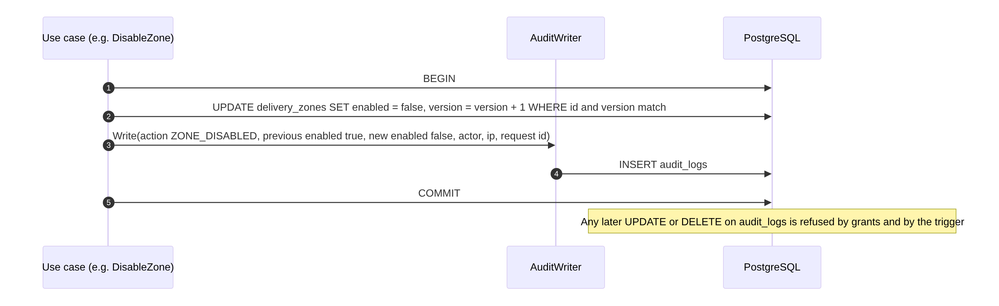

<details>
<summary>Diagram source (Mermaid)</summary>

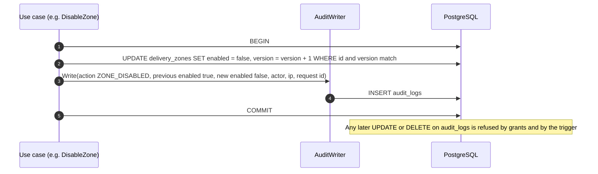

</details>

### 8.4 Privacy

| Rule | How |
| --- | --- |
| Zones and settings hold no personal data | Only codes, names, numbers |
| Audit states hold as little personal data as possible | For user changes store user id and changed role, not email or phone. If a phone must be shown, mask it (`+94 77 *** 4567`) \[Proposed\] |
| A user asks to be removed (anonymised) | Member 1 anonymises `users`. Audit rows keep only the uuid, which no longer points to a name. So audit history stays and the person is no longer identifiable \[Proposed, with M1\] |
| No secrets in tables | `system_settings` must never store keys or passwords; checked by code review and the allowed-key list |
| Logs | Gateway access logs contain IP, path and user agent. Tracking numbers appear in tracking paths, so log access is limited to the team and logs are kept a short time (U-36). Traefik does not log `Authorization` or `X-API-Key` headers by default; we must not turn header logging on |
| Browser | No tokens or personal data in localStorage or sessionStorage. Cache cleared on logout |
| Database dumps | Backups are protected; proof files are not inside the database (SRS 7.3) |

## 9. Caching and freshness

### 9.1 Backend

There is **no server-side cache** for my tables today. Zones and settings are small and read rarely, so reading PostgreSQL each time is fast enough.

If pricing (M2) later caches zones in memory for speed, it must refresh them when a zone changes. Two options: a short time limit (for example 60 seconds) or a zone-changed event through the outbox (U-32). Until that is decided, **no module caches zones**.

### 9.2 Frontend (TanStack Query)

| Data | `staleTime` (proposed) | Refresh when | Notes |
| --- | --- | --- | --- |
| Dispatch board | 0 | Every 30 s, window focus, after any assign or reassign | Doc 2 3.5 |
| Failed-delivery list | 0 | Every 30 s, after a decision |  |
| Fleet list | 30 s | Focus, after a status change |  |
| Zones list | 5 min | After create, edit, enable or disable | Rarely changes |
| Pricing rules | 5 min | After any change |  |
| Merchants, users | 1 min | After any action |  |
| Reports | 1 min | When filters change | Same filters reuse the cache |
| Audit log pages | 0 | On every page open | Must always be current |
| Courier tasks | 0 | Screen open, pull to refresh, after any task action | No timer (saves data on phones) |

**Invalidation rule:** each mutation hook lists the query keys it makes stale (Doc 3 3.7 query key factory). On logout or role change the whole cache is cleared.

### 9.3 Gateway and Cloudflare

| Content | Cache | Rule |
| --- | --- | --- |
| `/api/*` responses | **Never cached** | Core API sends `Cache-Control: no-store` on authenticated responses **\[Proposed with M1\]**; Cloudflare does not cache API paths by default, and no cache rule may be added for them |
| SPA `index.html` | Not cached | \[Repo\] Engineering Standards 10 |
| SPA JS and CSS files (hashed names) | 1 year (`max-age=31536000`, immutable) | \[Repo\] |
| SSE stream | Never cached or buffered | INV-07 |

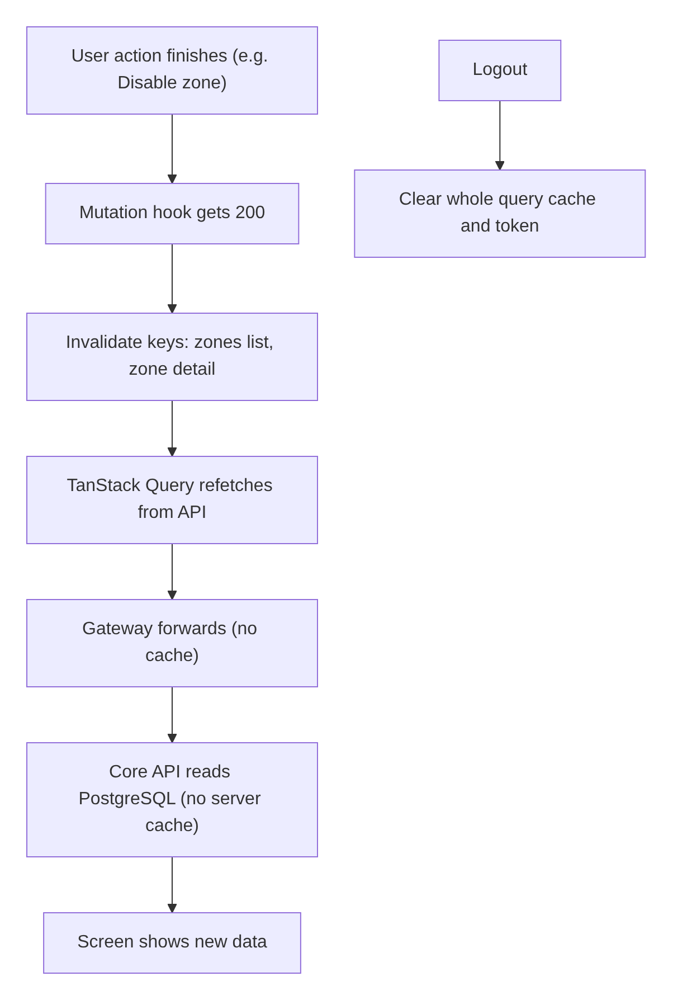

<details>
<summary>Diagram source (Mermaid)</summary>

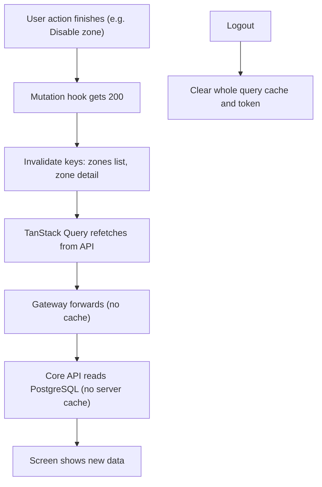

</details>

## 10. Seed data and test data

### 10.1 Seed data (development and demo only)

Seeds are run by `make db-seed` / `go run core-api/cmd/seed/main.go` \[Repo\] local-development.md. Rules **\[Proposed\]**:

- Seeds are **separate from migrations**. Migrations build the structure; seeds add sample rows.
- Seeds can run many times without making duplicates (`INSERT ... ON CONFLICT DO NOTHING`).
- Seeds **never run in production**. The seed program refuses to run when `APP_ENV=production` **\[TBD with M9\]**.
- Seed passwords like `Password123!` (repo) are for local use only.

**My seed rows (proposed, using real Sri Lankan postal codes):**

| Zone code | Name | Surcharge (cents) | Prefixes | Enabled |
| --- | --- | --- | --- | --- |
| `ZONE_COLOMBO_CENTRAL` | Colombo Central | 0 | 00100, 00200, 00300 | yes |
| `ZONE_COLOMBO_SOUTH` | Colombo South | 0 | 00400, 00500, 00600 | yes |
| `ZONE_COLOMBO_EAST` | Colombo East | 5000 (LKR 50.00) | 00700, 00800 | yes |
| `ZONE_NEGOMBO` | Negombo | 10000 (LKR 100.00) | 11500 | yes |
| `ZONE_KANDY` | Kandy | 15000 (LKR 150.00) | 20000 | yes |
| `ZONE_GALLE` | Galle | 15000 (LKR 150.00) | 80000 | yes |
| `ZONE_DEMO_DISABLED` | Demo Disabled Zone | 0 | 99999 | **no** (to test disabled behaviour) |

| Setting key | Type | Seed value | Purpose |
| --- | --- | --- | --- |
| `reports.max_range_days` | INTEGER | 92 | Longest report period (Doc 3 7.2) |
| `ops.board_refresh_seconds` | INTEGER | 30 | Board polling interval shown to screens **\[Proposed; or keep in frontend config\]** |
| `ops.maintenance_banner` | STRING | "" | Optional message shown on ops screens |

Seed users come from Member 1's seed (admin, dispatcher, courier accounts in local-development.md \[Repo\]). Zone `created_by` uses the seed admin's id.

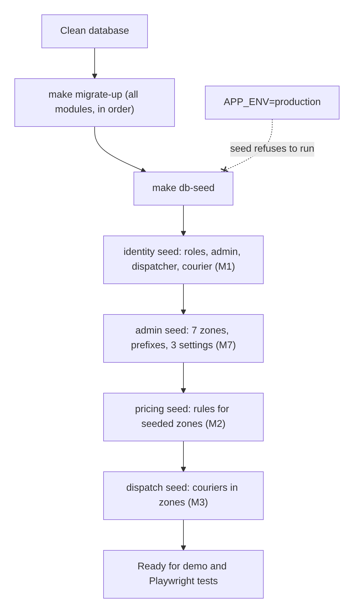

<details>
<summary>Diagram source (Mermaid)</summary>

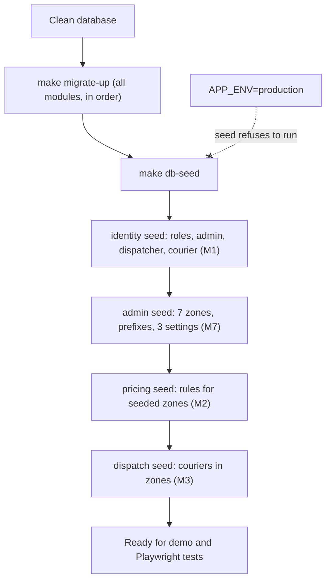

</details>

The seed order matches the migration order (section 6.3), because pricing and courier seeds need the zones.

### 10.2 Test data

| Test level | Data source | Rules |
| --- | --- | --- |
| Go domain unit tests | Built in code with small builder functions (`aZone().WithPrefixes("00300")`) | No database |
| Go use case tests | In-memory fakes of the repositories | Each test sets up only what it needs |
| Go integration tests | Fresh PostgreSQL per test package with Testcontainers \[Repo\] test-strategy; run all migrations, then insert test rows | Each test cleans up (transaction rollback or truncate) |
| Frontend unit tests | Fixture JSON that matches API.md examples (mock service worker or fake `ApiClient`) | Fixtures in `__tests__/fixtures/`; update when API.md changes |
| Playwright E2E | The seed data above plus Member 1's seed accounts | Tests must not depend on row order; create their own parcels where needed |

**Must-have test cases for data rules:**

| # | Case | Expected |
| --- | --- | --- |
| TD-01 | Insert prefix `0030` (4 digits) | Allowed |
| TD-02 | Insert prefix `00A00` | CHECK fails |
| TD-03 | Same prefix in two zones | PK fails, 409 |
| TD-04 | `003` in one zone and `00300` in another, at the same time | Second one gets 409 (advisory lock test) |
| TD-05 | Zone code `zone_colombo` (lower case) | CHECK fails |
| TD-06 | Surcharge -100 | CHECK fails |
| TD-07 | Update zone with old version | 0 rows, 409 |
| TD-08 | `UPDATE audit_logs` as app role | Permission denied |
| TD-09 | `DELETE FROM audit_logs` without retention flag | Trigger error |
| TD-10 | Disabled zone still referenced by old parcels | Allowed (no delete, FK stays) |
| TD-11 | Same Idempotency-Key from two different admins | Two separate results (needs U-39 key fix) |
| TD-12 | Every migration runs `up`, then `down`, then `up` again on a clean database | Works (clean rebuild, SRS 7.3) |

## 11. Data lifecycle of a zone

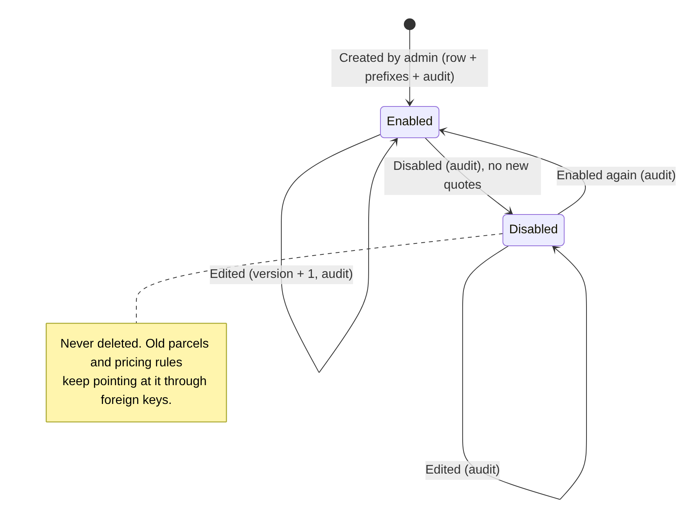

<details>
<summary>Diagram source (Mermaid)</summary>

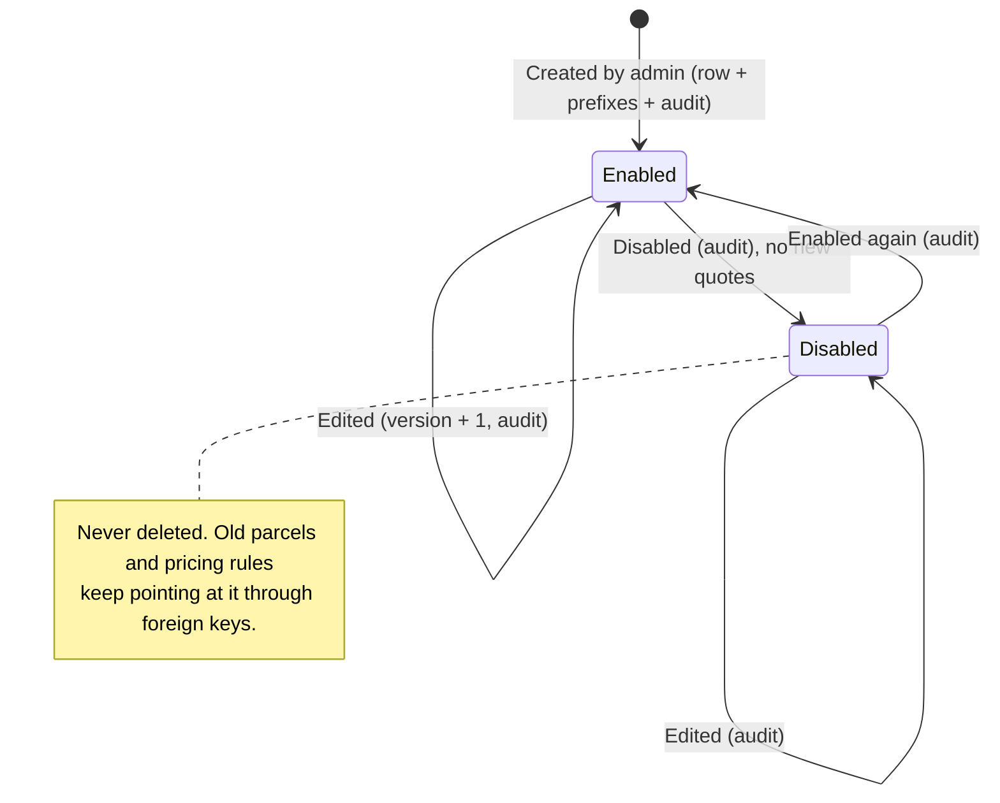

</details>

## 12. Open questions

Earlier questions still apply, especially U-03 (surcharge format), U-13 (zone model), U-24 (idempotency), U-30 (audit writer owner), U-32 (zone events), U-34 (version column, now included in the proposed migration).

| ID | Question | Decide with |
| --- | --- | --- |
| U-35 | Add `zone_postal_codes` and `system_settings` to the system ERD and ownership table in database-schema.md | Members 1, 9 |
| U-36 | How long gateway access logs are kept, and who can read them | Member 9 |
| U-37 | `delivery_zones.id`: uuid (proposed) or the zone code as a varchar id (repo)? Must be fixed **before** Members 2 and 3 write foreign keys | Members 1, 2, 3 |
| U-38 | `audit_logs.target_id` as varchar (so setting keys fit) instead of uuid, and add a `reason` column | Member 1 |
| U-39 | `idempotency_keys` primary key `(caller_scope, operation, key)` instead of `key` alone | Platform owner, Member 1 |
| U-40 | Migration numbering: timestamps with module name (proposed) instead of 6-digit sequence | All backend members, Member 9 |
| U-41 | After 2 years: delete audit rows, or archive to a protected dump first? | Members 1, 9 |

## 13. Sign-off

To be reviewed by Members 1, 2, 3, 4, 5, 6, 8, 9 and 10. Most important: Member 1 (co-owner of admin and audit), Members 2 and 3 (foreign keys to zones), Member 9 (database roles, CronJobs, logs).

| Member | Approved (date) | Notes |
| --- | --- | --- |
| Member 1 |  |  |
| Member 2 |  |  |
| Member 3 |  |  |
| Member 4 |  |  |
| Member 5 |  |  |
| Member 6 |  |  |
| Member 8 |  |  |
| Member 9 |  |  |
| Member 10 |  |  |
